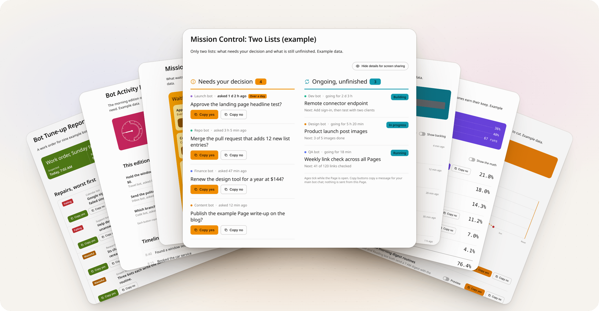

<p align="center">
  <a href="https://grokbotpages.com/">
    <picture>
      <source media="(prefers-color-scheme: dark)" srcset="assets/hero-dark.png">
      <source media="(prefers-color-scheme: light)" srcset="assets/hero-light.png">
      
    </picture>
  </a>
</p>

# Awesome Grok Bot Pages [](https://awesome.re)

> A curated list of public Grok Bot Pages: dashboards, trackers, tools and reports built with Grok Bot.

Browse the list at [grokbotpages.com](https://grokbotpages.com/), with a screenshot and a copyable prompt for every Page.

[Contributing](./CONTRIBUTING.md)

Grok Bot Pages are interactive pages that Grok Bot builds and hosts. This list collects Pages that anyone can open without signing in and that work for a stranger with no context: real data or a working control, no placeholder text, and no private details. Every entry credits its author and includes the prompt used to build it. Sections follow the Grok Bot plugin categories.

## Contents

- [Latest Additions](#latest-additions)
- [Mission Control](#mission-control)
- [Productivity](#productivity)
- [Data Analytics](#data-analytics)
- [Infrastructure](#infrastructure)
- [Agent Orchestration](#agent-orchestration)
- [Bot Management](#bot-management)
- [Payments and Finance](#payments-and-finance)
- [Sales](#sales)
- [Marketing](#marketing)
- [Inbox and Collaboration](#inbox-and-collaboration)
- [Research](#research)
- [Design](#design)
- [Documents and Files](#documents-and-files)
- [Scheduling and Support](#scheduling-and-support)
- [Create your Page and get listed](#create-your-page-and-get-listed)
  - [Need data for a dashboard?](#need-data-for-a-dashboard)
  - [Example prompt: Site analytics dashboard](#example-prompt-site-analytics-dashboard)
- [Listing rules](#listing-rules)
- [Entry format](#entry-format)
- [Contributing](#contributing)

## Latest Additions

Newest listings, also shown in their section.

- [News Pulse Docs](https://news-pulse-docs-4g7j.pages.grok.bot/) - A link hub for hourly news digests across 20 topic pulses plus a Top 20 Right Now, from world news and AI to robotics, neuroscience and EVs, each with a Latest edition and full Archive as a Google Doc and PDF, an RSS feed per pulse and an open JSON API (live public data). Shared in [Robert Scoble's post on X](https://x.com/Scobleizer/status/2116623281797370154). By Robert Scoble ([@Scobleizer](https://x.com/Scobleizer)).
  Template page: [grokbotpages.com/t/news-pulse-docs/](https://grokbotpages.com/t/news-pulse-docs/).

- [Revenue, last week](https://revenue-last-week-example-4v3c.pages.grok.bot/) - Booked revenue against plan by segment for last week, with the deals that slipped and why (example data). Inspired by [@maestrooth's post](https://x.com/maestrooth/status/2116619589140578691). Example Page by Awesome Grok Bot Pages.
  Template page: [grokbotpages.com/t/revenue-last-week/](https://grokbotpages.com/t/revenue-last-week/).
  <details><summary>Prompt</summary>

  ```text
  Build me a wide Grok Bot Page called "Revenue, last week" from my CRM or billing system and my sales plan. At the top, four numbers: booked last week, the plan for the week, the difference against plan in percent, and how many deals slipped, then a one-line takeaway of what carried the week and what slipped. Add a segment switch (All, Enterprise, Mid-market, SMB) that updates every number, the chart and the list. Then a weekly booked vs. plan chart for the last 7 weeks with a Show plan toggle and a hover or tap readout. Then the deals that slipped out of last week: account, segment, amount, owner, the new close week and a Why toggle, with a sort by largest first or soonest new date. Every control must really work on the Page; no buttons that do nothing. Anything not connected shows as empty instead of a guess. Then create a routine that rebuilds the Page every Monday at 8:00 AM.
  ```

  </details>

- [Q4 Forecast & Pipeline](https://q4-forecast-and-pipeline-example-xahm.pages.grok.bot/) - Q4 commit against target, the pace needed to close the gap, and every deal stuck for 14 days or more (example data). Inspired by [@maestrooth's post](https://x.com/maestrooth/status/2116619589140578691). Example Page by Awesome Grok Bot Pages.
  Template page: [grokbotpages.com/t/q4-forecast-and-pipeline/](https://grokbotpages.com/t/q4-forecast-and-pipeline/).
  <details><summary>Prompt</summary>

  ```text
  Build me a wide Grok Bot Page called "Q4 Forecast & Pipeline" from my CRM. At the top, four numbers: the Q4 target, what is committed, the open pipeline, and how many deals have had no stage change or logged activity for 14 days or more, then a one-line takeaway with the percent of target committed and the weeks left. Then a week-by-week chart of committed revenue against the target line for the 13 weeks of the quarter, with a Show needed pace toggle that draws the pace needed to reach target and a hover or tap readout. Then the deals to watch: name, amount, stage, owner, close date and days since the last change, with a NEW tag on deals added this week and a stuck flag on every deal at 14 days or more. Add a stage filter with counts, a Stuck 14+ days only toggle, a sort by largest or longest without a change, and a Details toggle per deal. The stuck count at the top must match the flagged deals in the list. Every control must really work on the Page; no buttons that do nothing. Anything not connected shows as empty instead of a guess. Then create a routine that refreshes the Page every hour during work hours so it stays live.
  ```

  </details>

- [Morning brief](https://morning-brief-example-x6tk.pages.grok.bot/) - Your day ready by 7:00: meetings, the emails that need you, your focus time and the one thing most likely to slip (example data). Inspired by [@maestrooth's post](https://x.com/maestrooth/status/2116619589140578691). Example Page by Awesome Grok Bot Pages.
  Template page: [grokbotpages.com/t/morning-brief/](https://grokbotpages.com/t/morning-brief/).
  <details><summary>Prompt</summary>

  ```text
  Build me a wide Grok Bot Page called "Morning brief" from my calendar and email. At the top, four numbers: meetings today, emails that need me, focus time (free blocks of 30 minutes or more) and how many things are at risk of slipping. Then call out the one thing most likely to slip today, why, the one step that saves it, and a working copy button with a ready message for that step. Then my day as a strip from first meeting to last and an agenda below it: each meeting with time, who is in it and what to prep, which I can open by tapping it, with a Show free time toggle for lunch, gaps and focus blocks. Then the emails that need me, grouped as Reply today, This week and Read only with counts, each with the sender, subject and the ask in one line. Every control must really work on the Page; no buttons that do nothing. Anything not connected shows as empty instead of a guess. Then create a routine that rebuilds the Page every weekday so it is ready by 7:00 AM.
  ```

  </details>

- [Board memo, October](https://board-memo-october-example-o6rx.pages.grok.bot/) - The monthly board update drafted from ARR, growth, burn and runway, marked as a draft and never sent (example data). Inspired by [@maestrooth's post](https://x.com/maestrooth/status/2116619589140578691). Example Page by Awesome Grok Bot Pages.
  Template page: [grokbotpages.com/t/board-memo-october/](https://grokbotpages.com/t/board-memo-october/).
  <details><summary>Prompt</summary>

  ```text
  Build me a wide Grok Bot Page called "Board memo" for last month, from my billing, bank or accounting, and CRM. At the top, four numbers: ARR, month-over-month growth, net burn and runway in months, then a 6-month ARR chart. Then draft the monthly board update from those numbers only: a one-line summary, Numbers, What went well, What did not, and Asks. Mark it clearly as DRAFT, NEVER SENT. Add a Full or Short switch, a Show sources toggle that tags every number with where it came from, and a working Copy draft button that copies the version on screen. Never send, schedule or share the memo; I copy it myself. Every control must really work on the Page; no buttons that do nothing. Anything not connected shows as empty instead of a guess, and a number you cannot source stays out of the memo. Then create a routine that redrafts the Page on the 1st of every month at 8:00 AM.
  ```

  </details>

- [Expense policy](https://expense-policy-example-ilde.pages.grok.bot/) - An expense policy Page that rewrites itself when a rule changes in Slack, with the message behind every change (example data). Inspired by [@maestrooth's post](https://x.com/maestrooth/status/2116619589140578691). Example Page by Awesome Grok Bot Pages.
  Template page: [grokbotpages.com/t/expense-policy/](https://grokbotpages.com/t/expense-policy/).
  <details><summary>Prompt</summary>

  ```text
  Build me a wide Grok Bot Page called "Expense policy" that holds our current expense policy as numbered sections, written in plain words. Watch the #ops-policy channel in Slack. When a message there changes a rule, rewrite only the section it touches, and show the message that caused it: who posted it, when, and the exact words. At the top, four numbers: rewrites so far, readers this month, stale lines (rules on the Page that no longer match Slack) and the average minutes from Slack message to Page update. Add a search box that filters the sections, a Highlight last change toggle that shows the old value struck through next to the new one, a Copy policy button, and a change log with a Details toggle on every entry showing before and after. Every control must really work on the Page; no buttons that do nothing. Anything not connected shows as empty instead of a guess, and never invent a rule nobody posted. Then create a routine that updates the Page whenever a new message in #ops-policy changes a rule, plus a daily check at 9:00 AM for anything missed.
  ```

  </details>

- [Competitor watch](https://competitor-watch-example-bvhl.pages.grok.bot/) - Every price change and launch from 5 competitors, checked daily against their own pages (example data). Inspired by [@maestrooth's post](https://x.com/maestrooth/status/2116619589140578691). Example Page by Awesome Grok Bot Pages.
  Template page: [grokbotpages.com/t/competitor-watch/](https://grokbotpages.com/t/competitor-watch/).
  <details><summary>Prompt</summary>

  ```text
  Build me a wide Grok Bot Page called "Competitor watch" that tracks these 5 companies: [list them with their websites]. Check each one's pricing page, changelog and blog every day. At the top, four numbers: companies tracked, price moves, launches and the time of the last check, then one line saying what matters most. Then one row per company with the plan I care about, its price before and after, the change in percent, and a Details toggle with what changed in plain words, the exact source page, and a 30-day price line. Add a filter for All, Price moves, Launches and No change with counts, and a sort for Biggest change, Newest and A to Z. Only report a change you saw on the company's own page, and link to it. Every control must really work on the Page; no buttons that do nothing. Anything not connected shows as empty instead of a guess. Then create a routine that rechecks all 5 every day at 6:00 AM.
  ```

  </details>

- [Mission Control: Two Lists](https://mission-control-two-lists-example-3z7u.pages.grok.bot/) - Only two lists: what needs your decision, with Copy yes and Copy no buttons and ages that keep ticking, and what is still ongoing and unfinished, plus an eye button that blurs the details for screen sharing (example data). Inspired by [Alex Finn's post on X](https://x.com/AlexFinn/status/2115612249826148795) ([@AlexFinn](https://x.com/AlexFinn)). By Alex Finn ([@AlexFinn](https://x.com/AlexFinn)). Example Page by Awesome Grok Bot Pages ([@Agent-Analytics](https://github.com/Agent-Analytics/awesome-grok-bot-pages)).
  Template page: [grokbotpages.com/t/mission-control-two-lists/](https://grokbotpages.com/t/mission-control-two-lists/).
  <details><summary>Prompt</summary>

  ```text
  Build me a wide Grok Bot Page called "Mission Control" with two lists only, side by side. Left: "Needs your decision" with a count, every open question one of my bots is waiting on me for, oldest first: the bot, the question in one line, how long ago it asked (keep the age ticking), and working Copy yes and Copy no buttons that copy a message I paste into this chat, showing Copied after a click; if the clipboard is blocked, show the text to select. Right: "Ongoing, unfinished" with a count, every task or routine still running: the bot, the task, a short status like Building, Running or In progress, how long it has been going and the next step. Add an eye button that blurs the item text so I can share my screen. No charts, no animated characters, no other sections. Ask each bot what it waits on me for and what it is still working on, use only real data, show "unknown" instead of guessing, and drop items once I answer them.
  ```

  </details>
  <details><summary>Routine prompt (optional)</summary>

  ```text
  Create a routine that refreshes my "Mission Control" Page every hour from 8 AM to 10 PM. Each run, ask every bot what it waits on me for and what is still unfinished, rebuild both lists with the same layout and copy buttons, and drop decisions I already answered. Message me only when a decision has waited more than a day.
  ```

  </details>

- [Command Center](https://command-center-example-it3x.pages.grok.bot/) - A kitchen ticket rail for what your bots wait on you for: tagged tickets with due items first, working copy buttons with a ready reply for your main bot chat, a Show why switch, a day-by-day timeline and In progress and Finished tabs (example data). Inspired by [Moritz Kremb's post on X](https://x.com/moritzkremb/status/2114787902932857293) ([@moritzkremb](https://x.com/moritzkremb)). By Moritz Kremb ([@moritzkremb](https://x.com/moritzkremb)). Example Page by Awesome Grok Bot Pages ([@Agent-Analytics](https://github.com/Agent-Analytics/awesome-grok-bot-pages)).
  Template page: [grokbotpages.com/t/command-center/](https://grokbotpages.com/t/command-center/).
  <details><summary>Prompt</summary>

  ```text
  Build me a wide Grok Bot Page called "Command Center" so I never lose the overview of what my bots did. You are my chief of staff: ask each of my bots what it is waiting on me for, what it is working on and what it finished, and use their routines and recent runs. Show "Waiting on me" as a rail of tickets, each with the asking bot, one line on what to do, a tag (Due today, Approval, Yes/no, Reply, Sign or Action), due items first, a filter by tag and a "Show why" switch that reveals the reason. Give every ticket working copy buttons (Copy yes and Copy no, or one short ready reply) that copy a message I paste into this chat, and show Copied after a click; if the clipboard is blocked, show the text to select. Below, a timeline of bot activity grouped by day, with day tabs that show a count and a filter by bot, and In progress and Finished tabs with a count each. Use only real data and show "unknown" instead of guessing.
  ```

  </details>
  <details><summary>Routine prompt (optional)</summary>

  ```text
  Create a routine that refreshes my "Command Center" Page every two hours from 8 AM to 8 PM on weekdays. Each run, ask my bots what they wait on me for, what they are working on and what they finished, rebuild the tickets, timeline and status tabs, keep the layout and copy buttons, and drop tickets I already answered. Only message me if a new ticket is due today.
  ```

  </details>

- [Agent Status Board](https://agent-status-board-example-aeo2.pages.grok.bot/) - A ward board of every bot: a census band that filters by state, one row per bot with what it needs from you and copy buttons for the reply, what it is doing, a Show backlog switch and who used the most of the plan (example data). Inspired by [Ashni's post on X](https://x.com/ashnichrist/status/2112998428456194373) ([@ashnichrist](https://x.com/ashnichrist)). By Ashni ([@ashnichrist](https://x.com/ashnichrist)). Example Page by Awesome Grok Bot Pages ([@Agent-Analytics](https://github.com/Agent-Analytics/awesome-grok-bot-pages)).
  Template page: [grokbotpages.com/t/agent-status-board/](https://grokbotpages.com/t/agent-status-board/).
  <details><summary>Prompt</summary>

  ```text
  Build me a wide Grok Bot Page called "Agent Status Board" that reads like a ward board for my bots. At the top, a census bar: one strip split by state (Needs you, Blocked, Busy, Idle) with a count each, and tabs with the same counts that filter the board. Then one row per bot, bots that need me first: name and role, a state plate, a "Needs from you" note when it waits on me, what it is doing now, last active, and its backlog behind a "Show backlog" switch. Every row that needs me gets working copy buttons (Copy yes and Copy no, or one short ready reply) that copy a message I paste into this chat, and shows Copied after a click; if the clipboard is blocked, show the text to select. Below, show which bots used the most of my plan this week, from my plan usage summary. Use only real data from my bots, routines and recent runs, show "unknown" instead of guessing, and say the controls only change the view.
  ```

  </details>
  <details><summary>Routine prompt (optional)</summary>

  ```text
  Create a routine that refreshes my "Agent Status Board" Page every hour from 8 AM to 8 PM. Each run, ask every bot for its state, what it needs from me, what it is doing and its backlog, read my plan usage summary, rebuild the board with the same layout and copy buttons, and drop items I already answered. Message me only when a bot turns Blocked.
  ```

  </details>

- [Bot Fleet Ops](https://bot-fleet-ops-example-udcj.pages.grok.bot/) - A morning fuel check for the bot fleet: a burn-down of the weekly plan with a projection to the reset, three fixes with Preview switches that move the projection and copy buttons to approve them, and a red, yellow or green light per bot (example data). Inspired by [Brian Roemmele's Mission Control post on X](https://x.com/BrianRoemmele/status/2111201533971103942) ([@BrianRoemmele](https://x.com/BrianRoemmele)). By Brian Roemmele ([@BrianRoemmele](https://x.com/BrianRoemmele)). Example Page by Awesome Grok Bot Pages ([@Agent-Analytics](https://github.com/Agent-Analytics/awesome-grok-bot-pages)).
  Template page: [grokbotpages.com/t/bot-fleet-ops/](https://grokbotpages.com/t/bot-fleet-ops/).
  <details><summary>Prompt</summary>

  ```text
  Build me a wide Grok Bot Page called "Bot Fleet Ops" that tells me each morning whether my bots will run out of plan before it resets. Read my plan usage summary and every bot's routines and recent runs. Lead with a burn-down chart of plan left by day, the actual line up to now and a dashed projection to the reset, and say plainly on which day it runs out. Then list your recommendations (pause, merge or tighten something), each with what it saves per day, a "Preview" switch that redraws the projection as if I did it, and working copy buttons (Copy yes and Copy no) that copy a message I paste into this chat, showing Copied after a click; if the clipboard is blocked, show the text to select. Below, a fleet table with a red, yellow or green light per bot, its share of the week and one line on why. Use only real data, show "unknown" instead of guessing, and say the switches only change the view.
  ```

  </details>
  <details><summary>Routine prompt (optional)</summary>

  ```text
  Create a routine that refreshes my "Bot Fleet Ops" Page every morning at 7 AM. Each run, read my plan usage summary and every bot's recent runs, redraw the burn-down and projection, rebuild the recommendations with their copy buttons and the fleet lights, and keep the layout. Message me only if the projection says the plan runs out before it resets.
  ```

  </details>

- [Bot Tune-up Report](https://bot-tune-up-report-example-wls2.pages.grok.bot/) - A weekly work order for your bots: what is failing, what wastes plan and what to tidy, each repair with its fix and copy buttons, a Copy all fixes button, a severity filter and an impact versus effort map (example data). Inspired by [Brian Roemmele's Optimizer post on X](https://x.com/BrianRoemmele/status/2112337968820334676) ([@BrianRoemmele](https://x.com/BrianRoemmele)). By Brian Roemmele ([@BrianRoemmele](https://x.com/BrianRoemmele)). Example Page by Awesome Grok Bot Pages ([@Agent-Analytics](https://github.com/Agent-Analytics/awesome-grok-bot-pages)).
  Template page: [grokbotpages.com/t/bot-tune-up-report/](https://grokbotpages.com/t/bot-tune-up-report/).
  <details><summary>Prompt</summary>

  ```text
  Build me a wide Grok Bot Page called "Bot Tune-up Report" that reads like a mechanic's work order for my bots. Inspect every bot: chat length, failing logins or connectors, empty or duplicate bots, routines that do the same job, and what each one costs from my plan usage summary. Put an inspection header on top (when, how many bots, total issues), then one repair line per issue, worst first: the bot, what is wrong, the fix, impact and effort, with a filter by severity. Every repair line gets working copy buttons (Copy yes and Copy no) that copy a message I paste into this chat, plus one "Copy all fixes" button at the end, and each shows Copied after a click; if the clipboard is blocked, show the text to select. Add an impact versus effort chart of the repairs. Use only real data, show "unknown" instead of guessing, and fix nothing until I send the message.
  ```

  </details>
  <details><summary>Routine prompt (optional)</summary>

  ```text
  Create a routine that reruns my "Bot Tune-up Report" every Sunday at 6 PM. Each run, inspect every bot again, rebuild the work order with the same layout and copy buttons, mark repairs I already approved as done, and message me only if a bot is failing.
  ```

  </details>

- [Weekly Usage Audit](https://weekly-usage-audit-example-7eoy.pages.grok.bot/) - Last week's usage itemized like a bill: each bot's share with a verdict (earns it, trim or cut), copy buttons for the trims, a Show the math switch, a bot by day heatmap and the runs that repeat (example data). Inspired by [Brian Roemmele's usage audit post on X](https://x.com/BrianRoemmele/status/2112249592133935133) ([@BrianRoemmele](https://x.com/BrianRoemmele)). By Brian Roemmele ([@BrianRoemmele](https://x.com/BrianRoemmele)). Example Page by Awesome Grok Bot Pages ([@Agent-Analytics](https://github.com/Agent-Analytics/awesome-grok-bot-pages)).
  Template page: [grokbotpages.com/t/weekly-usage-audit/](https://grokbotpages.com/t/weekly-usage-audit/).
  <details><summary>Prompt</summary>

  ```text
  Build me a wide Grok Bot Page called "Weekly Usage Audit" from the usage export I upload here, laid out like a utility bill. On top, the statement period and the share of my weekly plan used. Then one line per bot, biggest first: runs, average run size and share of the week, with a "Show the math" switch that reveals how each share was worked out, and a verdict on whether the bot earns its keep. Every line with a Cut or Trim verdict gets working copy buttons (Copy yes and Copy no) that copy a message I paste into this chat, and shows Copied after a click; if the clipboard is blocked, show the text to select. Add a heatmap of usage by bot and day, and a list of runs that repeat with the same input. Use only the export and my bots' routines, show "unknown" instead of guessing, and change nothing until I send the message.
  ```

  </details>
  <details><summary>Routine prompt (optional)</summary>

  ```text
  Create a routine that every Monday at 9 AM asks me for last week's usage export, then rebuilds my "Weekly Usage Audit" Page from it with the same layout, verdicts and copy buttons. Message me only if one bot used more than a quarter of the week.
  ```

  </details>

- [Bot Activity Dashboard](https://bot-activity-dashboard-example-m3yc.pages.grok.bot/) - A morning and evening edition of what your bots did: counts for waiting on you, in progress and finished, tabs for each with copy buttons on what waits on you, and a timeline filterable by day and bot (example data). Inspired by [@byalexai's post on X](https://x.com/byalexai/status/2114837470680318365) ([@byalexai](https://x.com/byalexai)). By [@byalexai](https://x.com/byalexai). Example Page by Awesome Grok Bot Pages ([@Agent-Analytics](https://github.com/Agent-Analytics/awesome-grok-bot-pages)).
  Template page: [grokbotpages.com/t/bot-activity-dashboard/](https://grokbotpages.com/t/bot-activity-dashboard/).
  <details><summary>Prompt</summary>

  ```text
  Build me a Grok Bot Page called "Bot Activity Dashboard" that works like a twice-daily edition of what my bots did. Ask each of my bots what it is waiting on me for, what it is working on and what it finished, and read their routines and recent runs. At the top, show when this edition was taken and when the next one comes, on a small clock. Then tabs for Waiting on me, In progress and Finished, each with a count. Waiting items show the bot, what it needs and when it asked, with working copy buttons (Copy yes and Copy no, or one short ready reply) that copy a message I paste into this chat and show Copied after a click; if the clipboard is blocked, show the text to select. In-progress items that recur show their schedule, like "Daily about 21:30", and when they last ran. Finished items show what was done and when. Below, an activity timeline with day tabs that show a count and a filter by bot. Use only real data and show "unknown" instead of guessing.
  ```

  </details>
  <details><summary>Routine prompt (optional)</summary>

  ```text
  Create a routine that refreshes my "Bot Activity Dashboard" Page twice a day, at 9:00 and 21:00. Each run, ask my bots what they wait on me for, what they are working on and what they finished, rebuild the edition with the same layout and copy buttons, and drop items I already answered. Message me only if something new waits on me.
  ```

  </details>

- [Bot Crew Office](https://bot-crew-office-example-pw33.pages.grok.bot/) - An office floor of your bot crew: every bot at a desk with a callsign and a state dot, a GO / NO-GO list with Copy GO and Copy NO-GO buttons, an activity feed, a crew list and Now, Day, Dusk and Night lighting (example data). Inspired by [@0xCarnagee's post on X](https://x.com/0xCarnagee/status/2115623287707381874) ([@0xCarnagee](https://x.com/0xCarnagee)). By [@0xCarnagee](https://x.com/0xCarnagee). Example Page by Awesome Grok Bot Pages ([@Agent-Analytics](https://github.com/Agent-Analytics/awesome-grok-bot-pages)).
  Template page: [grokbotpages.com/t/bot-crew-office/](https://grokbotpages.com/t/bot-crew-office/).
  <details><summary>Prompt</summary>

  ```text
  Build me a wide Grok Bot Page called "Bot Crew Office" that shows my bots as a crew in an office. Give each bot a short callsign and draw it as a desk on an office floor plan, with a colored dot for its state: coding, browsing, in terminal, thinking, needs you, error, done or idle, and a legend. Add a Now, Day, Dusk and Night switch that changes the office lighting. Next to the office, a GO / NO-GO list of everything a bot is waiting on me for: the callsign, the question in one line, and working Copy GO and Copy NO-GO buttons that copy the exact message I paste into this chat, showing Copied after a click; if the clipboard is blocked, show the text to select. Add an activity feed of the latest events and a crew list with what each bot is doing now. Use only real data from my bots, routines and recent runs, and say nothing is sent from the Page.
  ```

  </details>
  <details><summary>Routine prompt (optional)</summary>

  ```text
  Create a routine that refreshes my "Bot Crew Office" Page every hour from 8 AM to 8 PM. Each run, ask every bot for its state and what it waits on me for, redraw the office and the GO / NO-GO list with the same layout and copy buttons, and drop questions I already answered. Message me only when a bot hits an error.
  ```

  </details>

- [My Bots Dashboard](https://bots-dashboard-example-ctaz.pages.grok.bot/) - A plain one-page overview of every bot with a section switcher: what needs you with copy buttons for each answer, the bots at a glance and by area, today's routines and usage (example data). Inspired by [Emily Nguyen's post on X](https://x.com/emilyntech/status/2113117549890273584) ([@emilyntech](https://x.com/emilyntech)). By Emily Nguyen ([@emilyntech](https://x.com/emilyntech)). Example Page by Awesome Grok Bot Pages ([@Agent-Analytics](https://github.com/Agent-Analytics/awesome-grok-bot-pages)).
  Template page: [grokbotpages.com/t/my-bots-dashboard/](https://grokbotpages.com/t/my-bots-dashboard/).
  <details><summary>Prompt</summary>

  ```text
  Build me a plain, white Grok Bot Page called "My Bots Dashboard" with a switcher at the top for: All, Needs you, At a glance, Bots by area, Today's routines and Usage. Needs you: a line like "3 open, 1 blocked", then each item marked "your call", "blocked" (for example a connection that expired) or "review" for a possible duplicate bot, with the bot, one line on what to do and working copy buttons (Copy yes and Copy no, or one short ready reply) that copy a message I paste into this chat and show Copied after a click; if the clipboard is blocked, show the text to select. At a glance: one sentence with the number of bots, routines, routines that failed today and possible duplicates. Bots by area: a map of areas like Home, Money, Work and Health sized by how many bots each has, with the bots in each. Today's routines: each routine with its time, bot and whether it worked, failed or runs later, and flag routines that overlap. Usage: how much of my weekly plan is used, when it resets and which bots used the most, from my plan usage summary. Keep it calm: one green accent, no decoration. Use only real data and show "unknown" instead of guessing.
  ```

  </details>
  <details><summary>Routine prompt (optional)</summary>

  ```text
  Create a routine that refreshes my "My Bots Dashboard" Page every morning at 8 AM and again at 2 PM. Each run, rebuild every section from my bots, routines and plan usage summary with the same layout and copy buttons, and drop items I already answered. Message me only if a routine failed.
  ```

  </details>

- [Mission Board](https://mission-board-example-6745.pages.grok.bot/) - A phone-friendly board: what waits on you at the top with big thumb-sized copy buttons and a Due today switch, missions with step progress in the middle and the daily briefs at the bottom (example data). Inspired by [Marcell Hazzard's post on X](https://x.com/Marcellhazzard/status/2115638752030937510) ([@Marcellhazzard](https://x.com/Marcellhazzard)). By Marcell Hazzard ([@Marcellhazzard](https://x.com/Marcellhazzard)). Example Page by Awesome Grok Bot Pages ([@Agent-Analytics](https://github.com/Agent-Analytics/awesome-grok-bot-pages)).
  Template page: [grokbotpages.com/t/mission-board/](https://grokbotpages.com/t/mission-board/).
  <details><summary>Prompt</summary>

  ```text
  Build me a narrow, phone-friendly Grok Bot Page called "Mission Board" that stacks like phone widgets. At the top, a "Waiting on me" list with a count, so approvals don't get buried: each item shows what to do, which bot asks and when it is due, with today's items marked and a "Due today" switch. Each item gets big, thumb-sized copy buttons (Copy yes and Copy no, or one short ready reply) that copy a message I paste into this chat and show Copied after a tap; if the clipboard is blocked, show the text to select. In the middle, my active missions or projects, each with how far along it is in steps and one line on what is next. At the bottom, the daily briefs my bots send me, such as inbox, money and calendar, with a switch between today and yesterday. Collect the list from my bots, so it fills up on its own as they ask for things. Use only real data and show "unknown" instead of guessing.
  ```

  </details>
  <details><summary>Routine prompt (optional)</summary>

  ```text
  Create a routine that refreshes my "Mission Board" Page every morning at 7 AM and whenever a bot asks me for something. Each run, collect what my bots wait on me for, update missions and briefs with the same layout and copy buttons, and drop items I already answered. Message me only if something is due today.
  ```

  </details>

- [Routine Run Board](https://routine-run-board-example-e6f6.pages.grok.bot/) - Every routine on one timetable: schedule, last run, result and a strip of its last 20 runs, approvals with copy buttons, and filters by result and bot (example data). Inspired by [Vikrant Shukla's post on X](https://x.com/vikrantshukla/status/2113158413186187736) ([@vikrantshukla](https://x.com/vikrantshukla)). By Vikrant Shukla ([@vikrantshukla](https://x.com/vikrantshukla)). Example Page by Awesome Grok Bot Pages ([@Agent-Analytics](https://github.com/Agent-Analytics/awesome-grok-bot-pages)).
  Template page: [grokbotpages.com/t/routine-run-board/](https://grokbotpages.com/t/routine-run-board/).
  <details><summary>Prompt</summary>

  ```text
  Build me a wide Grok Bot Page called "Routine Run Board" that reads like a railway timetable for every routine across all my bots. On top, one line with counts: routines, worked, failed and waiting on me. Then a "Waiting on your approval" list with what each routine needs from me, the bot and when it asked, and working copy buttons (Copy yes and Copy no, or one short ready reply) that copy a message I paste into this chat and show Copied after a click; if the clipboard is blocked, show the text to select. Then the timetable: routine, bot, schedule, last run, result (worked, failed, waiting or skipped), a strip of its last 20 runs as small squares, and a note such as why it failed, with a filter by result with counts and a filter by bot. The app keeps the 20 most recent run records per routine, so also append each morning's results to a run log file and read it for anything older. Use only real data and show "unknown" instead of guessing.
  ```

  </details>
  <details><summary>Routine prompt (optional)</summary>

  ```text
  Create a routine that refreshes my "Routine Run Board" Page every morning at 7:30, before I start. Each run, read every routine's recent runs, append them to the run log file, rebuild the timetable and the approval list with the same layout and copy buttons, and drop approvals I already gave. Message me only if a routine failed twice in a row.
  ```

  </details>

- [Side Project Mission Control](https://side-project-mission-control-example-zxug.pages.grok.bot/) - One screen for a solo builder running a product with bots: site, deploy, PR and error status, a ranked Needs you list with two copy buttons per item for the reply, key numbers with sparklines, a shipping queue and bot activity (example data). Inspired by [Alex Finn's Mission Control post on X](https://x.com/AlexFinn/status/2115612249826148795) ([@AlexFinn](https://x.com/AlexFinn)). By Awesome Grok Bot Pages ([@Agent-Analytics](https://github.com/Agent-Analytics/awesome-grok-bot-pages)).
  Template page: [grokbotpages.com/t/side-project-mission-control/](https://grokbotpages.com/t/side-project-mission-control/).
  <details><summary>Prompt</summary>

  ```text
  Build me a wide Grok Bot Page called "Side Project Mission Control" for the product I run with my bots. Use whatever I have connected: GitHub (or my git host) for open PRs, the last deploy and CI, my analytics (for example the Agent Analytics MCP) for visits, signups and clicks on my main call-to-action, my uptime or error tracker if I have one, and my bots and routines for the activity feed. At the top, a status strip: is the site up, the last deploy and whether it passed, open PRs with how many wait on me or fail CI, and new errors in the last 24 hours. Then a "Needs you" list ranked by urgency: which bot asks, what to do in one line, where to do it and about how long it takes, a Why toggle, and two working copy buttons per item that copy a ready reply for that bot (for example Copy yes and Copy no), showing Copied after a click and the text to select if the clipboard is blocked. Add a sort for most urgent or quickest first. Then today's key numbers (visits, signups, CTA clicks) with a sparkline each and the change against the 7-day average, with a 14 days or 24 hours switch and a hover readout. Then a shipping queue in three columns, In review, Blocked and Done this week, with an area filter, a Show done toggle and a Details toggle per item. End with a bot activity feed I can filter by bot. Every control must really work; no buttons that do nothing. Anything not connected shows as empty instead of a guess.
  ```

  </details>
  <details><summary>Routine prompt (optional)</summary>

  ```text
  Create a routine that refreshes my "Side Project Mission Control" Page every weekday at 8:30 AM. Each run, pull fresh status, numbers, PRs and bot activity, ask each bot what it needs from me, rebuild the Page with the same layout and copy buttons, and drop items I already handled. Message me only if the site is down or a deploy failed.
  ```

  </details>

- [Decisions Console](https://decisions-console-example-cblp.pages.grok.bot/) - Only the decisions your bots wait on you for, ranked by due time, money at stake and age, each with Copy yes and Copy no buttons, plus division goal gauges, a bot roster, a 72-hour stale log and what you cleared today (example data). Inspired by [Jordan Rafealov's post on X](https://x.com/JordanRafealov/status/2116152545274147218) ([@JordanRafealov](https://x.com/JordanRafealov)). By Awesome Grok Bot Pages ([@Agent-Analytics](https://github.com/Agent-Analytics/awesome-grok-bot-pages)).
  Template page: [grokbotpages.com/t/decisions-console/](https://grokbotpages.com/t/decisions-console/).
  <details><summary>Prompt</summary>

  ```text
  Build me a wide Grok Bot Page called "Decisions Console" that shows only what needs me. You are my chief of staff: collect every decision my bots are waiting on me for. At the top, show a goal gauge for each of my divisions or main goals, with the goal, today's number, the target and the date. In the middle, a "Waiting on you" queue ranked by due time, then money at stake, then age. Each item shows the asking bot, the decision in one line, when it is due, how long it has waited and the money at stake, a Details toggle with the reason, and working Copy yes and Copy no buttons that copy a ready reply for that bot, showing Copied after a click and the text to select if the clipboard is blocked. Add a "Mark done" button that only hides the item on the Page, and say so next to it. Add a filter by division and a sort by due time, age or money. On the side, list my bots by division with a status dot (working, waiting on me, idle), a short log of anything waiting over 72 hours, and what I cleared today. At the bottom, show bots working, waiting on me, cleared today and a countdown to the next refresh. Use only real data from my bots and routines. If something is missing, show "unknown" instead of guessing.
  ```

  </details>
  <details><summary>Routine prompt (optional)</summary>

  ```text
  Create a routine that refreshes my "Decisions Console" Page every hour on weekdays from 8 AM to 7 PM. Each run, ask every bot what decisions it waits on me for, rebuild the queue, gauges and roster with the same layout and copy buttons, move answered decisions to Cleared today, and message me only when a decision is due within an hour or has waited over 72 hours.
  ```

  </details>

- [Bot Org Chart](https://bot-org-chart-example-ujfc.pages.grok.bot/) - A blueprint org chart of your bots: you at the top, Grok Bot as the chief of staff, the specialists it delegates to with status dots and dashed hand-offs, clickable bot cards with routines, and what waits on you with Copy yes and Copy no buttons (example data). By Awesome Grok Bot Pages ([@Agent-Analytics](https://github.com/Agent-Analytics/awesome-grok-bot-pages)).
  Template page: [grokbotpages.com/t/bot-org-chart/](https://grokbotpages.com/t/bot-org-chart/).
  <details><summary>Prompt</summary>

  ```text
  Make me a wide Grok Bot Page called "Bot Org Chart" that shows how my bots are organized. Put me at the top. Under me put my main Grok Bot, labeled "Chief of staff": it is the bot I talk to, and it delegates work to my specialist bots. Draw an arrow from it to each specialist. Draw a dashed line between two bots only where one really hands work to the other, and list those hand-offs under the chart. Give each bot a simple blob avatar with two eyes, a one-line role, its routines with their schedule, and its status (working, idle or waiting on me). Clicking a bot in the chart highlights its card. For every bot that waits on me, add a "Waiting on you" row with the question and working Copy yes and Copy no buttons that copy a ready reply for that bot, showing Copied after a click and the text to select if the clipboard is blocked. Fill it from my real bots, their descriptions and their routines, and don't invent anything.
  ```

  </details>
  <details><summary>Routine prompt (optional)</summary>

  ```text
  Create a routine that refreshes my "Bot Org Chart" Page every day at 8:00 AM. Each run, read my bots, their descriptions, routines and statuses, ask which ones wait on me, and rebuild the chart, the hand-offs, the bot cards and the Waiting on you rows with the same layout and copy buttons. Only message me if a bot was added or removed.
  ```

  </details>

- [Mission Control](https://mission-control-example-sgmr.pages.grok.bot/) - A dark, clean night office of your bots: working bots at desks with a speech bubble, idle bots in the lounge, a live clock with stat cards, what waits on you with Copy yes and Copy no buttons and an eye button that blurs each item, an activity timeline, upcoming routines and an activity heatmap (example data). Inspired by [Alex Finn's post on X](https://x.com/AlexFinn/status/2115612249826148795) ([@AlexFinn](https://x.com/AlexFinn)). By Alex Finn ([@AlexFinn](https://x.com/AlexFinn)). Example Page by Awesome Grok Bot Pages ([@Agent-Analytics](https://github.com/Agent-Analytics/awesome-grok-bot-pages)).
  Template page: [grokbotpages.com/t/mission-control/](https://grokbotpages.com/t/mission-control/).
  <details><summary>Prompt (Alex Finn, from <a href="https://x.com/AlexFinn/status/2115612249826148795">his post on X</a>)</summary>

  ```text
  Build me a dashboard Page called "Mission Control" that shows what all my bots are doing. Refresh it every hour on weekdays with a routine.

  Layout:
  1. Top bar: a live clock and 3–5 stat cards for numbers I care about (ask me which ones, then pull them from my connected accounts).
  2. Left column, "Waiting on me": every open question or approval my bots are waiting on me for, newest first. Each item gets an Open button that jumps straight to that bot's chat, and an eye button that blurs it so I can keep it private on camera.
  3. Middle, "Activity timeline": tasks my bots finished, newest first, with each bot's picture and a one-line plain-English summary.
  4. Right column, "Upcoming routines": my scheduled routines with their next run time and which bot owns each one.
  5. Top of everything "The office": a fun 2D top-down office. Bots that are working sit at desks typing, with a little speech bubble saying what they're on. Idle bots wander around. Add a heatmap of activity by hour for the last 7 days.

  Use only real data from my bots, routines and accounts. If something is missing, show it as empty instead of making it up. Make it dark and clean.
  ```

  </details>
  <details><summary>Routine prompt (optional)</summary>

  ```text
  Create a routine that refreshes my "Mission Control" Page every hour on weekdays from 8 AM to 8 PM. Each run, ask every bot what it is working on, what it finished and what it waits on me for, then rebuild the office, the three columns, the stat cards and the activity heatmap with the same layout. Drop questions I already answered. Message me only when something has waited on me for more than a day.
  ```

  </details>

- [Site Analytics Dashboard](https://site-analytics-dashboard-example-xahy.pages.grok.bot/) - A one-page analytics report from Agent Analytics: headline visits, signups and conversion, daily visits per site with a 7-day average and a site switch, weekly signups, a landing to signup funnel and suggested next steps with Copy yes and Copy no buttons (example data). By Awesome Grok Bot Pages ([@Agent-Analytics](https://github.com/Agent-Analytics/awesome-grok-bot-pages)).
  Template page: [grokbotpages.com/t/site-analytics-dashboard/](https://grokbotpages.com/t/site-analytics-dashboard/).
  <details><summary>Prompt</summary>

  ```text
  Build me a wide Grok Bot Page called "Site Analytics Dashboard" from my Agent Analytics data for the last 30 days. Connect the Agent Analytics MCP server at https://mcp.agentanalytics.sh/mcp first if it isn't connected. Start with one row of headline numbers: visits in the last 7 days across my sites with the change on the week before, signups in the last 30 days, and landing to call-to-action conversion. Then, per site, 7-day visits as a big number, a one-line note in plain English and a daily visits line with a dashed 7-day average, with a switch to show one site or all of them. Then a weekly signups chart and a landing, call-to-action click, signup funnel. End with up to 3 suggested next steps based on the numbers, each with working Copy yes and Copy no buttons that copy a ready reply for my bot, showing Copied after a click and the text to select if the clipboard is blocked. Use only real numbers; show "no data" instead of guessing.
  ```

  </details>
  <details><summary>Routine prompt (optional)</summary>

  ```text
  Create a routine that refreshes my "Site Analytics Dashboard" Page every day at 8:00 AM with fresh Agent Analytics data for the last 30 days, keeping the same layout, charts and copy buttons, and updating the suggested next steps. Message me only if visits or signups drop more than 30% against the 7-day average.
  ```

  </details>

## Mission Control

One screen for what your bots and projects are doing and what waits on you.

- [Mission Control](https://mission-control-example-sgmr.pages.grok.bot/) - A dark, clean night office of your bots: working bots at desks with a speech bubble, idle bots in the lounge, a live clock with stat cards, what waits on you with Copy yes and Copy no buttons and an eye button that blurs each item, an activity timeline, upcoming routines and an activity heatmap (example data). Inspired by [Alex Finn's post on X](https://x.com/AlexFinn/status/2115612249826148795) ([@AlexFinn](https://x.com/AlexFinn)). By Alex Finn ([@AlexFinn](https://x.com/AlexFinn)). Example Page by Awesome Grok Bot Pages ([@Agent-Analytics](https://github.com/Agent-Analytics/awesome-grok-bot-pages)).
  Template page: [grokbotpages.com/t/mission-control/](https://grokbotpages.com/t/mission-control/).
  <details><summary>Prompt (Alex Finn, from <a href="https://x.com/AlexFinn/status/2115612249826148795">his post on X</a>)</summary>

  ```text
  Build me a dashboard Page called "Mission Control" that shows what all my bots are doing. Refresh it every hour on weekdays with a routine.

  Layout:
  1. Top bar: a live clock and 3–5 stat cards for numbers I care about (ask me which ones, then pull them from my connected accounts).
  2. Left column, "Waiting on me": every open question or approval my bots are waiting on me for, newest first. Each item gets an Open button that jumps straight to that bot's chat, and an eye button that blurs it so I can keep it private on camera.
  3. Middle, "Activity timeline": tasks my bots finished, newest first, with each bot's picture and a one-line plain-English summary.
  4. Right column, "Upcoming routines": my scheduled routines with their next run time and which bot owns each one.
  5. Top of everything "The office": a fun 2D top-down office. Bots that are working sit at desks typing, with a little speech bubble saying what they're on. Idle bots wander around. Add a heatmap of activity by hour for the last 7 days.

  Use only real data from my bots, routines and accounts. If something is missing, show it as empty instead of making it up. Make it dark and clean.
  ```

  </details>
  <details><summary>Routine prompt (optional)</summary>

  ```text
  Create a routine that refreshes my "Mission Control" Page every hour on weekdays from 8 AM to 8 PM. Each run, ask every bot what it is working on, what it finished and what it waits on me for, then rebuild the office, the three columns, the stat cards and the activity heatmap with the same layout. Drop questions I already answered. Message me only when something has waited on me for more than a day.
  ```

  </details>

- [Side Project Mission Control](https://side-project-mission-control-example-zxug.pages.grok.bot/) - One screen for a solo builder running a product with bots: site, deploy, PR and error status, a ranked Needs you list with two copy buttons per item for the reply, key numbers with sparklines, a shipping queue and bot activity (example data). Inspired by [Alex Finn's Mission Control post on X](https://x.com/AlexFinn/status/2115612249826148795) ([@AlexFinn](https://x.com/AlexFinn)). By Awesome Grok Bot Pages ([@Agent-Analytics](https://github.com/Agent-Analytics/awesome-grok-bot-pages)).
  Template page: [grokbotpages.com/t/side-project-mission-control/](https://grokbotpages.com/t/side-project-mission-control/).
  <details><summary>Prompt</summary>

  ```text
  Build me a wide Grok Bot Page called "Side Project Mission Control" for the product I run with my bots. Use whatever I have connected: GitHub (or my git host) for open PRs, the last deploy and CI, my analytics (for example the Agent Analytics MCP) for visits, signups and clicks on my main call-to-action, my uptime or error tracker if I have one, and my bots and routines for the activity feed. At the top, a status strip: is the site up, the last deploy and whether it passed, open PRs with how many wait on me or fail CI, and new errors in the last 24 hours. Then a "Needs you" list ranked by urgency: which bot asks, what to do in one line, where to do it and about how long it takes, a Why toggle, and two working copy buttons per item that copy a ready reply for that bot (for example Copy yes and Copy no), showing Copied after a click and the text to select if the clipboard is blocked. Add a sort for most urgent or quickest first. Then today's key numbers (visits, signups, CTA clicks) with a sparkline each and the change against the 7-day average, with a 14 days or 24 hours switch and a hover readout. Then a shipping queue in three columns, In review, Blocked and Done this week, with an area filter, a Show done toggle and a Details toggle per item. End with a bot activity feed I can filter by bot. Every control must really work; no buttons that do nothing. Anything not connected shows as empty instead of a guess.
  ```

  </details>
  <details><summary>Routine prompt (optional)</summary>

  ```text
  Create a routine that refreshes my "Side Project Mission Control" Page every weekday at 8:30 AM. Each run, pull fresh status, numbers, PRs and bot activity, ask each bot what it needs from me, rebuild the Page with the same layout and copy buttons, and drop items I already handled. Message me only if the site is down or a deploy failed.
  ```

  </details>

## Productivity

Planners, trackers and task boards.

- [Morning brief](https://morning-brief-example-x6tk.pages.grok.bot/) - Your day ready by 7:00: meetings, the emails that need you, your focus time and the one thing most likely to slip (example data). Inspired by [@maestrooth's post](https://x.com/maestrooth/status/2116619589140578691). Example Page by Awesome Grok Bot Pages.
  Template page: [grokbotpages.com/t/morning-brief/](https://grokbotpages.com/t/morning-brief/).
  <details><summary>Prompt</summary>

  ```text
  Build me a wide Grok Bot Page called "Morning brief" from my calendar and email. At the top, four numbers: meetings today, emails that need me, focus time (free blocks of 30 minutes or more) and how many things are at risk of slipping. Then call out the one thing most likely to slip today, why, the one step that saves it, and a working copy button with a ready message for that step. Then my day as a strip from first meeting to last and an agenda below it: each meeting with time, who is in it and what to prep, which I can open by tapping it, with a Show free time toggle for lunch, gaps and focus blocks. Then the emails that need me, grouped as Reply today, This week and Read only with counts, each with the sender, subject and the ask in one line. Every control must really work on the Page; no buttons that do nothing. Anything not connected shows as empty instead of a guess. Then create a routine that rebuilds the Page every weekday so it is ready by 7:00 AM.
  ```

  </details>

- [Mission Control: Two Lists](https://mission-control-two-lists-example-3z7u.pages.grok.bot/) - Only two lists: what needs your decision, with Copy yes and Copy no buttons and ages that keep ticking, and what is still ongoing and unfinished, plus an eye button that blurs the details for screen sharing (example data). Inspired by [Alex Finn's post on X](https://x.com/AlexFinn/status/2115612249826148795) ([@AlexFinn](https://x.com/AlexFinn)). By Alex Finn ([@AlexFinn](https://x.com/AlexFinn)). Example Page by Awesome Grok Bot Pages ([@Agent-Analytics](https://github.com/Agent-Analytics/awesome-grok-bot-pages)).
  Template page: [grokbotpages.com/t/mission-control-two-lists/](https://grokbotpages.com/t/mission-control-two-lists/).
  <details><summary>Prompt</summary>

  ```text
  Build me a wide Grok Bot Page called "Mission Control" with two lists only, side by side. Left: "Needs your decision" with a count, every open question one of my bots is waiting on me for, oldest first: the bot, the question in one line, how long ago it asked (keep the age ticking), and working Copy yes and Copy no buttons that copy a message I paste into this chat, showing Copied after a click; if the clipboard is blocked, show the text to select. Right: "Ongoing, unfinished" with a count, every task or routine still running: the bot, the task, a short status like Building, Running or In progress, how long it has been going and the next step. Add an eye button that blurs the item text so I can share my screen. No charts, no animated characters, no other sections. Ask each bot what it waits on me for and what it is still working on, use only real data, show "unknown" instead of guessing, and drop items once I answer them.
  ```

  </details>
  <details><summary>Routine prompt (optional)</summary>

  ```text
  Create a routine that refreshes my "Mission Control" Page every hour from 8 AM to 10 PM. Each run, ask every bot what it waits on me for and what is still unfinished, rebuild both lists with the same layout and copy buttons, and drop decisions I already answered. Message me only when a decision has waited more than a day.
  ```

  </details>

- [Command Center](https://command-center-example-it3x.pages.grok.bot/) - A kitchen ticket rail for what your bots wait on you for: tagged tickets with due items first, working copy buttons with a ready reply for your main bot chat, a Show why switch, a day-by-day timeline and In progress and Finished tabs (example data). Inspired by [Moritz Kremb's post on X](https://x.com/moritzkremb/status/2114787902932857293) ([@moritzkremb](https://x.com/moritzkremb)). By Moritz Kremb ([@moritzkremb](https://x.com/moritzkremb)). Example Page by Awesome Grok Bot Pages ([@Agent-Analytics](https://github.com/Agent-Analytics/awesome-grok-bot-pages)).
  Template page: [grokbotpages.com/t/command-center/](https://grokbotpages.com/t/command-center/).
  <details><summary>Prompt</summary>

  ```text
  Build me a wide Grok Bot Page called "Command Center" so I never lose the overview of what my bots did. You are my chief of staff: ask each of my bots what it is waiting on me for, what it is working on and what it finished, and use their routines and recent runs. Show "Waiting on me" as a rail of tickets, each with the asking bot, one line on what to do, a tag (Due today, Approval, Yes/no, Reply, Sign or Action), due items first, a filter by tag and a "Show why" switch that reveals the reason. Give every ticket working copy buttons (Copy yes and Copy no, or one short ready reply) that copy a message I paste into this chat, and show Copied after a click; if the clipboard is blocked, show the text to select. Below, a timeline of bot activity grouped by day, with day tabs that show a count and a filter by bot, and In progress and Finished tabs with a count each. Use only real data and show "unknown" instead of guessing.
  ```

  </details>
  <details><summary>Routine prompt (optional)</summary>

  ```text
  Create a routine that refreshes my "Command Center" Page every two hours from 8 AM to 8 PM on weekdays. Each run, ask my bots what they wait on me for, what they are working on and what they finished, rebuild the tickets, timeline and status tabs, keep the layout and copy buttons, and drop tickets I already answered. Only message me if a new ticket is due today.
  ```

  </details>

- [Bot Activity Dashboard](https://bot-activity-dashboard-example-m3yc.pages.grok.bot/) - A morning and evening edition of what your bots did: counts for waiting on you, in progress and finished, tabs for each with copy buttons on what waits on you, and a timeline filterable by day and bot (example data). Inspired by [@byalexai's post on X](https://x.com/byalexai/status/2114837470680318365) ([@byalexai](https://x.com/byalexai)). By [@byalexai](https://x.com/byalexai). Example Page by Awesome Grok Bot Pages ([@Agent-Analytics](https://github.com/Agent-Analytics/awesome-grok-bot-pages)).
  Template page: [grokbotpages.com/t/bot-activity-dashboard/](https://grokbotpages.com/t/bot-activity-dashboard/).
  <details><summary>Prompt</summary>

  ```text
  Build me a Grok Bot Page called "Bot Activity Dashboard" that works like a twice-daily edition of what my bots did. Ask each of my bots what it is waiting on me for, what it is working on and what it finished, and read their routines and recent runs. At the top, show when this edition was taken and when the next one comes, on a small clock. Then tabs for Waiting on me, In progress and Finished, each with a count. Waiting items show the bot, what it needs and when it asked, with working copy buttons (Copy yes and Copy no, or one short ready reply) that copy a message I paste into this chat and show Copied after a click; if the clipboard is blocked, show the text to select. In-progress items that recur show their schedule, like "Daily about 21:30", and when they last ran. Finished items show what was done and when. Below, an activity timeline with day tabs that show a count and a filter by bot. Use only real data and show "unknown" instead of guessing.
  ```

  </details>
  <details><summary>Routine prompt (optional)</summary>

  ```text
  Create a routine that refreshes my "Bot Activity Dashboard" Page twice a day, at 9:00 and 21:00. Each run, ask my bots what they wait on me for, what they are working on and what they finished, rebuild the edition with the same layout and copy buttons, and drop items I already answered. Message me only if something new waits on me.
  ```

  </details>

- [Mission Board](https://mission-board-example-6745.pages.grok.bot/) - A phone-friendly board: what waits on you at the top with big thumb-sized copy buttons and a Due today switch, missions with step progress in the middle and the daily briefs at the bottom (example data). Inspired by [Marcell Hazzard's post on X](https://x.com/Marcellhazzard/status/2115638752030937510) ([@Marcellhazzard](https://x.com/Marcellhazzard)). By Marcell Hazzard ([@Marcellhazzard](https://x.com/Marcellhazzard)). Example Page by Awesome Grok Bot Pages ([@Agent-Analytics](https://github.com/Agent-Analytics/awesome-grok-bot-pages)).
  Template page: [grokbotpages.com/t/mission-board/](https://grokbotpages.com/t/mission-board/).
  <details><summary>Prompt</summary>

  ```text
  Build me a narrow, phone-friendly Grok Bot Page called "Mission Board" that stacks like phone widgets. At the top, a "Waiting on me" list with a count, so approvals don't get buried: each item shows what to do, which bot asks and when it is due, with today's items marked and a "Due today" switch. Each item gets big, thumb-sized copy buttons (Copy yes and Copy no, or one short ready reply) that copy a message I paste into this chat and show Copied after a tap; if the clipboard is blocked, show the text to select. In the middle, my active missions or projects, each with how far along it is in steps and one line on what is next. At the bottom, the daily briefs my bots send me, such as inbox, money and calendar, with a switch between today and yesterday. Collect the list from my bots, so it fills up on its own as they ask for things. Use only real data and show "unknown" instead of guessing.
  ```

  </details>
  <details><summary>Routine prompt (optional)</summary>

  ```text
  Create a routine that refreshes my "Mission Board" Page every morning at 7 AM and whenever a bot asks me for something. Each run, collect what my bots wait on me for, update missions and briefs with the same layout and copy buttons, and drop items I already answered. Message me only if something is due today.
  ```

  </details>

## Data Analytics

Dashboards and metrics.

Maintainers' pick: dashboards pair well with [Agent Analytics](https://agentanalytics.sh), which has an MCP server (`https://mcp.agentanalytics.sh/mcp`) so Grok Bot can pull real site stats into a Page. [Setup guide](https://docs.agentanalytics.sh/installation/). Any analytics provider is welcome.

- [Site Analytics Dashboard](https://site-analytics-dashboard-example-xahy.pages.grok.bot/) - A one-page analytics report from Agent Analytics: headline visits, signups and conversion, daily visits per site with a 7-day average and a site switch, weekly signups, a landing to signup funnel and suggested next steps with Copy yes and Copy no buttons (example data). By Awesome Grok Bot Pages ([@Agent-Analytics](https://github.com/Agent-Analytics/awesome-grok-bot-pages)).
  Template page: [grokbotpages.com/t/site-analytics-dashboard/](https://grokbotpages.com/t/site-analytics-dashboard/).
  <details><summary>Prompt</summary>

  ```text
  Build me a wide Grok Bot Page called "Site Analytics Dashboard" from my Agent Analytics data for the last 30 days. Connect the Agent Analytics MCP server at https://mcp.agentanalytics.sh/mcp first if it isn't connected. Start with one row of headline numbers: visits in the last 7 days across my sites with the change on the week before, signups in the last 30 days, and landing to call-to-action conversion. Then, per site, 7-day visits as a big number, a one-line note in plain English and a daily visits line with a dashed 7-day average, with a switch to show one site or all of them. Then a weekly signups chart and a landing, call-to-action click, signup funnel. End with up to 3 suggested next steps based on the numbers, each with working Copy yes and Copy no buttons that copy a ready reply for my bot, showing Copied after a click and the text to select if the clipboard is blocked. Use only real numbers; show "no data" instead of guessing.
  ```

  </details>
  <details><summary>Routine prompt (optional)</summary>

  ```text
  Create a routine that refreshes my "Site Analytics Dashboard" Page every day at 8:00 AM with fresh Agent Analytics data for the last 30 days, keeping the same layout, charts and copy buttons, and updating the suggested next steps. Message me only if visits or signups drop more than 30% against the 7-day average.
  ```

  </details>

## Infrastructure

Uptime, deploys and cloud costs.

No Pages yet. [Add yours](#create-your-page-and-get-listed).

## Agent Orchestration

Decisions your bots are waiting on you for.

- [Decisions Console](https://decisions-console-example-cblp.pages.grok.bot/) - Only the decisions your bots wait on you for, ranked by due time, money at stake and age, each with Copy yes and Copy no buttons, plus division goal gauges, a bot roster, a 72-hour stale log and what you cleared today (example data). Inspired by [Jordan Rafealov's post on X](https://x.com/JordanRafealov/status/2116152545274147218) ([@JordanRafealov](https://x.com/JordanRafealov)). By Awesome Grok Bot Pages ([@Agent-Analytics](https://github.com/Agent-Analytics/awesome-grok-bot-pages)).
  Template page: [grokbotpages.com/t/decisions-console/](https://grokbotpages.com/t/decisions-console/).
  <details><summary>Prompt</summary>

  ```text
  Build me a wide Grok Bot Page called "Decisions Console" that shows only what needs me. You are my chief of staff: collect every decision my bots are waiting on me for. At the top, show a goal gauge for each of my divisions or main goals, with the goal, today's number, the target and the date. In the middle, a "Waiting on you" queue ranked by due time, then money at stake, then age. Each item shows the asking bot, the decision in one line, when it is due, how long it has waited and the money at stake, a Details toggle with the reason, and working Copy yes and Copy no buttons that copy a ready reply for that bot, showing Copied after a click and the text to select if the clipboard is blocked. Add a "Mark done" button that only hides the item on the Page, and say so next to it. Add a filter by division and a sort by due time, age or money. On the side, list my bots by division with a status dot (working, waiting on me, idle), a short log of anything waiting over 72 hours, and what I cleared today. At the bottom, show bots working, waiting on me, cleared today and a countdown to the next refresh. Use only real data from my bots and routines. If something is missing, show "unknown" instead of guessing.
  ```

  </details>
  <details><summary>Routine prompt (optional)</summary>

  ```text
  Create a routine that refreshes my "Decisions Console" Page every hour on weekdays from 8 AM to 7 PM. Each run, ask every bot what decisions it waits on me for, rebuild the queue, gauges and roster with the same layout and copy buttons, move answered decisions to Cleared today, and message me only when a decision is due within an hour or has waited over 72 hours.
  ```

  </details>

- [Bot Crew Office](https://bot-crew-office-example-pw33.pages.grok.bot/) - An office floor of your bot crew: every bot at a desk with a callsign and a state dot, a GO / NO-GO list with Copy GO and Copy NO-GO buttons, an activity feed, a crew list and Now, Day, Dusk and Night lighting (example data). Inspired by [@0xCarnagee's post on X](https://x.com/0xCarnagee/status/2115623287707381874) ([@0xCarnagee](https://x.com/0xCarnagee)). By [@0xCarnagee](https://x.com/0xCarnagee). Example Page by Awesome Grok Bot Pages ([@Agent-Analytics](https://github.com/Agent-Analytics/awesome-grok-bot-pages)).
  Template page: [grokbotpages.com/t/bot-crew-office/](https://grokbotpages.com/t/bot-crew-office/).
  <details><summary>Prompt</summary>

  ```text
  Build me a wide Grok Bot Page called "Bot Crew Office" that shows my bots as a crew in an office. Give each bot a short callsign and draw it as a desk on an office floor plan, with a colored dot for its state: coding, browsing, in terminal, thinking, needs you, error, done or idle, and a legend. Add a Now, Day, Dusk and Night switch that changes the office lighting. Next to the office, a GO / NO-GO list of everything a bot is waiting on me for: the callsign, the question in one line, and working Copy GO and Copy NO-GO buttons that copy the exact message I paste into this chat, showing Copied after a click; if the clipboard is blocked, show the text to select. Add an activity feed of the latest events and a crew list with what each bot is doing now. Use only real data from my bots, routines and recent runs, and say nothing is sent from the Page.
  ```

  </details>
  <details><summary>Routine prompt (optional)</summary>

  ```text
  Create a routine that refreshes my "Bot Crew Office" Page every hour from 8 AM to 8 PM. Each run, ask every bot for its state and what it waits on me for, redraw the office and the GO / NO-GO list with the same layout and copy buttons, and drop questions I already answered. Message me only when a bot hits an error.
  ```

  </details>

## Bot Management

Org charts, roles and hand-offs between your bots.

- [Bot Org Chart](https://bot-org-chart-example-ujfc.pages.grok.bot/) - A blueprint org chart of your bots: you at the top, Grok Bot as the chief of staff, the specialists it delegates to with status dots and dashed hand-offs, clickable bot cards with routines, and what waits on you with Copy yes and Copy no buttons (example data). By Awesome Grok Bot Pages ([@Agent-Analytics](https://github.com/Agent-Analytics/awesome-grok-bot-pages)).
  Template page: [grokbotpages.com/t/bot-org-chart/](https://grokbotpages.com/t/bot-org-chart/).
  <details><summary>Prompt</summary>

  ```text
  Make me a wide Grok Bot Page called "Bot Org Chart" that shows how my bots are organized. Put me at the top. Under me put my main Grok Bot, labeled "Chief of staff": it is the bot I talk to, and it delegates work to my specialist bots. Draw an arrow from it to each specialist. Draw a dashed line between two bots only where one really hands work to the other, and list those hand-offs under the chart. Give each bot a simple blob avatar with two eyes, a one-line role, its routines with their schedule, and its status (working, idle or waiting on me). Clicking a bot in the chart highlights its card. For every bot that waits on me, add a "Waiting on you" row with the question and working Copy yes and Copy no buttons that copy a ready reply for that bot, showing Copied after a click and the text to select if the clipboard is blocked. Fill it from my real bots, their descriptions and their routines, and don't invent anything.
  ```

  </details>
  <details><summary>Routine prompt (optional)</summary>

  ```text
  Create a routine that refreshes my "Bot Org Chart" Page every day at 8:00 AM. Each run, read my bots, their descriptions, routines and statuses, ask which ones wait on me, and rebuild the chart, the hand-offs, the bot cards and the Waiting on you rows with the same layout and copy buttons. Only message me if a bot was added or removed.
  ```

  </details>

- [Agent Status Board](https://agent-status-board-example-aeo2.pages.grok.bot/) - A ward board of every bot: a census band that filters by state, one row per bot with what it needs from you and copy buttons for the reply, what it is doing, a Show backlog switch and who used the most of the plan (example data). Inspired by [Ashni's post on X](https://x.com/ashnichrist/status/2112998428456194373) ([@ashnichrist](https://x.com/ashnichrist)). By Ashni ([@ashnichrist](https://x.com/ashnichrist)). Example Page by Awesome Grok Bot Pages ([@Agent-Analytics](https://github.com/Agent-Analytics/awesome-grok-bot-pages)).
  Template page: [grokbotpages.com/t/agent-status-board/](https://grokbotpages.com/t/agent-status-board/).
  <details><summary>Prompt</summary>

  ```text
  Build me a wide Grok Bot Page called "Agent Status Board" that reads like a ward board for my bots. At the top, a census bar: one strip split by state (Needs you, Blocked, Busy, Idle) with a count each, and tabs with the same counts that filter the board. Then one row per bot, bots that need me first: name and role, a state plate, a "Needs from you" note when it waits on me, what it is doing now, last active, and its backlog behind a "Show backlog" switch. Every row that needs me gets working copy buttons (Copy yes and Copy no, or one short ready reply) that copy a message I paste into this chat, and shows Copied after a click; if the clipboard is blocked, show the text to select. Below, show which bots used the most of my plan this week, from my plan usage summary. Use only real data from my bots, routines and recent runs, show "unknown" instead of guessing, and say the controls only change the view.
  ```

  </details>
  <details><summary>Routine prompt (optional)</summary>

  ```text
  Create a routine that refreshes my "Agent Status Board" Page every hour from 8 AM to 8 PM. Each run, ask every bot for its state, what it needs from me, what it is doing and its backlog, read my plan usage summary, rebuild the board with the same layout and copy buttons, and drop items I already answered. Message me only when a bot turns Blocked.
  ```

  </details>

- [Bot Fleet Ops](https://bot-fleet-ops-example-udcj.pages.grok.bot/) - A morning fuel check for the bot fleet: a burn-down of the weekly plan with a projection to the reset, three fixes with Preview switches that move the projection and copy buttons to approve them, and a red, yellow or green light per bot (example data). Inspired by [Brian Roemmele's Mission Control post on X](https://x.com/BrianRoemmele/status/2111201533971103942) ([@BrianRoemmele](https://x.com/BrianRoemmele)). By Brian Roemmele ([@BrianRoemmele](https://x.com/BrianRoemmele)). Example Page by Awesome Grok Bot Pages ([@Agent-Analytics](https://github.com/Agent-Analytics/awesome-grok-bot-pages)).
  Template page: [grokbotpages.com/t/bot-fleet-ops/](https://grokbotpages.com/t/bot-fleet-ops/).
  <details><summary>Prompt</summary>

  ```text
  Build me a wide Grok Bot Page called "Bot Fleet Ops" that tells me each morning whether my bots will run out of plan before it resets. Read my plan usage summary and every bot's routines and recent runs. Lead with a burn-down chart of plan left by day, the actual line up to now and a dashed projection to the reset, and say plainly on which day it runs out. Then list your recommendations (pause, merge or tighten something), each with what it saves per day, a "Preview" switch that redraws the projection as if I did it, and working copy buttons (Copy yes and Copy no) that copy a message I paste into this chat, showing Copied after a click; if the clipboard is blocked, show the text to select. Below, a fleet table with a red, yellow or green light per bot, its share of the week and one line on why. Use only real data, show "unknown" instead of guessing, and say the switches only change the view.
  ```

  </details>
  <details><summary>Routine prompt (optional)</summary>

  ```text
  Create a routine that refreshes my "Bot Fleet Ops" Page every morning at 7 AM. Each run, read my plan usage summary and every bot's recent runs, redraw the burn-down and projection, rebuild the recommendations with their copy buttons and the fleet lights, and keep the layout. Message me only if the projection says the plan runs out before it resets.
  ```

  </details>

- [Bot Tune-up Report](https://bot-tune-up-report-example-wls2.pages.grok.bot/) - A weekly work order for your bots: what is failing, what wastes plan and what to tidy, each repair with its fix and copy buttons, a Copy all fixes button, a severity filter and an impact versus effort map (example data). Inspired by [Brian Roemmele's Optimizer post on X](https://x.com/BrianRoemmele/status/2112337968820334676) ([@BrianRoemmele](https://x.com/BrianRoemmele)). By Brian Roemmele ([@BrianRoemmele](https://x.com/BrianRoemmele)). Example Page by Awesome Grok Bot Pages ([@Agent-Analytics](https://github.com/Agent-Analytics/awesome-grok-bot-pages)).
  Template page: [grokbotpages.com/t/bot-tune-up-report/](https://grokbotpages.com/t/bot-tune-up-report/).
  <details><summary>Prompt</summary>

  ```text
  Build me a wide Grok Bot Page called "Bot Tune-up Report" that reads like a mechanic's work order for my bots. Inspect every bot: chat length, failing logins or connectors, empty or duplicate bots, routines that do the same job, and what each one costs from my plan usage summary. Put an inspection header on top (when, how many bots, total issues), then one repair line per issue, worst first: the bot, what is wrong, the fix, impact and effort, with a filter by severity. Every repair line gets working copy buttons (Copy yes and Copy no) that copy a message I paste into this chat, plus one "Copy all fixes" button at the end, and each shows Copied after a click; if the clipboard is blocked, show the text to select. Add an impact versus effort chart of the repairs. Use only real data, show "unknown" instead of guessing, and fix nothing until I send the message.
  ```

  </details>
  <details><summary>Routine prompt (optional)</summary>

  ```text
  Create a routine that reruns my "Bot Tune-up Report" every Sunday at 6 PM. Each run, inspect every bot again, rebuild the work order with the same layout and copy buttons, mark repairs I already approved as done, and message me only if a bot is failing.
  ```

  </details>

- [Weekly Usage Audit](https://weekly-usage-audit-example-7eoy.pages.grok.bot/) - Last week's usage itemized like a bill: each bot's share with a verdict (earns it, trim or cut), copy buttons for the trims, a Show the math switch, a bot by day heatmap and the runs that repeat (example data). Inspired by [Brian Roemmele's usage audit post on X](https://x.com/BrianRoemmele/status/2112249592133935133) ([@BrianRoemmele](https://x.com/BrianRoemmele)). By Brian Roemmele ([@BrianRoemmele](https://x.com/BrianRoemmele)). Example Page by Awesome Grok Bot Pages ([@Agent-Analytics](https://github.com/Agent-Analytics/awesome-grok-bot-pages)).
  Template page: [grokbotpages.com/t/weekly-usage-audit/](https://grokbotpages.com/t/weekly-usage-audit/).
  <details><summary>Prompt</summary>

  ```text
  Build me a wide Grok Bot Page called "Weekly Usage Audit" from the usage export I upload here, laid out like a utility bill. On top, the statement period and the share of my weekly plan used. Then one line per bot, biggest first: runs, average run size and share of the week, with a "Show the math" switch that reveals how each share was worked out, and a verdict on whether the bot earns its keep. Every line with a Cut or Trim verdict gets working copy buttons (Copy yes and Copy no) that copy a message I paste into this chat, and shows Copied after a click; if the clipboard is blocked, show the text to select. Add a heatmap of usage by bot and day, and a list of runs that repeat with the same input. Use only the export and my bots' routines, show "unknown" instead of guessing, and change nothing until I send the message.
  ```

  </details>
  <details><summary>Routine prompt (optional)</summary>

  ```text
  Create a routine that every Monday at 9 AM asks me for last week's usage export, then rebuilds my "Weekly Usage Audit" Page from it with the same layout, verdicts and copy buttons. Message me only if one bot used more than a quarter of the week.
  ```

  </details>

- [My Bots Dashboard](https://bots-dashboard-example-ctaz.pages.grok.bot/) - A plain one-page overview of every bot with a section switcher: what needs you with copy buttons for each answer, the bots at a glance and by area, today's routines and usage (example data). Inspired by [Emily Nguyen's post on X](https://x.com/emilyntech/status/2113117549890273584) ([@emilyntech](https://x.com/emilyntech)). By Emily Nguyen ([@emilyntech](https://x.com/emilyntech)). Example Page by Awesome Grok Bot Pages ([@Agent-Analytics](https://github.com/Agent-Analytics/awesome-grok-bot-pages)).
  Template page: [grokbotpages.com/t/my-bots-dashboard/](https://grokbotpages.com/t/my-bots-dashboard/).
  <details><summary>Prompt</summary>

  ```text
  Build me a plain, white Grok Bot Page called "My Bots Dashboard" with a switcher at the top for: All, Needs you, At a glance, Bots by area, Today's routines and Usage. Needs you: a line like "3 open, 1 blocked", then each item marked "your call", "blocked" (for example a connection that expired) or "review" for a possible duplicate bot, with the bot, one line on what to do and working copy buttons (Copy yes and Copy no, or one short ready reply) that copy a message I paste into this chat and show Copied after a click; if the clipboard is blocked, show the text to select. At a glance: one sentence with the number of bots, routines, routines that failed today and possible duplicates. Bots by area: a map of areas like Home, Money, Work and Health sized by how many bots each has, with the bots in each. Today's routines: each routine with its time, bot and whether it worked, failed or runs later, and flag routines that overlap. Usage: how much of my weekly plan is used, when it resets and which bots used the most, from my plan usage summary. Keep it calm: one green accent, no decoration. Use only real data and show "unknown" instead of guessing.
  ```

  </details>
  <details><summary>Routine prompt (optional)</summary>

  ```text
  Create a routine that refreshes my "My Bots Dashboard" Page every morning at 8 AM and again at 2 PM. Each run, rebuild every section from my bots, routines and plan usage summary with the same layout and copy buttons, and drop items I already answered. Message me only if a routine failed.
  ```

  </details>

- [Routine Run Board](https://routine-run-board-example-e6f6.pages.grok.bot/) - Every routine on one timetable: schedule, last run, result and a strip of its last 20 runs, approvals with copy buttons, and filters by result and bot (example data). Inspired by [Vikrant Shukla's post on X](https://x.com/vikrantshukla/status/2113158413186187736) ([@vikrantshukla](https://x.com/vikrantshukla)). By Vikrant Shukla ([@vikrantshukla](https://x.com/vikrantshukla)). Example Page by Awesome Grok Bot Pages ([@Agent-Analytics](https://github.com/Agent-Analytics/awesome-grok-bot-pages)).
  Template page: [grokbotpages.com/t/routine-run-board/](https://grokbotpages.com/t/routine-run-board/).
  <details><summary>Prompt</summary>

  ```text
  Build me a wide Grok Bot Page called "Routine Run Board" that reads like a railway timetable for every routine across all my bots. On top, one line with counts: routines, worked, failed and waiting on me. Then a "Waiting on your approval" list with what each routine needs from me, the bot and when it asked, and working copy buttons (Copy yes and Copy no, or one short ready reply) that copy a message I paste into this chat and show Copied after a click; if the clipboard is blocked, show the text to select. Then the timetable: routine, bot, schedule, last run, result (worked, failed, waiting or skipped), a strip of its last 20 runs as small squares, and a note such as why it failed, with a filter by result with counts and a filter by bot. The app keeps the 20 most recent run records per routine, so also append each morning's results to a run log file and read it for anything older. Use only real data and show "unknown" instead of guessing.
  ```

  </details>
  <details><summary>Routine prompt (optional)</summary>

  ```text
  Create a routine that refreshes my "Routine Run Board" Page every morning at 7:30, before I start. Each run, read every routine's recent runs, append them to the run log file, rebuild the timetable and the approval list with the same layout and copy buttons, and drop approvals I already gave. Message me only if a routine failed twice in a row.
  ```

  </details>

## Payments and Finance

Spending, budgets, crypto and legal.

No Pages yet. [Add yours](#create-your-page-and-get-listed).

## Sales

Pipelines and CRM views.

- [Revenue, last week](https://revenue-last-week-example-4v3c.pages.grok.bot/) - Booked revenue against plan by segment for last week, with the deals that slipped and why (example data). Inspired by [@maestrooth's post](https://x.com/maestrooth/status/2116619589140578691). Example Page by Awesome Grok Bot Pages.
  Template page: [grokbotpages.com/t/revenue-last-week/](https://grokbotpages.com/t/revenue-last-week/).
  <details><summary>Prompt</summary>

  ```text
  Build me a wide Grok Bot Page called "Revenue, last week" from my CRM or billing system and my sales plan. At the top, four numbers: booked last week, the plan for the week, the difference against plan in percent, and how many deals slipped, then a one-line takeaway of what carried the week and what slipped. Add a segment switch (All, Enterprise, Mid-market, SMB) that updates every number, the chart and the list. Then a weekly booked vs. plan chart for the last 7 weeks with a Show plan toggle and a hover or tap readout. Then the deals that slipped out of last week: account, segment, amount, owner, the new close week and a Why toggle, with a sort by largest first or soonest new date. Every control must really work on the Page; no buttons that do nothing. Anything not connected shows as empty instead of a guess. Then create a routine that rebuilds the Page every Monday at 8:00 AM.
  ```

  </details>

- [Q4 Forecast & Pipeline](https://q4-forecast-and-pipeline-example-xahm.pages.grok.bot/) - Q4 commit against target, the pace needed to close the gap, and every deal stuck for 14 days or more (example data). Inspired by [@maestrooth's post](https://x.com/maestrooth/status/2116619589140578691). Example Page by Awesome Grok Bot Pages.
  Template page: [grokbotpages.com/t/q4-forecast-and-pipeline/](https://grokbotpages.com/t/q4-forecast-and-pipeline/).
  <details><summary>Prompt</summary>

  ```text
  Build me a wide Grok Bot Page called "Q4 Forecast & Pipeline" from my CRM. At the top, four numbers: the Q4 target, what is committed, the open pipeline, and how many deals have had no stage change or logged activity for 14 days or more, then a one-line takeaway with the percent of target committed and the weeks left. Then a week-by-week chart of committed revenue against the target line for the 13 weeks of the quarter, with a Show needed pace toggle that draws the pace needed to reach target and a hover or tap readout. Then the deals to watch: name, amount, stage, owner, close date and days since the last change, with a NEW tag on deals added this week and a stuck flag on every deal at 14 days or more. Add a stage filter with counts, a Stuck 14+ days only toggle, a sort by largest or longest without a change, and a Details toggle per deal. The stuck count at the top must match the flagged deals in the list. Every control must really work on the Page; no buttons that do nothing. Anything not connected shows as empty instead of a guess. Then create a routine that refreshes the Page every hour during work hours so it stays live.
  ```

  </details>

## Marketing

Campaigns and growth reports.

No Pages yet. [Add yours](#create-your-page-and-get-listed).

## Inbox and Collaboration

Mail and team digests.

No Pages yet. [Add yours](#create-your-page-and-get-listed).

## Research

Explainers and sourced reports.

- [News Pulse Docs](https://news-pulse-docs-4g7j.pages.grok.bot/) - A link hub for hourly news digests across 20 topic pulses plus a Top 20 Right Now, from world news and AI to robotics, neuroscience and EVs, each with a Latest edition and full Archive as a Google Doc and PDF, an RSS feed per pulse and an open JSON API (live public data). Shared in [Robert Scoble's post on X](https://x.com/Scobleizer/status/2116623281797370154). By Robert Scoble ([@Scobleizer](https://x.com/Scobleizer)).
  Template page: [grokbotpages.com/t/news-pulse-docs/](https://grokbotpages.com/t/news-pulse-docs/).

- [Competitor watch](https://competitor-watch-example-bvhl.pages.grok.bot/) - Every price change and launch from 5 competitors, checked daily against their own pages (example data). Inspired by [@maestrooth's post](https://x.com/maestrooth/status/2116619589140578691). Example Page by Awesome Grok Bot Pages.
  Template page: [grokbotpages.com/t/competitor-watch/](https://grokbotpages.com/t/competitor-watch/).
  <details><summary>Prompt</summary>

  ```text
  Build me a wide Grok Bot Page called "Competitor watch" that tracks these 5 companies: [list them with their websites]. Check each one's pricing page, changelog and blog every day. At the top, four numbers: companies tracked, price moves, launches and the time of the last check, then one line saying what matters most. Then one row per company with the plan I care about, its price before and after, the change in percent, and a Details toggle with what changed in plain words, the exact source page, and a 30-day price line. Add a filter for All, Price moves, Launches and No change with counts, and a sort for Biggest change, Newest and A to Z. Only report a change you saw on the company's own page, and link to it. Every control must really work on the Page; no buttons that do nothing. Anything not connected shows as empty instead of a guess. Then create a routine that rechecks all 5 every day at 6:00 AM.
  ```

  </details>

## Design

Galleries, generative art and games.

No Pages yet. [Add yours](#create-your-page-and-get-listed).

## Documents and Files

Memos and doc summaries.

- [Board memo, October](https://board-memo-october-example-o6rx.pages.grok.bot/) - The monthly board update drafted from ARR, growth, burn and runway, marked as a draft and never sent (example data). Inspired by [@maestrooth's post](https://x.com/maestrooth/status/2116619589140578691). Example Page by Awesome Grok Bot Pages.
  Template page: [grokbotpages.com/t/board-memo-october/](https://grokbotpages.com/t/board-memo-october/).
  <details><summary>Prompt</summary>

  ```text
  Build me a wide Grok Bot Page called "Board memo" for last month, from my billing, bank or accounting, and CRM. At the top, four numbers: ARR, month-over-month growth, net burn and runway in months, then a 6-month ARR chart. Then draft the monthly board update from those numbers only: a one-line summary, Numbers, What went well, What did not, and Asks. Mark it clearly as DRAFT, NEVER SENT. Add a Full or Short switch, a Show sources toggle that tags every number with where it came from, and a working Copy draft button that copies the version on screen. Never send, schedule or share the memo; I copy it myself. Every control must really work on the Page; no buttons that do nothing. Anything not connected shows as empty instead of a guess, and a number you cannot source stays out of the memo. Then create a routine that redrafts the Page on the 1st of every month at 8:00 AM.
  ```

  </details>

- [Expense policy](https://expense-policy-example-ilde.pages.grok.bot/) - An expense policy Page that rewrites itself when a rule changes in Slack, with the message behind every change (example data). Inspired by [@maestrooth's post](https://x.com/maestrooth/status/2116619589140578691). Example Page by Awesome Grok Bot Pages.
  Template page: [grokbotpages.com/t/expense-policy/](https://grokbotpages.com/t/expense-policy/).
  <details><summary>Prompt</summary>

  ```text
  Build me a wide Grok Bot Page called "Expense policy" that holds our current expense policy as numbered sections, written in plain words. Watch the #ops-policy channel in Slack. When a message there changes a rule, rewrite only the section it touches, and show the message that caused it: who posted it, when, and the exact words. At the top, four numbers: rewrites so far, readers this month, stale lines (rules on the Page that no longer match Slack) and the average minutes from Slack message to Page update. Add a search box that filters the sections, a Highlight last change toggle that shows the old value struck through next to the new one, a Copy policy button, and a change log with a Details toggle on every entry showing before and after. Every control must really work on the Page; no buttons that do nothing. Anything not connected shows as empty instead of a guess, and never invent a rule nobody posted. Then create a routine that updates the Page whenever a new message in #ops-policy changes a rule, plus a daily check at 9:00 AM for anything missed.
  ```

  </details>

## Scheduling and Support

Calendars and tickets.

No Pages yet. [Add yours](#create-your-page-and-get-listed).

## Create your Page and get listed

1. Build or open your Page in Grok Bot.
2. Paste the snippet below into the same chat.
3. Make the Page public with the share control on the Page.
4. Star [this repository](https://github.com/Agent-Analytics/awesome-grok-bot-pages). A star is required to get listed.
5. Open a pull request that adds your entry to the right section of this README, in the [entry format](#entry-format).

Before you make a Page public, swap any personal or business data for realistic mock data or public data.

```text
Get this Page ready to list on Awesome Grok Bot Pages. Remove any private details and placeholder text, and check that it works for a stranger with no context. At the bottom, add a "Made with Grok Bot" section with one line: "Listed on Awesome Grok Bot Pages: https://github.com/Agent-Analytics/awesome-grok-bot-pages". Then give me a one-sentence description for the listing and tell me how to make the Page public. If the Page shows personal or business data, make a public copy with realistic mock data instead. Also write a short, reusable prompt that would recreate this Page, without my private details. Then create a routine that refreshes this Page with fresh data on a schedule (for example daily).
```

### Need data for a dashboard?

[Agent Analytics](https://agentanalytics.sh) has an MCP server (`https://mcp.agentanalytics.sh/mcp`) so Grok Bot can pull real site stats into a Page. See the [setup guide](https://docs.agentanalytics.sh/installation/). Any analytics provider is welcome. Keep the private Page with real data for yourself and list a public copy with mock data.

### Example prompt: Site analytics dashboard

```text
Build me a wide Page called "Site analytics dashboard". Use the Agent Analytics MCP (https://mcp.agentanalytics.sh/mcp) to pull the last 30 days for each of my sites. For each site, show a card with total visits for the last 7 days as a big number, a one-line note comparing this week to the 30-day daily average, and a daily visits line chart with a dashed 7-day average. Add a weekly signups columns card and a landing visitors to Start free clicks to signups funnel card. Label every card with its data source. Then create a routine that refreshes this Page with fresh data every day at 8:00 AM.
```

## Listing rules

- The link is public and opens without signing in.
- Public Pages use mock or public data, never personal info.
- The Page contains no private data: no personal emails, names of private people, account IDs, inbox items or file paths.
- The Page follows the Grok Bot Pages content rules.
- The Page has real data or a working control, and no placeholder text.
- The entry credits a name plus a GitHub handle, an X handle, or both.
- The entry includes the prompt used to build the Page, with no private details. A creator showcase whose creator has not shared a prompt is listed without a Prompt block, and its page says the creator hasn't shared the prompt.
- The contributor starred this repository before opening the pull request.
- The "Made with Grok Bot" backlink footer is strongly requested but not required.
- Pages that go private or get deleted are removed.

## Entry format

````markdown
- [Title](public page link) - One factual sentence. By Name ([@github](https://github.com/handle), [@x](https://x.com/handle)).
  Template page: [grokbotpages.com/t/slug/](https://grokbotpages.com/t/slug/).
  <details><summary>Prompt</summary>

  ```text
  The prompt used to build the Page.
  ```

  </details>
  <details><summary>Routine prompt (optional)</summary>

  ```text
  A prompt for a routine that keeps the Page updated.
  ```

  </details>
````

- A name is required, plus at least one of a GitHub handle or an X handle. Both are fine.
- The prompt block is required, except for a creator showcase whose creator has not shared a prompt. Keep the blank line after `<summary>` and the two-space indentation so GitHub renders the code block inside it.
- An optional `Inspired by [source](url).` can go before `By`.
- An optional `Routine prompt (optional)` block can follow the prompt block, in the same format, with a prompt for a routine that keeps the Page updated.
- The `Template page` line links the entry's page on grokbotpages.com. The slug is the title in lowercase with hyphens, for example `side-project-mission-control`. The page goes live once the pull request is merged.
- Keep the description to one factual sentence about what the Page shows or does.

## Contributing

Star this repository before opening your pull request. It is required to get listed.

Listing contributions only need to add an entry to `README.md`. New Pages may also appear in Latest Additions. See [`CONTRIBUTING.md`](./CONTRIBUTING.md) for the full review criteria.

## License

[CC0 1.0](./LICENSE)
