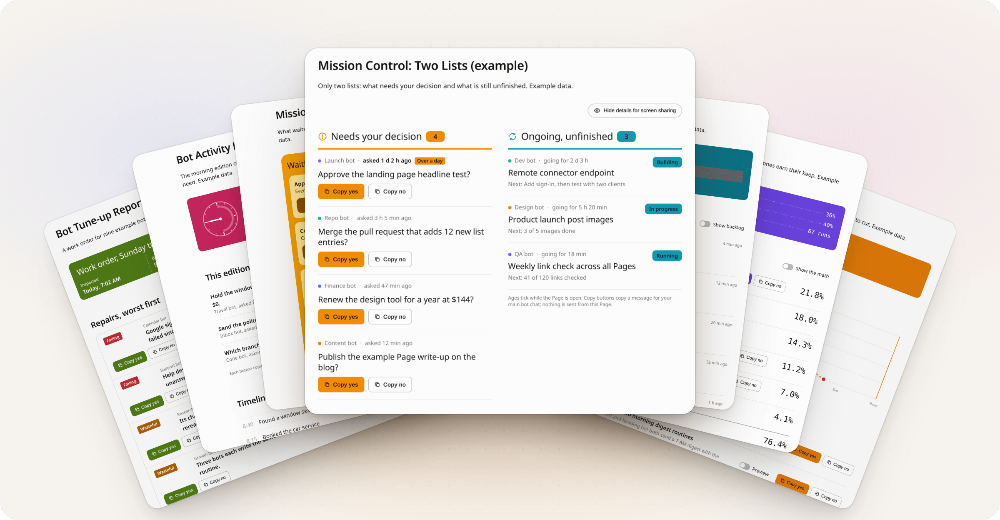

<p align="center">
  <a href="https://grokbotpages.com/">
    <picture>
      <source media="(prefers-color-scheme: dark)" srcset="assets/hero-dark.png">
      <source media="(prefers-color-scheme: light)" srcset="assets/hero-light.png">
      
    </picture>
  </a>
</p>

# Awesome Grok Bot Pages [](https://awesome.re)

> A curated list of public Grok Bot Pages: dashboards, trackers, tools and reports built with Grok Bot.

Browse the list at [grokbotpages.com](https://grokbotpages.com/), with a screenshot and a copyable prompt for every Page.

[Contributing](./CONTRIBUTING.md)

Grok Bot Pages are interactive pages that Grok Bot builds and hosts. This list collects Pages that anyone can open without signing in and that work for a stranger with no context: real data or a working control, no placeholder text, and no private details. Every entry credits its author and includes the prompt used to build it. Sections follow the Grok Bot plugin categories.

## Contents

- [Latest Additions](#latest-additions)
- [Mission Control](#mission-control)
- [Productivity](#productivity)
- [Data Analytics](#data-analytics)
- [Infrastructure](#infrastructure)
- [Agent Orchestration](#agent-orchestration)
- [Bot Management](#bot-management)
- [Payments and Finance](#payments-and-finance)
- [Sales](#sales)
- [Marketing](#marketing)
- [Inbox and Collaboration](#inbox-and-collaboration)
- [Research](#research)
- [Design](#design)
- [Documents and Files](#documents-and-files)
- [Scheduling and Support](#scheduling-and-support)
- [Create your Page and get listed](#create-your-page-and-get-listed)
  - [Need data for a dashboard?](#need-data-for-a-dashboard)
  - [Example prompt: Site analytics dashboard](#example-prompt-site-analytics-dashboard)
- [Listing rules](#listing-rules)
- [Entry format](#entry-format)
- [Contributing](#contributing)

## Latest Additions

Newest listings, also shown in their section.

- [Follow-up Seeds](https://follow-up-seeds-example-sxdr.pages.grok.bot/) - Replies that said they would try something, kept as seeds until they turn into proof: seed and proof counts, every seed with its quote, age and status (Too early, Ready to ask, Asked, Proof, Did not work), status filters, and a Copy follow-up or Copy ask to share button on each (example data). Inspired by [Paul's post on X](https://x.com/0xPaulvibe/status/2120554313369936040) ([@0xPaulvibe](https://x.com/0xPaulvibe)). His bot, Mention Meerkat, saves every "going to give that a try" reply as a seed; his own prompt from the post is quoted on the example Page. Paul's own prompt from the post is quoted on the Page; this prompt turns it into a Page. Example Page by Awesome Grok Bot Pages ([@Agent-Analytics](https://github.com/Agent-Analytics/awesome-grok-bot-pages)).
  Template page: [grokbotpages.com/t/follow-up-seeds/](https://grokbotpages.com/t/follow-up-seeds/).
  <details><summary>Prompt (turns Paul's prompt into a Page, by Awesome Grok Bot Pages)</summary>

  ```text
  Make me a Grok Bot Page called "Follow-up Seeds" from the replies to my posts, and keep updating this same Page instead of making a new one. A seed is anyone who said they would try, test or use something of mine but has not shared a result yet. At the top: how many seeds I have and how many turned into proof. Then every seed with the date, their reply in a short quote with a link, how many days ago it was, and a status: Too early (under 3 days), Ready to ask, Asked, Proof or Did not work. Each Ready to ask seed gets a Copy follow-up button with one casual, no-pressure line asking how it went. Each Proof seed gets a Copy ask to share button. Each Did not work seed keeps one line on what got in the way. Let me filter by status. Use only real replies and link each one.
  ```

  </details>
  <details><summary>Routine prompt (optional)</summary>

  ```text
  Create a routine for my "Follow-up Seeds" Page: every morning at 09:00, read new replies to my posts, add anyone who said they would try something of mine as a seed on the same Page, move seeds older than 3 days to Ready to ask with a drafted follow-up line, and send me one line with how many are ready. Never send a follow-up for me.
  ```

  </details>

- [Done Tracker](https://done-tracker-example-xkpj.pages.grok.bot/) - Tasks finished, week by week: this week's total against a crowned best week, 4 weekly bars with the change from the week before, 14 daily bars with a 14-day total, and open tasks by area with a Copy done button each (example data). Inspired by [多動パンダ's post on X](https://x.com/panda_tado/status/2120440830108618989) ([@panda_tado](https://x.com/panda_tado)). He shared his to-do dashboard after rebuilding his outer loop with Grok Bot. No prompt was shared, so the prompt is written from the post and its dashboard screenshot. Example Page by Awesome Grok Bot Pages ([@Agent-Analytics](https://github.com/Agent-Analytics/awesome-grok-bot-pages)).
  Template page: [grokbotpages.com/t/done-tracker/](https://grokbotpages.com/t/done-tracker/).
  <details><summary>Prompt (written by Awesome Grok Bot Pages from the post)</summary>

  ```text
  Make me a Grok Bot Page called "Done Tracker" from my to-do list, and keep updating this same Page instead of making a new one. At the top: how many tasks I finished this week, my best week so far with a crown on it, and the change from last week. Then the last 4 weeks as bars (weeks start Monday), each with its total and the change from the week before. Then the last 14 days as bars of tasks finished per day, with the 14 day total and the change from the 14 days before. Then my open tasks grouped by area, oldest first, each with a Copy done button that copies a short message I can send you to mark it finished. Use my local time zone and only my real tasks; if a day has no data, show it as empty instead of guessing.
  ```

  </details>
  <details><summary>Routine prompt (optional)</summary>

  ```text
  Create a routine for my "Done Tracker" Page: every night at 23:30, read my to-do list, count what I finished today, update the weekly and 14 day bars and my best week on the same Page, and refresh my open tasks. If I beat my best week, send me one line.
  ```

  </details>

- [Workout Tracker](https://workout-tracker-example-6fh3.pages.grok.bot/) - Today's training session with tick-box sets, target and last-time numbers, a rest timer and a Copy today's log button that turns the ticks into a message for your bot (ticks reset on reload), plus a week strip and an 8-week top-set chart per lift (example data). Inspired by [Johnny G's post on X](https://x.com/johnnygx612/status/2119932123213934709) ([@johnnygx612](https://x.com/johnnygx612)). Johnny uses a workout tracker Page and noted that ticks on a phone do not save, so this example adds a Copy today's log button that turns ticks into a message for the bot. No prompt was shared, so the prompt is written from the post. Example Page by Awesome Grok Bot Pages ([@Agent-Analytics](https://github.com/Agent-Analytics/awesome-grok-bot-pages)).
  Template page: [grokbotpages.com/t/workout-tracker/](https://grokbotpages.com/t/workout-tracker/).
  <details><summary>Prompt (written by Awesome Grok Bot Pages from the post)</summary>

  ```text
  Make me a Grok Bot Page called "Workout Tracker" for my training plan [paste it, or describe days, lifts, sets and reps]. Show today's session at the top: each exercise with its sets as tick boxes, the target weight and reps, and last time's numbers. Ticking a box only changes the view and resets on reload, so add a "Copy today's log" button that copies what I ticked as a message I paste back to you, and you then save it into the Page. Add a rest timer with 60, 90 and 120 second buttons. Then this week as a strip of days (done, today, planned, rest), and a chart of my top set on each main lift over the last 8 weeks. Use only my real logs; anything I have not logged stays empty.
  ```

  </details>
  <details><summary>Routine prompt (optional)</summary>

  ```text
  Create a routine for my "Workout Tracker" Page: every morning at 06:30 on training days, update the same Page with today's session and target weights from my last logs, and send me one line with the first lift. When I paste a log, save it to the Page.
  ```

  </details>

- [Decision Timeline](https://decision-timeline-example-a745.pages.grok.bot/) - Every project decision and why it was made: status counts as filters (Waiting on you, Confirmed, Brainstorm, Superseded), a newest-first timeline with reasons and what replaced old calls, Copy yes and Copy no on each decision that waits on you, and an area by week heat map (example data). Inspired by [Theseus Cristian's video on X](https://x.com/Theseus_23/status/2120198019832598694) ([@Theseus_23](https://x.com/Theseus_23)). The post's video shows Theseus's own Decision Timeline Page, and the prompt typed in the video is quoted on the example Page. Example Page by Awesome Grok Bot Pages ([@Agent-Analytics](https://github.com/Agent-Analytics/awesome-grok-bot-pages)).
  Template page: [grokbotpages.com/t/decision-timeline/](https://grokbotpages.com/t/decision-timeline/).
  <details><summary>Prompt (fuller version of the creator's prompt, by Awesome Grok Bot Pages)</summary>

  ```text
  Make me a Grok Bot Page called "Decision Timeline" that shows every decision on my project [name] and why it was made. Read our chats, my notes and the project files. At the top, counts by status: Waiting on me, Confirmed, Brainstorm and Superseded, as filter buttons. Then a timeline, newest first, of every decision: the date, the decision in one line, the area (for example design, site, packaging, pricing), the reason, and who or what it came from. A superseded decision says what replaced it. Every decision waiting on me gets Copy yes and Copy no buttons with a short reply I can paste back to you. Then a heat map of areas by week so I can see where decisions cluster. Add a newest or oldest sort. Use only real decisions from my project; if the reason is not written down, say "reason not recorded".
  ```

  </details>
  <details><summary>Routine prompt (optional)</summary>

  ```text
  Create a routine for my "Decision Timeline" Page: every evening at 18:00, add the decisions we made today to the same Page with their reasons, mark replaced ones as Superseded, and message me only if something is waiting on me for more than 2 days.
  ```

  </details>

- [Mention Scan](https://mention-scan-example-pcrq.pages.grok.bot/) - Every time one creator mentioned a topic in 6 months, on one Page: extra names the bot added, a month by month mention chart, one card per claim with a quote, the sources they shared and a grade (Backed, Mixed, Not backed, No source), grade filters, and a Copy button with a follow-up question for each weak claim (example data). Inspired by [Dave Gambrill's post on X](https://x.com/gambrill/status/2120136983729074408) ([@gambrill](https://x.com/gambrill)). Dave asked his bot to scan one creator's last 6 months for one topic, it widened the search to other names, and he made the resulting Page public; his prompt from the post's screenshot is quoted on the example Page. Example Page by Awesome Grok Bot Pages ([@Agent-Analytics](https://github.com/Agent-Analytics/awesome-grok-bot-pages)).
  Template page: [grokbotpages.com/t/mention-scan/](https://grokbotpages.com/t/mention-scan/).
  <details><summary>Prompt (general version of the creator's prompt, by Awesome Grok Bot Pages)</summary>

  ```text
  Make me a Grok Bot Page called "Mention Scan". Scan [@handle]'s posts from the last 6 months for every time they mention [topic], and also catch other names for it (spellings, abbreviations, related terms), and list which extra names you added. At the top: how many posts mention it, how many separate claims they make, and how many of those claims their own sources back up. Then a month by month chart of mentions. Then one card per claim: the date, a short quote with a link to the post, the claim in one line, the sources or links they shared, and a grade: Backed, Mixed, Not backed or No source, with one line on why. Let me filter by grade. Each claim that is Mixed, Not backed or No source gets a Copy button with a polite question I could ask them about it. Link every post and source; if you could not open a source, say so. This is a research summary, not advice.
  ```

  </details>
  <details><summary>Routine prompt (optional)</summary>

  ```text
  Create a routine for my "Mention Scan" Page: every Monday at 08:00, scan [@handle]'s posts from the past week for [topic] and its other names, add any new claims to the same Page with their grade and sources, and message me only if there is a new claim.
  ```

  </details>

- [Post Ideas Board](https://post-ideas-board-example-scze.pages.grok.bot/) - X post ideas in two languages on one Page that keeps updating: tonight's suggestion with English and Japanese side by side, X character counts and Copy buttons for each version, idea cards by status (Idea, Drafted, Ready, Posted) with topic filters, and a 7-evening posting strip (example data). Inspired by [micci's post on X](https://x.com/micci1841/status/2120209277923295734) ([@micci1841](https://x.com/micci1841)). No prompt was shared, so the prompt is written from the post. Example Page by Awesome Grok Bot Pages ([@Agent-Analytics](https://github.com/Agent-Analytics/awesome-grok-bot-pages)).
  Template page: [grokbotpages.com/t/post-ideas-board/](https://grokbotpages.com/t/post-ideas-board/).
  <details><summary>Prompt (written by Awesome Grok Bot Pages from the post)</summary>

  ```text
  Make me a Grok Bot Page called "Post Ideas Board" for my X post ideas, and keep updating this same Page instead of making a new one. Each idea gets an English draft, a Japanese translation and a status: Idea, Drafted, Ready or Posted. At the top, show tonight's suggested post with both versions side by side, the X character count for each, and Copy English and Copy Japanese buttons. Below, every idea as a card with both versions, its status, a topic tag and the same two Copy buttons, with filters by status and topic. Add a strip of the last 7 evenings showing which ones I posted. When I tell you I posted one, move it to Posted on this same Page. Use only my own ideas; if there is no translation yet, say so instead of guessing.
  ```

  </details>
  <details><summary>Routine prompt (optional)</summary>

  ```text
  Create a routine for my "Post Ideas Board" Page: every evening at 19:00, pick one Ready or Drafted idea I have not posted, polish the English draft and its Japanese translation, make it tonight's suggestion on the same Page, and send me one line with the English draft. If I tell you I posted it, mark it Posted on the Page.
  ```

  </details>

- [F2L Cases](https://f2l-cases-example-lrbn.pages.grok.bot/) - Rubik's Cube F2L cases as cards: a cube diagram per case with only the pair in colour, one checked algorithm with move count and a Copy button, group filters, learning and learned marks, and a random case to drill (example data). Inspired by [Nam's post on X](https://x.com/laivietnam91/status/2119654882382950480) ([@laivietnam91](https://x.com/laivietnam91)). The post's video shows Nam's own F2L Page for beginners. No prompt was shared, so the prompt is written from the post. Example Page by Awesome Grok Bot Pages ([@Agent-Analytics](https://github.com/Agent-Analytics/awesome-grok-bot-pages)).
  Template page: [grokbotpages.com/t/f2l-cases/](https://grokbotpages.com/t/f2l-cases/).
  <details><summary>Prompt (written by Awesome Grok Bot Pages from the post)</summary>

  ```text
  Make me a Grok Bot Page called "F2L Cases" to help me learn the F2L step of solving a Rubik's Cube (CFOP). Start with how to hold the cube (white cross on the bottom, yellow on top, the slot I am filling is front right) and how to read the move letters R, U, F and the ' and 2 marks. Then show the cases as cards in groups: the 4 basic inserts first, then corner on top with white to the side, corner on top with white facing up, and pieces stuck in the slot. Each card gets a cube diagram of the case with only the corner and edge I am pairing in colour, one standard algorithm, the move count and a Copy button for the algorithm. Let me filter by group, mark cases as learning or learned (just for this visit), and pick a random case to drill. Check every algorithm actually solves the case it is drawn with.
  ```

  </details>
  <details><summary>Routine prompt (optional)</summary>

  ```text
  Create a routine for my "F2L Cases" Page: every Sunday at 10:00, ask me which cases I learned this week, move them to Learned on the Page, add the next 4 cases I have not seen yet, and send me one line with the 4 new algorithms.
  ```

  </details>

- [Paycheck Planner](https://paycheck-planner-example-lmyd.pages.grok.bot/) - A paycheck planner for hourly and shift workers: wage, regular and overtime hours and take-home percent, an editable list of bills due before the next check, one bar that splits the check into bills and what is left, and calm next moves with Copy scripts when the check falls short (example data). Inspired by [The Come Up's post on X](https://x.com/FreebandGr94644/status/2119855339994529998) ([@FreebandGr94644](https://x.com/FreebandGr94644)). The post shares a public Grok Bot Page, Paycheck Planner, that this example is modelled on. No prompt was shared, so the prompt is written from the post. Example Page by Awesome Grok Bot Pages ([@Agent-Analytics](https://github.com/Agent-Analytics/awesome-grok-bot-pages)).
  Template page: [grokbotpages.com/t/paycheck-planner/](https://grokbotpages.com/t/paycheck-planner/).
  <details><summary>Prompt (written by Awesome Grok Bot Pages from the post)</summary>

  ```text
  Make me a Grok Bot Page called "Paycheck Planner" for hourly and shift work. Inputs: hourly wage, regular hours and overtime hours this pay period (overtime at 1.5x), weekly or every two weeks, and my take-home percent after taxes. Then a list of must-pay bills due before my next check that I can edit, add and remove. Show gross pay, take-home, the bills total and what is left, or how short I am, in plain dollars, with one bar that splits the check into each bill and what is left. If I am short, list calm next moves with a Copy button for what to say (for example asking a biller for a few extra days). Everything stays on the Page, nothing is saved. Say it is an estimate, not tax advice.
  ```

  </details>
  <details><summary>Routine prompt (optional)</summary>

  ```text
  Create a routine for my "Paycheck Planner" Page: every other Friday at 07:00, ask me for this check's hours, update the Page with them and the bills due before the next check, and send me one line with what is left or how short I am.
  ```

  </details>

- [Renewals and Due Dates](https://renewals-and-due-dates-example-yk36.pages.grok.bot/) - Household contracts and subscriptions in one place: a Needs you list for renewals in the next 14 days, missed dates and missing dates with a Copy button for each supplier note, a 12-month renewal timeline, monthly spend split into regular and renewals, and category filters (example data). Inspired by [William Kwan's post on X](https://x.com/williamkwanco/status/2119007766241329521) ([@williamkwanco](https://x.com/williamkwanco)). No prompt was shared, so the prompt is written from the post. Example Page by Awesome Grok Bot Pages ([@Agent-Analytics](https://github.com/Agent-Analytics/awesome-grok-bot-pages)).
  Template page: [grokbotpages.com/t/renewals-and-due-dates/](https://grokbotpages.com/t/renewals-and-due-dates/).
  <details><summary>Prompt (written by Awesome Grok Bot Pages from the post)</summary>

  ```text
  Make me a Grok Bot Page called "Renewals and Due Dates" from my household contracts list [paste it, or tell me where it lives, for example a Notion table]. For each contract: name, supplier, start date, end or renewal date, cost and how often, autopay yes or no. At the top, a "Needs you" list: anything renewing in the next 14 days, anything past its date, and anything with no date yet, each with a Copy button for a short note to the supplier (cancel, renegotiate or ask for the date). Then a 12-month timeline with each renewal as a marker, and a bar chart of what goes out each month split into regular and renewals. Let me filter by category. Use only what is in my list; mark missing dates as missing, do not guess.
  ```

  </details>
  <details><summary>Routine prompt (optional)</summary>

  ```text
  Create a routine for my "Renewals and Due Dates" Page: every Monday at 08:00, re-read my contracts list, rebuild the Page, and message me only if something renews within 7 days, a date has passed, or a new contract has no date. Otherwise stay quiet.
  ```

  </details>

- [Fight Camp Fuel](https://fight-camp-fuel-example-64la.pages.grok.bot/) - A fight camp nutrition coach: plate photos logged into today against calorie, protein, carb, fat and water targets, a 7-day intake chart with training days that shows under-eating early, the water cut plan to weigh-in, and one fix for tomorrow (example data). Inspired by [Jon Burgess's post on X](https://x.com/JonBurg88715724/status/2116946326034456857) ([@JonBurg88715724](https://x.com/JonBurg88715724)). No prompt was shared, so the prompt is written from the post. Example Page by Awesome Grok Bot Pages ([@Agent-Analytics](https://github.com/Agent-Analytics/awesome-grok-bot-pages)).
  Template page: [grokbotpages.com/t/fight-camp-fuel/](https://grokbotpages.com/t/fight-camp-fuel/).
  <details><summary>Prompt (written by Awesome Grok Bot Pages from the post)</summary>

  ```text
  Be my nutrition coach for fight camp and keep a Grok Bot Page called "Fight Camp Fuel". When I send a photo of a plate, estimate the food, calories and protein, carbs and fat, log it with the time, and update the Page. At the top: today against my targets for calories, protein, carbs, fat and water, and the days left to weigh-in. Then a 7-day chart of calories eaten against target, with training sessions marked, so under-eating shows up early. Then today's meal log, newest first. Then the water cut plan: litres per day for each day to weigh-in and my weight against the target weight. End with one fix for tomorrow, with a Copy button. My targets: [weight, weigh-in date, target weight, training days]. Say when an estimate is unsure. No medical advice beyond food and water.
  ```

  </details>
  <details><summary>Routine prompt (optional)</summary>

  ```text
  Create a routine for my "Fight Camp Fuel" Page: every night at 21:30, close the day, move it into the 7-day chart, write one fix for tomorrow, and update the days left and the water plan. Keep the layout the same. If I logged no meals today, say so instead of guessing.
  ```

  </details>

- [Dinners and Groceries](https://dinners-and-groceries-example-ei54.pages.grok.bot/) - This week's 5 dinners with a grocery checklist grouped by aisle that you can tick off, with a count of what is left and a Copy button for the remaining list (example data). Inspired by [BotTutorialsDaily's post on X](https://x.com/BotTutorials/status/2116610235012157813) ([@BotTutorials](https://x.com/BotTutorials)). Prompt quoted word for word from the post. Example Page by Awesome Grok Bot Pages ([@Agent-Analytics](https://github.com/Agent-Analytics/awesome-grok-bot-pages)).
  Template page: [grokbotpages.com/t/dinners-and-groceries/](https://grokbotpages.com/t/dinners-and-groceries/).
  <details><summary>Prompt (BotTutorialsDaily, quoted from <a href="https://x.com/BotTutorials/status/2116610235012157813">their post on X</a>)</summary>

  ```text
  Make me a Page with this week's 5 dinners and a grocery checklist I can tick off.
  ```

  </details>
  <details><summary>Routine prompt (optional)</summary>

  ```text
  Create a routine for my dinners Page: every Sunday at 10:00, plan next week's 5 dinners, rebuild the grocery checklist from them, and keep the layout the same. When I tell you what I bought, tick it off on the Page.
  ```

  </details>

- [Game Night Scoreboard](https://game-night-scoreboard-example-3n4n.pages.grok.bot/) - A board game group's scores out of the group chat: standings with a game filter, a searchable game log with a Copy proof button per game, disputed results, records by game and a Hall of Shame (example data). Inspired by [BigD's post on X](https://x.com/a3a1z6/status/2117257428697858101) ([@a3a1z6](https://x.com/a3a1z6)). He shared no prompt, so the prompt is written from the post. Example Page by Awesome Grok Bot Pages ([@Agent-Analytics](https://github.com/Agent-Analytics/awesome-grok-bot-pages)).
  Template page: [grokbotpages.com/t/game-night-scoreboard/](https://grokbotpages.com/t/game-night-scoreboard/).
  <details><summary>Prompt (written by Awesome Grok Bot Pages from the post)</summary>

  ```text
  Build me a wide Grok Bot Page called "Game Night Scoreboard" for my board game group: [list the players and the games you play]. Our scores used to live in the group chat where nobody could find them; this Page is the record. At the top, four numbers: game nights played, the current leader with their wins, the longest win streak, and the last game night with its winner. Then standings: each player's wins, games played, win rate and current streak, with a game filter and a sort by wins or win rate. Then the game log, newest first: date, game, winner, every player's score, and a short note when something was disputed, with a search box (try a name, a game or a date) and a Copy proof button on every game that copies one line with the date, game, scores and winner, so arguments come with proof. Then per-game records: most wins, highest score and when it happened. Then a Hall of Shame with who came last most often. Add a Disputed list for results someone questioned, each with a Copy question button with a ready message for the group. Every control must really work on the Page; no buttons that do nothing. Only show results we actually reported; never guess a score. Then create a routine: after each game night, when I send you the results in chat, add them to the log and update every number, standing and record.
  ```

  </details>

- [AI Visibility Report](https://ai-visibility-report-example-bfun.pages.grok.bot/) - A weekly AI visibility report: how often your brand is recommended across ChatGPT, Claude, Perplexity and Gemini, competitor share, cited sources, description accuracy flags, week-over-week change, and a to-do list with Copy buttons (example data). Inspired by [Scott Vayner's post on X](https://x.com/scottvayner/status/2118762594148245689) ([@scottvayner](https://x.com/scottvayner)). No prompt was shared and no original pages.grok.bot link was posted, so the prompt is written from the post. Example Page by Awesome Grok Bot Pages ([@Agent-Analytics](https://github.com/Agent-Analytics/awesome-grok-bot-pages)).
  Template page: [grokbotpages.com/t/ai-visibility-report/](https://grokbotpages.com/t/ai-visibility-report/).
  <details><summary>Prompt (written by Awesome Grok Bot Pages from the post)</summary>

  ```text
  Make me a Grok Bot Page called "AI Visibility Report" for [brand]. Every week, ask ChatGPT, Claude, Perplexity and Gemini a set of questions my customers actually ask (with web search on), then write the report. At the top: how often I am recommended across the four engines (example %), my top competitor share, cited source pages count, and week-over-week change. Then a per-engine breakdown. Then competitor share. Then the pages the AIs cited. Then description accuracy flags (right, vague, wrong) with Copy fix buttons. Then a to-do list with Copy buttons: get listed on cited pages, write missing pages, fix wrong descriptions. Use only example invented brand data. End with one question for me.
  ```

  </details>
  <details><summary>Routine prompt (optional)</summary>

  ```text
  Create a routine for my "AI Visibility Report" Page: every Monday at 09:00, re-ask the same customer questions across ChatGPT, Claude, Perplexity and Gemini, update the % and competitor share, refresh cited sources and description flags, and rewrite the to-do list. Keep the layout the same.
  ```

  </details>

- [Job Search Bot Team](https://job-search-bot-team-example-zhda.pages.grok.bot/) - A timeline and bot roster for a job search run by a Grok Bot team: KPI strip, waiting-on-you items with Copy reply buttons, one-job-per-bot tips, and offer decision cards with Copy yes and Copy decline (example data). Inspired by [Chase's thread on X](https://x.com/CybertruckATX/status/2117436124243308986) ([@CybertruckATX](https://x.com/CybertruckATX)). No prompt was shared, so the prompt is written from the post and tips. Example Page by Awesome Grok Bot Pages ([@Agent-Analytics](https://github.com/Agent-Analytics/awesome-grok-bot-pages)).
  Template page: [grokbotpages.com/t/job-search-bot-team/](https://grokbotpages.com/t/job-search-bot-team/).
  <details><summary>Prompt (written by Awesome Grok Bot Pages from the post and tips)</summary>

  ```text
  Make me a Grok Bot Page called "Job Search Bot Team" that runs my job search with a small Grok Bot team. At the top: days searching, bots in use, interviews booked, and offers on the table. Then a Waiting on you list: each item is a draft reply, application note or decision, with a Copy reply button. I send everything myself; bots only draft. Then a bot roster with one job per bot (router, career lead, job search, read-only mail, transition, money, portfolio), each with a one-line tip and a Copy tip button. Then a timeline of invented example events, newest first. Then offer decision cards with Copy yes and Copy decline. Use only example data. Credit the X thread that inspired the tips: one router bot, one job per bot, read-only inbox, plan the worst case early, keep watchers quiet, audit your bots.
  ```

  </details>
  <details><summary>Routine prompt (optional)</summary>

  ```text
  Create a routine for my "Job Search Bot Team" Page: every morning at 08:00, refresh Waiting on you from the bots that drafted overnight, update the KPI strip, and keep the roster and timeline layout the same. Stay quiet when nothing changed.
  ```

  </details>

- [Grok Widgets](https://grok-widgets-example-vqhv.pages.grok.bot/) - A free gallery of drop-in Page widgets (clocks, weather, crypto and stock tickers, charts, KPI cards, to-do boards) plus dark, neon and glass themes, each with a Copy prompt to add that widget to your Page in one sentence (example data). Inspired by [AbundantAlpha's post on X](https://x.com/AbundantAlpha/status/2116570991019135338) ([@AbundantAlpha](https://x.com/AbundantAlpha)). No prompt was shared, so the prompt is written from the post. Example Page by Awesome Grok Bot Pages ([@Agent-Analytics](https://github.com/Agent-Analytics/awesome-grok-bot-pages)).
  Template page: [grokbotpages.com/t/grok-widgets/](https://grokbotpages.com/t/grok-widgets/).
  <details><summary>Prompt (written by Awesome Grok Bot Pages from the post)</summary>

  ```text
  Make me a Grok Bot Page called "Grok Widgets": a free gallery of drop-in Page widgets and themes. At the top: how many widgets, how many themes, and a one-line tip that each widget has a Copy prompt. Then filter pills by kind (clocks, weather, tickers, charts, KPI cards, to-do boards) and by theme (dark, neon, glass). For each widget: a short preview with example data, a one-sentence add prompt, and a Copy button so I can paste it into any Page. Include three themes as cards with a Copy theme prompt each. Use only example data. End with Links to the original gallery if I have one.
  ```

  </details>
  <details><summary>Routine prompt (optional)</summary>

  ```text
  Create a routine for my "Grok Widgets" Page: every Monday at 10:00, add any new widget or theme I describe, keep the filters and Copy buttons, and leave the rest of the layout the same.
  ```

  </details>

- [Teach Me This](https://teach-me-this-example-zk3u.pages.grok.bot/) - A one-topic lesson from a post or link: a 3 to 5 step lesson plan, explain-it-back questions with Copy buttons, a quiz you reveal one answer at a time, and a spaced review schedule (example data). Inspired by [Daniel Endara's post on X](https://x.com/danielendara/status/2116936574168416621) ([@danielendara](https://x.com/danielendara)). Sensei bot template: [x.ai/bot/wUPzZYJGLoY859G420jxh](https://x.ai/bot/wUPzZYJGLoY859G420jxh). No prompt was shared, so the prompt is written from the post. Example Page by Awesome Grok Bot Pages ([@Agent-Analytics](https://github.com/Agent-Analytics/awesome-grok-bot-pages)).
  Template page: [grokbotpages.com/t/teach-me-this/](https://grokbotpages.com/t/teach-me-this/).
  <details><summary>Prompt (written by Awesome Grok Bot Pages from the post)</summary>

  ```text
  When I say "teach me this" with a post, a link or a topic, make a short lesson Grok Bot Page about it. Start with one sentence on what it is and a link to the source. Then a lesson plan of 3 to 5 steps, one concept at a time, each with a plain explanation and one example. Then "Explain it back": one question per step that I answer in my own words, with a Copy button so I can paste my answer to you and you check it. Then a 5-question quiz with answers I can reveal one at a time. End with a review schedule (tomorrow, in 3 days, in a week), each with a Copy button for the review prompt. Keep each step short and never invent facts the source does not support.
  ```

  </details>

- [Cheapest Power Hours](https://cheapest-power-hours-example-3fnc.pages.grok.bot/) - A year of half-hourly power prices for one region: when the cheapest four hours start by season, an hourly price chart with a month picker, start times per month, and what one 30 kWh charge costs when timed well or badly (example data). Inspired by [Octomiser's post on X](https://x.com/octomiser/status/2117563839130620225) ([@octomiser](https://x.com/octomiser)). No prompt was shared, so the prompt is written from the post. Example Page by Awesome Grok Bot Pages ([@Agent-Analytics](https://github.com/Agent-Analytics/awesome-grok-bot-pages)).
  Template page: [grokbotpages.com/t/cheapest-power-hours/](https://grokbotpages.com/t/cheapest-power-hours/).
  <details><summary>Prompt (written by Awesome Grok Bot Pages from the post)</summary>

  ```text
  Build me a wide Grok Bot Page called "Cheapest Power Hours" from a year of half-hourly electricity prices for [your region and tariff, for example London on Octopus Agile], from [start date] to [end date]. For each day, find the cheapest unbroken four-hour run and note when it started. At the top, four numbers with the exact counts: winter days (November to February) whose cheapest 4 hours started overnight, spring and summer days (April to August) whose cheapest 4 hours started late morning to midday, days whose cheapest 4 hours touched 16:00 to 19:00, and negative-price half-hours. Then an hourly bar chart of the average price per clock hour with a month picker, so I can flip between winter and summer. Then a stacked chart of overnight, midday and other start times per month. Then a cost calculator: one 30 kWh load in the cheapest 4 hours against 17:00 to 21:00, per month. Then a short "What to do" list by season with a Copy button on each tip. Use pence per kWh including VAT, label every chart, and say which numbers are measured and which are explanation. Every control must really work on the Page.
  ```

  </details>

- [Jarvis HUD](https://jarvis-hud-example-ioid.pages.grok.bot/) - A heads-up display for every bot you run: a Systems panel with status lights and last action, a Waiting on you queue with Approve, Later and Copy on each item, a morning brief with the one thing to do first, and a Focus mode (example data). Inspired by [Julian Goldie's post on X](https://x.com/JulianGoldieSEO/status/2117118176148480310) ([@JulianGoldieSEO](https://x.com/JulianGoldieSEO)). Original thread: [Julian Goldie's Grok Jarvis post](https://x.com/JulianGoldieSEO/status/2116854011827806310). No prompt was shared, so the prompt is written from the post. Example Page by Awesome Grok Bot Pages ([@Agent-Analytics](https://github.com/Agent-Analytics/awesome-grok-bot-pages)).
  Template page: [grokbotpages.com/t/jarvis-hud/](https://grokbotpages.com/t/jarvis-hud/).
  <details><summary>Prompt (written by Awesome Grok Bot Pages from the post)</summary>

  ```text
  Build me a full-width Grok Bot Page called "Jarvis" that works as a heads-up display for all my Grok Bots. Dark screen, a glowing core in the middle that pulses, thin panel outlines. Panels: Systems (every bot I run, a status light, the last thing it did and when, and a count of active bots), Waiting on you (every decision that needs my yes, each with Approve and Later buttons that only tick it off on this screen and send nothing, plus a Copy button that copies the item), Morning brief (what every bot did since yesterday, what is waiting on me, and the one thing to do first), and Quick commands (Morning brief, Status, What's waiting, Focus mode). Focus mode dims the panels and stops the motion. Respect reduced motion. Keep the personality calm, short, precise, a little dry, and call me by my name. Every control must really work on the Page; nothing is sent from it.
  ```

  </details>

- [Bot Team Usage](https://bot-team-usage-example-43kl.pages.grok.bot/) - Where a 7-bot team's usage goes: share by bot, by week and routines against chat, with period and activity switches and Copy prompt tips to cut waste (example data). Inspired by [Darryl Kay's post on X](https://x.com/SrCaptainThrawn/status/2117049279374065823) ([@SrCaptainThrawn](https://x.com/SrCaptainThrawn)). He shared a screenshot, not a prompt, so the prompt is written from the post. Example Page by Awesome Grok Bot Pages ([@Agent-Analytics](https://github.com/Agent-Analytics/awesome-grok-bot-pages)).
  Template page: [grokbotpages.com/t/bot-team-usage/](https://grokbotpages.com/t/bot-team-usage/).
  <details><summary>Prompt (written by Awesome Grok Bot Pages from the post)</summary>

  ```text
  Build me a wide Grok Bot Page called "Bot team usage" from my Grok Bot usage report. Show shares of my total usage, never invented totals. At the top, four numbers: how many bots I have, the share used by my busiest bot, the share that came from routines against chat, and how this week compares with my busiest week. Then a By bot chart: one bar per bot with its share of usage, biggest first, and a one-line note on why the top bot uses the most (for example a chief of staff that routes everything). Then a By week chart for the last 4 weeks, with my busiest and lightest week labeled and what happened that week if you know it. Then routines against chat for each bot, and a list of my routines with their share, so I can see which ones barely register. Add a period switch (last 7 days, last 30 days) and an activity switch (All, Chat, Routines) that update every number, chart and list. End with up to 3 suggestions, each with a Copy prompt button I can paste to the right bot; the Page never changes a bot or routine itself. Every control must really work on the Page; no buttons that do nothing. Anything the report does not show stays empty instead of a guess. Then create a routine that rebuilds the Page every Monday at 9:00 AM.
  ```

  </details>

- [Agent Office](https://agent-office-example-h2a2.pages.grok.bot/) - An office floor of 10 agents making a video series, each desk showing its status and current task with steps, what needs you with Copy reply buttons, a team list with filters, an episode pipeline and an activity feed (example data). Inspired by [Filipe Flores's post on X](https://x.com/ofilipeflores/status/2116360547767644433) ([@ofilipeflores](https://x.com/ofilipeflores)). Based on his Page [Escritório das Frutinhas](https://escritorio-das-frutinhas-fix7.pages.grok.bot/); he shared no prompt, so the prompt is written from the Page. Example Page by Awesome Grok Bot Pages ([@Agent-Analytics](https://github.com/Agent-Analytics/awesome-grok-bot-pages)).
  Template page: [grokbotpages.com/t/agent-office/](https://grokbotpages.com/t/agent-office/).
  <details><summary>Prompt (written by Awesome Grok Bot Pages from the post)</summary>

  ```text
  Build me a wide Grok Bot Page called "Agent Office" that shows my team of AI agents as an office, working on my content series [name the series and where it posts, for example a short fruit-character drama on TikTok]. Give each agent a character, a desk on an office floor plan and a role (for example ideas, script, storyboard, voices, editing, captions, thumbnails, scheduling, quality check). At the top, four numbers: agents working, agents that need me, agents free, and episodes in progress. On the floor plan, mark each agent's status with a shape and a word (Exploring, Writing, Creating, Polishing, Thinking, Needs you, Done, Resting) and let me tap a desk to see that agent's current task: the task name, the step it is on out of how many, a timeline of its steps with times, and what it made. Then a Needs you list: each item names the agent, the question in one line, why it needs me, and a Copy reply button with a ready answer; the Page itself never approves or sends anything. Then the episode pipeline from Idea to Script, Storyboard, Voices, Edit, Ready and Posted, with counts per stage and each episode's title, stage and owner. End with an activity feed of what each agent did, newest first, with a filter by agent. Add a status filter with counts and a sort for Needs you first or A to Z. Every control must really work on the Page; no buttons that do nothing. Show only work my agents really did; anything not connected shows as empty instead of a guess. Then create a routine that refreshes the Page every hour while my agents are working.
  ```

  </details>

- [Morning Mission Control](https://morning-mission-control-example-3x24.pages.grok.bot/) - A morning command center with a live clock, a one-at-a-time headline ticker, ACTION, WATCH and FYI cards with Copy buttons, a 3-week calendar, what is waiting on you, a bot roster, what finished today and per-project status (example data). Inspired by [Wozmatic's post on X](https://x.com/Wozmatics/status/2117272603815502005) ([@Wozmatics](https://x.com/Wozmatics)). By Wozmatic ([@Wozmatics](https://x.com/Wozmatics), built on [@jameslayne](https://x.com/jameslayne)'s original prompt). Example Page by Awesome Grok Bot Pages ([@Agent-Analytics](https://github.com/Agent-Analytics/awesome-grok-bot-pages)).
  Template page: [grokbotpages.com/t/morning-mission-control/](https://grokbotpages.com/t/morning-mission-control/).
  <details><summary>Prompt (Wozmatic, from <a href="https://x.com/Wozmatics/status/2117272603815502005">his X Article</a>)</summary>

  ```text
  GOAL
  Every morning at 7:15, refresh my Dashboard Page so that within a minute I can see what I'm working on: what needs me today, what to watch, and what moved since yesterday. Set this up as a daily routine.
  ACCESS
  Make the Page easy to open at any time, without hunting for the link:
  1. Create a new Grok Bot agent called Dashboard and make it the owner of my Dashboard Page. Set the refresh up as that agent's own routine, so it runs the refresh and makes any changes to the Page that I ask for. Whenever I message it, even "hi", it also replies with one line holding a link to the Page, so I'm always one tap away, including on the mobile app.
  2. Tell me to pin the dashboard in my Library on desktop. I open the Library, click the three dots on the Page's row and choose Pin. It stays at the top under Pinned.
  3. As a fallback, tell me to bookmark the Page link in a web browser.
  Create the Page once, on the first run, and always update that same Page after that so the link never changes. Never create a second Page or a copy, because that would break the Dashboard agent's link, the Library pin and the bookmark. If the link ever changes, tell me and update the Dashboard agent.
  LAYOUT AND STYLE
  A full-colour, dark mission-control layout:
  A header with a large live clock in my time zone and 4 key-number tiles.
  A scrolling ticker of headline items, which pauses on hover.
  Coloured pills that jump to each section.
  Numbered "At a glance" cards colour-coded by type: ACTION (red), WATCH (amber), FYI (blue).
  Progress rings and bars where there's real data to show.
  A 3-week calendar strip and timeline, colour-coded by event type.
  A "Waiting on me" list.
  A bot roster grid showing when each of my bots was last active.
  A "Finished today" timeline.
  One section per active project or area of my life, each with its own "Last updated" stamp.
  Once it's built, keep the colour palette, card styles, glow and accents, spacing and section order. Change them only when I ask.
  HARD LIMITS (never break these)
  1. Edit only my Dashboard Page. Never create a second Page, and never rewrite the layout or change the style unless I ask.
  2. On each refresh, change only the content and data, never the structure or section ids.
  3. All sources are read only. Send no emails or messages, create no drafts, post nothing in chat tools, and create, edit, move or delete nothing in my files or any connected app.
  4. No secrets on the Page (passwords, codes, full account or card numbers; last 4 digits are fine).
  5. No em dashes anywhere.
  STEP 0: FIRST RUN ONLY, STYLE QUESTION (ask once, never again)
  On the very first refresh, before building or saving anything, ask me one question: am I happy with this colour scheme, card colours and visual style, or would I like anything changed (palette, accent colours, contrast, card style, density)? Apply my answer, then save in your memory that the style question has been asked. If there's no answer, use the layout as it is. Never ask this again on any later run. After this, change the style only when I ask for it directly.
  STEP 1: DECIDE THE SCOPE (my local date)
  Refresh every section on every run, covering everything since the previous refresh.
  STEP 2: GATHER (read only, newest first)
  Use every source I've connected to you, and skip any I haven't. For example:
  My notes and documents (such as Google Drive, Notion or OneDrive) for each active project or area of my life. These are the main source.
  My existing Pages.
  Email (such as Gmail or Outlook) since the last refresh, for replies, deadlines, payment requests and decisions on open items.
  Chat and messaging (such as Slack or Teams) since the last refresh, for mentions, direct messages and anything waiting on me.
  Task and project tools (such as Notion, Trello, Asana or Linear) for open tasks, due dates and anything assigned to me.
  My calendar for the next 3 weeks.
  Each of my bots' recent chats, for when it was last active and what it finished.
  STEP 3: WRITE THE CONTENT
  Every item comes from a source read this run, with a date. Tag anything inferred, stale or unconfirmed as "Unverified", with a one-line reason. Never invent numbers, names or chart data. Leave a chart out rather than fake one.
  At a glance has at most 9 cards, ranked by urgency:
  ACTION: I must decide or do something within 7 days.
  WATCH: a live risk, a date, or a reply that's due, with nothing for me to do yet.
  FYI: a change worth knowing, with nothing to do.
  Each card says what changed, why it matters, and the next step or deadline, with a source and date.
  Waiting on me lists only items blocked on me, oldest first, with how many days each has waited.
  Recalculate all countdowns against today's date in my time zone.
  STEP 4: FALLBACKS
  If a source can't be read, keep the last values, add a "Not refreshed today" note with the reason, and keep going. Never blank out a section. If a bot's chat can't be read, carry over its last-active time and mark it as carried over. If I haven't connected a source, leave it out rather than flag it.
  STEP 5: CHECK, THEN SAVE
  Before saving, check that every refreshed section has a "Last updated" stamp, the page-level updated time is set, every jump pill reaches its section, the header counts match the cards, colours match the card types, and there are no em dashes or secrets. Then save.
  STEP 6: MORNING CHECK-IN
  After saving, send me one short check-in with a link to the Page and up to 2 questions, asked one at a time in chat, or on voice if I'm on a call with you:
  1. Content: is anything missing, wrong or no longer relevant?
  2. Priority: should any card move up, move down or come off?
  Apply my answers on the next refresh, and keep everything else as it is. If the refresh fails or the Page can't be edited, say so in the check-in.
  ```

  </details>

- [Mentions and App Rank](https://mentions-and-app-rank-example-jsfv.pages.grok.bot/) - Daily X post counts and App Store rank for one app on a shared timeline: a 7, 14 or 30 day switch, the biggest day and best rank marked, week-over-week change, a daily table and a copyable summary line (example data). Inspired by [Carolina Dill's post on X](https://x.com/CarolinaDill/status/2118072659632115822) ([@CarolinaDill](https://x.com/CarolinaDill)). Original Page: [Grok Bot by the Numbers](https://tidy-meadow-cmmjbf.pages.grok.bot). No prompt was shared, so the prompt is written from the post. Example Page by Awesome Grok Bot Pages ([@Agent-Analytics](https://github.com/Agent-Analytics/awesome-grok-bot-pages)).
  Template page: [grokbotpages.com/t/mentions-and-app-rank/](https://grokbotpages.com/t/mentions-and-app-rank/).
  <details><summary>Prompt (written by Awesome Grok Bot Pages from the post)</summary>

  ```text
  Make me a Grok Bot Page that tracks one app by the numbers (example: Grok Bot). Show the daily count of posts on X that mention it and where it ranked in the App Store each day, for the last 30 days, with a 7, 14 and 30 day switch. Mark the biggest day and the best rank, show the change against the week before, and add a table of the daily numbers. Add a one-line summary of today I can copy. Say where each number comes from.
  ```

  </details>
  <details><summary>Routine prompt (optional)</summary>

  ```text
  Create a routine: every morning at 08:00, check my lesson Pages for reviews due today, and send me one line per lesson with the Page link and the first review question.
  ```

  </details>

  Create a routine for my "Mentions and App Rank" Page: every day at 09:00, add yesterday's X post count and App Store rank, update the charts, the week-over-week change and the summary line. Stay quiet unless the rank moves 5 places or posts double.
  ```

  </details>

- [Ship Velocity](https://ship-velocity-example-jbus.pages.grok.bot/) - An engineering ship velocity dashboard: merged PRs per month with a switch to contributors and PRs per contributor, and before and after performance cards with % change and a frame or launch budget line (example data). Inspired by [Lauren Tan's post on X](https://x.com/poteto/status/2118017093677494706) ([@poteto](https://x.com/poteto)). No prompt was shared, so the prompt is written from the post. Example Page by Awesome Grok Bot Pages ([@Agent-Analytics](https://github.com/Agent-Analytics/awesome-grok-bot-pages)).
  Template page: [grokbotpages.com/t/ship-velocity/](https://grokbotpages.com/t/ship-velocity/).
  <details><summary>Prompt (written by Awesome Grok Bot Pages from the post)</summary>

  ```text
  Make me a Grok Bot Page called "Ship Velocity" for [repo or team]. At the top: merged PRs last month, growth since [start month], active contributors, and how many tracked timings got faster. Then a monthly column chart of merged PRs from [start month] to now, with a switch to show contributors and PRs per contributor. Then before and after cards for each performance timing I track ([for example cold launch, relaunch, first paint, typing latency median and p90]): the old value, the new value, the % change, and a dashed budget line (one frame, 16.7 ms, for typing; [my launch budget] for startup). Put any timing that got slower or is over its budget first. Use merged PR counts from GitHub for [repo] and timings from [benchmark source]. Say where each number comes from, and leave a metric out rather than guess.
  ```

  </details>
  <details><summary>Routine prompt (optional)</summary>

  ```text
  Create a routine for my "Ship Velocity" Page: on the 1st of each month at 09:00, add last month's merged PRs and contributors from GitHub, read the latest benchmark results, update the before and after cards, and keep the layout the same. If a timing got slower or went over its budget, put it first and tell me.
  ```

  </details>

- [News Pulse](https://news-pulse-example-rh54.pages.grok.bot/) - A Top 10 right now plus four topic pulses (AI, Robotics, Tesla & EV, World News) built from public X posts, each with a headline, why it matters, engagement and a link to the post, with a time window, sort and topic switch (live X data as of Sun Nov 1, 6:29 PM Asia/Jerusalem). Inspired by [Robert Scoble's News Pulse](https://x.com/Scobleizer/status/2116623281797370154). Example Page by Awesome Grok Bot Pages.
  Template page: [grokbotpages.com/t/news-pulse/](https://grokbotpages.com/t/news-pulse/).
  <details><summary>Prompt</summary>

  ```text
  Build me a full-width Grok Bot Page called "News Pulse" from public X posts. Topics: AI, Robotics, Tesla & EV and World News (swap in 3 to 5 topics of your own). For each topic, find the most important stories from the last 3 days, posted by news outlets, companies and well-known public figures, never private individuals. Each story gets a short headline in your own words, a one-line why it matters, the source account, when it was posted, its engagement (likes, reposts, replies and views) and a link to the original X post. Keep everything on the Page itself: no links out except to the X posts. Never invent a post, number or quote. At the top, four numbers: stories, accounts, total engagement and how long ago the newest post went up, then one line on the most engaged story. Then a Top 10 right now across all topics with a Top 5 or Top 10 switch, a timeline of when each story broke, and the topic pulses with a topic switch that shows counts. Add a time window switch (6 hours, 24 hours, 3 days) that updates every number, count and list, and a sort for Most engaged, Newest and Most viewed. Label the Page "Live X data as of" the time you pulled it. Every control must really work on the Page; no buttons that do nothing. A topic with nothing in the window says so instead of a guess. Then create a routine that rebuilds the Page every 3 hours.
  ```

  </details>

- [Revenue, last week](https://revenue-last-week-example-4v3c.pages.grok.bot/) - Booked revenue against plan by segment for last week, with the deals that slipped and why (example data). Inspired by [@maestrooth's post](https://x.com/maestrooth/status/2116619589140578691). Example Page by Awesome Grok Bot Pages.
  Template page: [grokbotpages.com/t/revenue-last-week/](https://grokbotpages.com/t/revenue-last-week/).
  <details><summary>Prompt</summary>

  ```text
  Build me a wide Grok Bot Page called "Revenue, last week" from my CRM or billing system and my sales plan. At the top, four numbers: booked last week, the plan for the week, the difference against plan in percent, and how many deals slipped, then a one-line takeaway of what carried the week and what slipped. Add a segment switch (All, Enterprise, Mid-market, SMB) that updates every number, the chart and the list. Then a weekly booked vs. plan chart for the last 7 weeks with a Show plan toggle and a hover or tap readout. Then the deals that slipped out of last week: account, segment, amount, owner, the new close week and a Why toggle, with a sort by largest first or soonest new date. Every control must really work on the Page; no buttons that do nothing. Anything not connected shows as empty instead of a guess. Then create a routine that rebuilds the Page every Monday at 8:00 AM.
  ```

  </details>

- [Q4 Forecast & Pipeline](https://q4-forecast-and-pipeline-example-xahm.pages.grok.bot/) - Q4 commit against target, the pace needed to close the gap, and every deal stuck for 14 days or more (example data). Inspired by [@maestrooth's post](https://x.com/maestrooth/status/2116619589140578691). Example Page by Awesome Grok Bot Pages.
  Template page: [grokbotpages.com/t/q4-forecast-and-pipeline/](https://grokbotpages.com/t/q4-forecast-and-pipeline/).
  <details><summary>Prompt</summary>

  ```text
  Build me a wide Grok Bot Page called "Q4 Forecast & Pipeline" from my CRM. At the top, four numbers: the Q4 target, what is committed, the open pipeline, and how many deals have had no stage change or logged activity for 14 days or more, then a one-line takeaway with the percent of target committed and the weeks left. Then a week-by-week chart of committed revenue against the target line for the 13 weeks of the quarter, with a Show needed pace toggle that draws the pace needed to reach target and a hover or tap readout. Then the deals to watch: name, amount, stage, owner, close date and days since the last change, with a NEW tag on deals added this week and a stuck flag on every deal at 14 days or more. Add a stage filter with counts, a Stuck 14+ days only toggle, a sort by largest or longest without a change, and a Details toggle per deal. The stuck count at the top must match the flagged deals in the list. Every control must really work on the Page; no buttons that do nothing. Anything not connected shows as empty instead of a guess. Then create a routine that refreshes the Page every hour during work hours so it stays live.
  ```

  </details>

- [Morning brief](https://morning-brief-example-x6tk.pages.grok.bot/) - Your day ready by 7:00: meetings, the emails that need you, your focus time and the one thing most likely to slip (example data). Inspired by [@maestrooth's post](https://x.com/maestrooth/status/2116619589140578691). Example Page by Awesome Grok Bot Pages.
  Template page: [grokbotpages.com/t/morning-brief/](https://grokbotpages.com/t/morning-brief/).
  <details><summary>Prompt</summary>

  ```text
  Build me a wide Grok Bot Page called "Morning brief" from my calendar and email. At the top, four numbers: meetings today, emails that need me, focus time (free blocks of 30 minutes or more) and how many things are at risk of slipping. Then call out the one thing most likely to slip today, why, the one step that saves it, and a working copy button with a ready message for that step. Then my day as a strip from first meeting to last and an agenda below it: each meeting with time, who is in it and what to prep, which I can open by tapping it, with a Show free time toggle for lunch, gaps and focus blocks. Then the emails that need me, grouped as Reply today, This week and Read only with counts, each with the sender, subject and the ask in one line. Every control must really work on the Page; no buttons that do nothing. Anything not connected shows as empty instead of a guess. Then create a routine that rebuilds the Page every weekday so it is ready by 7:00 AM.
  ```

  </details>

- [Board memo, October](https://board-memo-october-example-o6rx.pages.grok.bot/) - The monthly board update drafted from ARR, growth, burn and runway, marked as a draft and never sent (example data). Inspired by [@maestrooth's post](https://x.com/maestrooth/status/2116619589140578691). Example Page by Awesome Grok Bot Pages.
  Template page: [grokbotpages.com/t/board-memo-october/](https://grokbotpages.com/t/board-memo-october/).
  <details><summary>Prompt</summary>

  ```text
  Build me a wide Grok Bot Page called "Board memo" for last month, from my billing, bank or accounting, and CRM. At the top, four numbers: ARR, month-over-month growth, net burn and runway in months, then a 6-month ARR chart. Then draft the monthly board update from those numbers only: a one-line summary, Numbers, What went well, What did not, and Asks. Mark it clearly as DRAFT, NEVER SENT. Add a Full or Short switch, a Show sources toggle that tags every number with where it came from, and a working Copy draft button that copies the version on screen. Never send, schedule or share the memo; I copy it myself. Every control must really work on the Page; no buttons that do nothing. Anything not connected shows as empty instead of a guess, and a number you cannot source stays out of the memo. Then create a routine that redrafts the Page on the 1st of every month at 8:00 AM.
  ```

  </details>

- [Expense policy](https://expense-policy-example-ilde.pages.grok.bot/) - An expense policy Page that rewrites itself when a rule changes in Slack, with the message behind every change (example data). Inspired by [@maestrooth's post](https://x.com/maestrooth/status/2116619589140578691). Example Page by Awesome Grok Bot Pages.
  Template page: [grokbotpages.com/t/expense-policy/](https://grokbotpages.com/t/expense-policy/).
  <details><summary>Prompt</summary>

  ```text
  Build me a wide Grok Bot Page called "Expense policy" that holds our current expense policy as numbered sections, written in plain words. Watch the #ops-policy channel in Slack. When a message there changes a rule, rewrite only the section it touches, and show the message that caused it: who posted it, when, and the exact words. At the top, four numbers: rewrites so far, readers this month, stale lines (rules on the Page that no longer match Slack) and the average minutes from Slack message to Page update. Add a search box that filters the sections, a Highlight last change toggle that shows the old value struck through next to the new one, a Copy policy button, and a change log with a Details toggle on every entry showing before and after. Every control must really work on the Page; no buttons that do nothing. Anything not connected shows as empty instead of a guess, and never invent a rule nobody posted. Then create a routine that updates the Page whenever a new message in #ops-policy changes a rule, plus a daily check at 9:00 AM for anything missed.
  ```

  </details>

- [Competitor watch](https://competitor-watch-example-bvhl.pages.grok.bot/) - Every price change and launch from 5 competitors, checked daily against their own pages (example data). Inspired by [@maestrooth's post](https://x.com/maestrooth/status/2116619589140578691). Example Page by Awesome Grok Bot Pages.
  Template page: [grokbotpages.com/t/competitor-watch/](https://grokbotpages.com/t/competitor-watch/).
  <details><summary>Prompt</summary>

  ```text
  Build me a wide Grok Bot Page called "Competitor watch" that tracks these 5 companies: [list them with their websites]. Check each one's pricing page, changelog and blog every day. At the top, four numbers: companies tracked, price moves, launches and the time of the last check, then one line saying what matters most. Then one row per company with the plan I care about, its price before and after, the change in percent, and a Details toggle with what changed in plain words, the exact source page, and a 30-day price line. Add a filter for All, Price moves, Launches and No change with counts, and a sort for Biggest change, Newest and A to Z. Only report a change you saw on the company's own page, and link to it. Every control must really work on the Page; no buttons that do nothing. Anything not connected shows as empty instead of a guess. Then create a routine that rechecks all 5 every day at 6:00 AM.
  ```

  </details>

- [Mission Control: Two Lists](https://mission-control-two-lists-example-3z7u.pages.grok.bot/) - Only two lists: what needs your decision, with Copy yes and Copy no buttons and ages that keep ticking, and what is still ongoing and unfinished, plus an eye button that blurs the details for screen sharing (example data). Inspired by [Alex Finn's post on X](https://x.com/AlexFinn/status/2115612249826148795) ([@AlexFinn](https://x.com/AlexFinn)). By Alex Finn ([@AlexFinn](https://x.com/AlexFinn)). Example Page by Awesome Grok Bot Pages ([@Agent-Analytics](https://github.com/Agent-Analytics/awesome-grok-bot-pages)).
  Template page: [grokbotpages.com/t/mission-control-two-lists/](https://grokbotpages.com/t/mission-control-two-lists/).
  <details><summary>Prompt</summary>

  ```text
  Build me a wide Grok Bot Page called "Mission Control" with two lists only, side by side. Left: "Needs your decision" with a count, every open question one of my bots is waiting on me for, oldest first: the bot, the question in one line, how long ago it asked (keep the age ticking), and working Copy yes and Copy no buttons that copy a message I paste into this chat, showing Copied after a click; if the clipboard is blocked, show the text to select. Right: "Ongoing, unfinished" with a count, every task or routine still running: the bot, the task, a short status like Building, Running or In progress, how long it has been going and the next step. Add an eye button that blurs the item text so I can share my screen. No charts, no animated characters, no other sections. Ask each bot what it waits on me for and what it is still working on, use only real data, show "unknown" instead of guessing, and drop items once I answer them.
  ```

  </details>
  <details><summary>Routine prompt (optional)</summary>

  ```text
  Create a routine that refreshes my "Mission Control" Page every hour from 8 AM to 10 PM. Each run, ask every bot what it waits on me for and what is still unfinished, rebuild both lists with the same layout and copy buttons, and drop decisions I already answered. Message me only when a decision has waited more than a day.
  ```

  </details>

- [Command Center](https://command-center-example-it3x.pages.grok.bot/) - A kitchen ticket rail for what your bots wait on you for: tagged tickets with due items first, working copy buttons with a ready reply for your main bot chat, a Show why switch, a day-by-day timeline and In progress and Finished tabs (example data). Inspired by [Moritz Kremb's post on X](https://x.com/moritzkremb/status/2114787902932857293) ([@moritzkremb](https://x.com/moritzkremb)). By Moritz Kremb ([@moritzkremb](https://x.com/moritzkremb)). Example Page by Awesome Grok Bot Pages ([@Agent-Analytics](https://github.com/Agent-Analytics/awesome-grok-bot-pages)).
  Template page: [grokbotpages.com/t/command-center/](https://grokbotpages.com/t/command-center/).
  <details><summary>Prompt</summary>

  ```text
  Build me a wide Grok Bot Page called "Command Center" so I never lose the overview of what my bots did. You are my chief of staff: ask each of my bots what it is waiting on me for, what it is working on and what it finished, and use their routines and recent runs. Show "Waiting on me" as a rail of tickets, each with the asking bot, one line on what to do, a tag (Due today, Approval, Yes/no, Reply, Sign or Action), due items first, a filter by tag and a "Show why" switch that reveals the reason. Give every ticket working copy buttons (Copy yes and Copy no, or one short ready reply) that copy a message I paste into this chat, and show Copied after a click; if the clipboard is blocked, show the text to select. Below, a timeline of bot activity grouped by day, with day tabs that show a count and a filter by bot, and In progress and Finished tabs with a count each. Use only real data and show "unknown" instead of guessing.
  ```

  </details>
  <details><summary>Routine prompt (optional)</summary>

  ```text
  Create a routine that refreshes my "Command Center" Page every two hours from 8 AM to 8 PM on weekdays. Each run, ask my bots what they wait on me for, what they are working on and what they finished, rebuild the tickets, timeline and status tabs, keep the layout and copy buttons, and drop tickets I already answered. Only message me if a new ticket is due today.
  ```

  </details>

- [Agent Status Board](https://agent-status-board-example-aeo2.pages.grok.bot/) - A ward board of every bot: a census band that filters by state, one row per bot with what it needs from you and copy buttons for the reply, what it is doing, a Show backlog switch and who used the most of the plan (example data). Inspired by [Ashni's post on X](https://x.com/ashnichrist/status/2112998428456194373) ([@ashnichrist](https://x.com/ashnichrist)). By Ashni ([@ashnichrist](https://x.com/ashnichrist)). Example Page by Awesome Grok Bot Pages ([@Agent-Analytics](https://github.com/Agent-Analytics/awesome-grok-bot-pages)).
  Template page: [grokbotpages.com/t/agent-status-board/](https://grokbotpages.com/t/agent-status-board/).
  <details><summary>Prompt</summary>

  ```text
  Build me a wide Grok Bot Page called "Agent Status Board" that reads like a ward board for my bots. At the top, a census bar: one strip split by state (Needs you, Blocked, Busy, Idle) with a count each, and tabs with the same counts that filter the board. Then one row per bot, bots that need me first: name and role, a state plate, a "Needs from you" note when it waits on me, what it is doing now, last active, and its backlog behind a "Show backlog" switch. Every row that needs me gets working copy buttons (Copy yes and Copy no, or one short ready reply) that copy a message I paste into this chat, and shows Copied after a click; if the clipboard is blocked, show the text to select. Below, show which bots used the most of my plan this week, from my plan usage summary. Use only real data from my bots, routines and recent runs, show "unknown" instead of guessing, and say the controls only change the view.
  ```

  </details>
  <details><summary>Routine prompt (optional)</summary>

  ```text
  Create a routine that refreshes my "Agent Status Board" Page every hour from 8 AM to 8 PM. Each run, ask every bot for its state, what it needs from me, what it is doing and its backlog, read my plan usage summary, rebuild the board with the same layout and copy buttons, and drop items I already answered. Message me only when a bot turns Blocked.
  ```

  </details>

- [Bot Fleet Ops](https://bot-fleet-ops-example-udcj.pages.grok.bot/) - A morning fuel check for the bot fleet: a burn-down of the weekly plan with a projection to the reset, three fixes with Preview switches that move the projection and copy buttons to approve them, and a red, yellow or green light per bot (example data). Inspired by [Brian Roemmele's Mission Control post on X](https://x.com/BrianRoemmele/status/2111201533971103942) ([@BrianRoemmele](https://x.com/BrianRoemmele)). By Brian Roemmele ([@BrianRoemmele](https://x.com/BrianRoemmele)). Example Page by Awesome Grok Bot Pages ([@Agent-Analytics](https://github.com/Agent-Analytics/awesome-grok-bot-pages)).
  Template page: [grokbotpages.com/t/bot-fleet-ops/](https://grokbotpages.com/t/bot-fleet-ops/).
  <details><summary>Prompt</summary>

  ```text
  Build me a wide Grok Bot Page called "Bot Fleet Ops" that tells me each morning whether my bots will run out of plan before it resets. Read my plan usage summary and every bot's routines and recent runs. Lead with a burn-down chart of plan left by day, the actual line up to now and a dashed projection to the reset, and say plainly on which day it runs out. Then list your recommendations (pause, merge or tighten something), each with what it saves per day, a "Preview" switch that redraws the projection as if I did it, and working copy buttons (Copy yes and Copy no) that copy a message I paste into this chat, showing Copied after a click; if the clipboard is blocked, show the text to select. Below, a fleet table with a red, yellow or green light per bot, its share of the week and one line on why. Use only real data, show "unknown" instead of guessing, and say the switches only change the view.
  ```

  </details>
  <details><summary>Routine prompt (optional)</summary>

  ```text
  Create a routine that refreshes my "Bot Fleet Ops" Page every morning at 7 AM. Each run, read my plan usage summary and every bot's recent runs, redraw the burn-down and projection, rebuild the recommendations with their copy buttons and the fleet lights, and keep the layout. Message me only if the projection says the plan runs out before it resets.
  ```

  </details>

- [Bot Tune-up Report](https://bot-tune-up-report-example-wls2.pages.grok.bot/) - A weekly work order for your bots: what is failing, what wastes plan and what to tidy, each repair with its fix and copy buttons, a Copy all fixes button, a severity filter and an impact versus effort map (example data). Inspired by [Brian Roemmele's Optimizer post on X](https://x.com/BrianRoemmele/status/2112337968820334676) ([@BrianRoemmele](https://x.com/BrianRoemmele)). By Brian Roemmele ([@BrianRoemmele](https://x.com/BrianRoemmele)). Example Page by Awesome Grok Bot Pages ([@Agent-Analytics](https://github.com/Agent-Analytics/awesome-grok-bot-pages)).
  Template page: [grokbotpages.com/t/bot-tune-up-report/](https://grokbotpages.com/t/bot-tune-up-report/).
  <details><summary>Prompt</summary>

  ```text
  Build me a wide Grok Bot Page called "Bot Tune-up Report" that reads like a mechanic's work order for my bots. Inspect every bot: chat length, failing logins or connectors, empty or duplicate bots, routines that do the same job, and what each one costs from my plan usage summary. Put an inspection header on top (when, how many bots, total issues), then one repair line per issue, worst first: the bot, what is wrong, the fix, impact and effort, with a filter by severity. Every repair line gets working copy buttons (Copy yes and Copy no) that copy a message I paste into this chat, plus one "Copy all fixes" button at the end, and each shows Copied after a click; if the clipboard is blocked, show the text to select. Add an impact versus effort chart of the repairs. Use only real data, show "unknown" instead of guessing, and fix nothing until I send the message.
  ```

  </details>
  <details><summary>Routine prompt (optional)</summary>

  ```text
  Create a routine that reruns my "Bot Tune-up Report" every Sunday at 6 PM. Each run, inspect every bot again, rebuild the work order with the same layout and copy buttons, mark repairs I already approved as done, and message me only if a bot is failing.
  ```

  </details>

- [Weekly Usage Audit](https://weekly-usage-audit-example-7eoy.pages.grok.bot/) - Last week's usage itemized like a bill: each bot's share with a verdict (earns it, trim or cut), copy buttons for the trims, a Show the math switch, a bot by day heatmap and the runs that repeat (example data). Inspired by [Brian Roemmele's usage audit post on X](https://x.com/BrianRoemmele/status/2112249592133935133) ([@BrianRoemmele](https://x.com/BrianRoemmele)). By Brian Roemmele ([@BrianRoemmele](https://x.com/BrianRoemmele)). Example Page by Awesome Grok Bot Pages ([@Agent-Analytics](https://github.com/Agent-Analytics/awesome-grok-bot-pages)).
  Template page: [grokbotpages.com/t/weekly-usage-audit/](https://grokbotpages.com/t/weekly-usage-audit/).
  <details><summary>Prompt</summary>

  ```text
  Build me a wide Grok Bot Page called "Weekly Usage Audit" from the usage export I upload here, laid out like a utility bill. On top, the statement period and the share of my weekly plan used. Then one line per bot, biggest first: runs, average run size and share of the week, with a "Show the math" switch that reveals how each share was worked out, and a verdict on whether the bot earns its keep. Every line with a Cut or Trim verdict gets working copy buttons (Copy yes and Copy no) that copy a message I paste into this chat, and shows Copied after a click; if the clipboard is blocked, show the text to select. Add a heatmap of usage by bot and day, and a list of runs that repeat with the same input. Use only the export and my bots' routines, show "unknown" instead of guessing, and change nothing until I send the message.
  ```

  </details>
  <details><summary>Routine prompt (optional)</summary>

  ```text
  Create a routine that every Monday at 9 AM asks me for last week's usage export, then rebuilds my "Weekly Usage Audit" Page from it with the same layout, verdicts and copy buttons. Message me only if one bot used more than a quarter of the week.
  ```

  </details>

- [Bot Activity Dashboard](https://bot-activity-dashboard-example-m3yc.pages.grok.bot/) - A morning and evening edition of what your bots did: counts for waiting on you, in progress and finished, tabs for each with copy buttons on what waits on you, and a timeline filterable by day and bot (example data). Inspired by [@byalexai's post on X](https://x.com/byalexai/status/2114837470680318365) ([@byalexai](https://x.com/byalexai)). By [@byalexai](https://x.com/byalexai). Example Page by Awesome Grok Bot Pages ([@Agent-Analytics](https://github.com/Agent-Analytics/awesome-grok-bot-pages)).
  Template page: [grokbotpages.com/t/bot-activity-dashboard/](https://grokbotpages.com/t/bot-activity-dashboard/).
  <details><summary>Prompt</summary>

  ```text
  Build me a Grok Bot Page called "Bot Activity Dashboard" that works like a twice-daily edition of what my bots did. Ask each of my bots what it is waiting on me for, what it is working on and what it finished, and read their routines and recent runs. At the top, show when this edition was taken and when the next one comes, on a small clock. Then tabs for Waiting on me, In progress and Finished, each with a count. Waiting items show the bot, what it needs and when it asked, with working copy buttons (Copy yes and Copy no, or one short ready reply) that copy a message I paste into this chat and show Copied after a click; if the clipboard is blocked, show the text to select. In-progress items that recur show their schedule, like "Daily about 21:30", and when they last ran. Finished items show what was done and when. Below, an activity timeline with day tabs that show a count and a filter by bot. Use only real data and show "unknown" instead of guessing.
  ```

  </details>
  <details><summary>Routine prompt (optional)</summary>

  ```text
  Create a routine that refreshes my "Bot Activity Dashboard" Page twice a day, at 9:00 and 21:00. Each run, ask my bots what they wait on me for, what they are working on and what they finished, rebuild the edition with the same layout and copy buttons, and drop items I already answered. Message me only if something new waits on me.
  ```

  </details>

- [Bot Crew Office](https://bot-crew-office-example-pw33.pages.grok.bot/) - An office floor of your bot crew: every bot at a desk with a callsign and a state dot, a GO / NO-GO list with Copy GO and Copy NO-GO buttons, an activity feed, a crew list and Now, Day, Dusk and Night lighting (example data). Inspired by [@0xCarnagee's post on X](https://x.com/0xCarnagee/status/2115623287707381874) ([@0xCarnagee](https://x.com/0xCarnagee)). By [@0xCarnagee](https://x.com/0xCarnagee). Example Page by Awesome Grok Bot Pages ([@Agent-Analytics](https://github.com/Agent-Analytics/awesome-grok-bot-pages)).
  Template page: [grokbotpages.com/t/bot-crew-office/](https://grokbotpages.com/t/bot-crew-office/).
  <details><summary>Prompt</summary>

  ```text
  Build me a wide Grok Bot Page called "Bot Crew Office" that shows my bots as a crew in an office. Give each bot a short callsign and draw it as a desk on an office floor plan, with a colored dot for its state: coding, browsing, in terminal, thinking, needs you, error, done or idle, and a legend. Add a Now, Day, Dusk and Night switch that changes the office lighting. Next to the office, a GO / NO-GO list of everything a bot is waiting on me for: the callsign, the question in one line, and working Copy GO and Copy NO-GO buttons that copy the exact message I paste into this chat, showing Copied after a click; if the clipboard is blocked, show the text to select. Add an activity feed of the latest events and a crew list with what each bot is doing now. Use only real data from my bots, routines and recent runs, and say nothing is sent from the Page.
  ```

  </details>
  <details><summary>Routine prompt (optional)</summary>

  ```text
  Create a routine that refreshes my "Bot Crew Office" Page every hour from 8 AM to 8 PM. Each run, ask every bot for its state and what it waits on me for, redraw the office and the GO / NO-GO list with the same layout and copy buttons, and drop questions I already answered. Message me only when a bot hits an error.
  ```

  </details>

- [My Bots Dashboard](https://bots-dashboard-example-ctaz.pages.grok.bot/) - A plain one-page overview of every bot with a section switcher: what needs you with copy buttons for each answer, the bots at a glance and by area, today's routines and usage (example data). Inspired by [Emily Nguyen's post on X](https://x.com/emilyntech/status/2113117549890273584) ([@emilyntech](https://x.com/emilyntech)). By Emily Nguyen ([@emilyntech](https://x.com/emilyntech)). Example Page by Awesome Grok Bot Pages ([@Agent-Analytics](https://github.com/Agent-Analytics/awesome-grok-bot-pages)).
  Template page: [grokbotpages.com/t/my-bots-dashboard/](https://grokbotpages.com/t/my-bots-dashboard/).
  <details><summary>Prompt</summary>

  ```text
  Build me a plain, white Grok Bot Page called "My Bots Dashboard" with a switcher at the top for: All, Needs you, At a glance, Bots by area, Today's routines and Usage. Needs you: a line like "3 open, 1 blocked", then each item marked "your call", "blocked" (for example a connection that expired) or "review" for a possible duplicate bot, with the bot, one line on what to do and working copy buttons (Copy yes and Copy no, or one short ready reply) that copy a message I paste into this chat and show Copied after a click; if the clipboard is blocked, show the text to select. At a glance: one sentence with the number of bots, routines, routines that failed today and possible duplicates. Bots by area: a map of areas like Home, Money, Work and Health sized by how many bots each has, with the bots in each. Today's routines: each routine with its time, bot and whether it worked, failed or runs later, and flag routines that overlap. Usage: how much of my weekly plan is used, when it resets and which bots used the most, from my plan usage summary. Keep it calm: one green accent, no decoration. Use only real data and show "unknown" instead of guessing.
  ```

  </details>
  <details><summary>Routine prompt (optional)</summary>

  ```text
  Create a routine that refreshes my "My Bots Dashboard" Page every morning at 8 AM and again at 2 PM. Each run, rebuild every section from my bots, routines and plan usage summary with the same layout and copy buttons, and drop items I already answered. Message me only if a routine failed.
  ```

  </details>

- [Mission Board](https://mission-board-example-6745.pages.grok.bot/) - A phone-friendly board: what waits on you at the top with big thumb-sized copy buttons and a Due today switch, missions with step progress in the middle and the daily briefs at the bottom (example data). Inspired by [Marcell Hazzard's post on X](https://x.com/Marcellhazzard/status/2115638752030937510) ([@Marcellhazzard](https://x.com/Marcellhazzard)). By Marcell Hazzard ([@Marcellhazzard](https://x.com/Marcellhazzard)). Example Page by Awesome Grok Bot Pages ([@Agent-Analytics](https://github.com/Agent-Analytics/awesome-grok-bot-pages)).
  Template page: [grokbotpages.com/t/mission-board/](https://grokbotpages.com/t/mission-board/).
  <details><summary>Prompt</summary>

  ```text
  Build me a narrow, phone-friendly Grok Bot Page called "Mission Board" that stacks like phone widgets. At the top, a "Waiting on me" list with a count, so approvals don't get buried: each item shows what to do, which bot asks and when it is due, with today's items marked and a "Due today" switch. Each item gets big, thumb-sized copy buttons (Copy yes and Copy no, or one short ready reply) that copy a message I paste into this chat and show Copied after a tap; if the clipboard is blocked, show the text to select. In the middle, my active missions or projects, each with how far along it is in steps and one line on what is next. At the bottom, the daily briefs my bots send me, such as inbox, money and calendar, with a switch between today and yesterday. Collect the list from my bots, so it fills up on its own as they ask for things. Use only real data and show "unknown" instead of guessing.
  ```

  </details>
  <details><summary>Routine prompt (optional)</summary>

  ```text
  Create a routine that refreshes my "Mission Board" Page every morning at 7 AM and whenever a bot asks me for something. Each run, collect what my bots wait on me for, update missions and briefs with the same layout and copy buttons, and drop items I already answered. Message me only if something is due today.
  ```

  </details>

- [Routine Run Board](https://routine-run-board-example-e6f6.pages.grok.bot/) - Every routine on one timetable: schedule, last run, result and a strip of its last 20 runs, approvals with copy buttons, and filters by result and bot (example data). Inspired by [Vikrant Shukla's post on X](https://x.com/vikrantshukla/status/2113158413186187736) ([@vikrantshukla](https://x.com/vikrantshukla)). By Vikrant Shukla ([@vikrantshukla](https://x.com/vikrantshukla)). Example Page by Awesome Grok Bot Pages ([@Agent-Analytics](https://github.com/Agent-Analytics/awesome-grok-bot-pages)).
  Template page: [grokbotpages.com/t/routine-run-board/](https://grokbotpages.com/t/routine-run-board/).
  <details><summary>Prompt</summary>

  ```text
  Build me a wide Grok Bot Page called "Routine Run Board" that reads like a railway timetable for every routine across all my bots. On top, one line with counts: routines, worked, failed and waiting on me. Then a "Waiting on your approval" list with what each routine needs from me, the bot and when it asked, and working copy buttons (Copy yes and Copy no, or one short ready reply) that copy a message I paste into this chat and show Copied after a click; if the clipboard is blocked, show the text to select. Then the timetable: routine, bot, schedule, last run, result (worked, failed, waiting or skipped), a strip of its last 20 runs as small squares, and a note such as why it failed, with a filter by result with counts and a filter by bot. The app keeps the 20 most recent run records per routine, so also append each morning's results to a run log file and read it for anything older. Use only real data and show "unknown" instead of guessing.
  ```

  </details>
  <details><summary>Routine prompt (optional)</summary>

  ```text
  Create a routine that refreshes my "Routine Run Board" Page every morning at 7:30, before I start. Each run, read every routine's recent runs, append them to the run log file, rebuild the timetable and the approval list with the same layout and copy buttons, and drop approvals I already gave. Message me only if a routine failed twice in a row.
  ```

  </details>

- [Side Project Mission Control](https://side-project-mission-control-example-zxug.pages.grok.bot/) - One screen for a solo builder running a product with bots: site, deploy, PR and error status, a ranked Needs you list with two copy buttons per item for the reply, key numbers with sparklines, a shipping queue and bot activity (example data). Inspired by [Alex Finn's Mission Control post on X](https://x.com/AlexFinn/status/2115612249826148795) ([@AlexFinn](https://x.com/AlexFinn)). By Awesome Grok Bot Pages ([@Agent-Analytics](https://github.com/Agent-Analytics/awesome-grok-bot-pages)).
  Template page: [grokbotpages.com/t/side-project-mission-control/](https://grokbotpages.com/t/side-project-mission-control/).
  <details><summary>Prompt</summary>

  ```text
  Build me a wide Grok Bot Page called "Side Project Mission Control" for the product I run with my bots. Use whatever I have connected: GitHub (or my git host) for open PRs, the last deploy and CI, my analytics (for example the Agent Analytics MCP) for visits, signups and clicks on my main call-to-action, my uptime or error tracker if I have one, and my bots and routines for the activity feed. At the top, a status strip: is the site up, the last deploy and whether it passed, open PRs with how many wait on me or fail CI, and new errors in the last 24 hours. Then a "Needs you" list ranked by urgency: which bot asks, what to do in one line, where to do it and about how long it takes, a Why toggle, and two working copy buttons per item that copy a ready reply for that bot (for example Copy yes and Copy no), showing Copied after a click and the text to select if the clipboard is blocked. Add a sort for most urgent or quickest first. Then today's key numbers (visits, signups, CTA clicks) with a sparkline each and the change against the 7-day average, with a 14 days or 24 hours switch and a hover readout. Then a shipping queue in three columns, In review, Blocked and Done this week, with an area filter, a Show done toggle and a Details toggle per item. End with a bot activity feed I can filter by bot. Every control must really work; no buttons that do nothing. Anything not connected shows as empty instead of a guess.
  ```

  </details>
  <details><summary>Routine prompt (optional)</summary>

  ```text
  Create a routine that refreshes my "Side Project Mission Control" Page every weekday at 8:30 AM. Each run, pull fresh status, numbers, PRs and bot activity, ask each bot what it needs from me, rebuild the Page with the same layout and copy buttons, and drop items I already handled. Message me only if the site is down or a deploy failed.
  ```

  </details>

- [Decisions Console](https://decisions-console-example-cblp.pages.grok.bot/) - Only the decisions your bots wait on you for, ranked by due time, money at stake and age, each with Copy yes and Copy no buttons, plus division goal gauges, a bot roster, a 72-hour stale log and what you cleared today (example data). Inspired by [Jordan Rafealov's post on X](https://x.com/JordanRafealov/status/2116152545274147218) ([@JordanRafealov](https://x.com/JordanRafealov)). By Awesome Grok Bot Pages ([@Agent-Analytics](https://github.com/Agent-Analytics/awesome-grok-bot-pages)).
  Template page: [grokbotpages.com/t/decisions-console/](https://grokbotpages.com/t/decisions-console/).
  <details><summary>Prompt</summary>

  ```text
  Build me a wide Grok Bot Page called "Decisions Console" that shows only what needs me. You are my chief of staff: collect every decision my bots are waiting on me for. At the top, show a goal gauge for each of my divisions or main goals, with the goal, today's number, the target and the date. In the middle, a "Waiting on you" queue ranked by due time, then money at stake, then age. Each item shows the asking bot, the decision in one line, when it is due, how long it has waited and the money at stake, a Details toggle with the reason, and working Copy yes and Copy no buttons that copy a ready reply for that bot, showing Copied after a click and the text to select if the clipboard is blocked. Add a "Mark done" button that only hides the item on the Page, and say so next to it. Add a filter by division and a sort by due time, age or money. On the side, list my bots by division with a status dot (working, waiting on me, idle), a short log of anything waiting over 72 hours, and what I cleared today. At the bottom, show bots working, waiting on me, cleared today and a countdown to the next refresh. Use only real data from my bots and routines. If something is missing, show "unknown" instead of guessing.
  ```

  </details>
  <details><summary>Routine prompt (optional)</summary>

  ```text
  Create a routine that refreshes my "Decisions Console" Page every hour on weekdays from 8 AM to 7 PM. Each run, ask every bot what decisions it waits on me for, rebuild the queue, gauges and roster with the same layout and copy buttons, move answered decisions to Cleared today, and message me only when a decision is due within an hour or has waited over 72 hours.
  ```

  </details>

- [Bot Org Chart](https://bot-org-chart-example-ujfc.pages.grok.bot/) - A blueprint org chart of your bots: you at the top, Grok Bot as the chief of staff, the specialists it delegates to with status dots and dashed hand-offs, clickable bot cards with routines, and what waits on you with Copy yes and Copy no buttons (example data). By Awesome Grok Bot Pages ([@Agent-Analytics](https://github.com/Agent-Analytics/awesome-grok-bot-pages)).
  Template page: [grokbotpages.com/t/bot-org-chart/](https://grokbotpages.com/t/bot-org-chart/).
  <details><summary>Prompt</summary>

  ```text
  Make me a wide Grok Bot Page called "Bot Org Chart" that shows how my bots are organized. Put me at the top. Under me put my main Grok Bot, labeled "Chief of staff": it is the bot I talk to, and it delegates work to my specialist bots. Draw an arrow from it to each specialist. Draw a dashed line between two bots only where one really hands work to the other, and list those hand-offs under the chart. Give each bot a simple blob avatar with two eyes, a one-line role, its routines with their schedule, and its status (working, idle or waiting on me). Clicking a bot in the chart highlights its card. For every bot that waits on me, add a "Waiting on you" row with the question and working Copy yes and Copy no buttons that copy a ready reply for that bot, showing Copied after a click and the text to select if the clipboard is blocked. Fill it from my real bots, their descriptions and their routines, and don't invent anything.
  ```

  </details>
  <details><summary>Routine prompt (optional)</summary>

  ```text
  Create a routine that refreshes my "Bot Org Chart" Page every day at 8:00 AM. Each run, read my bots, their descriptions, routines and statuses, ask which ones wait on me, and rebuild the chart, the hand-offs, the bot cards and the Waiting on you rows with the same layout and copy buttons. Only message me if a bot was added or removed.
  ```

  </details>

- [Mission Control](https://mission-control-example-sgmr.pages.grok.bot/) - A dark, clean night office of your bots: working bots at desks with a speech bubble, idle bots in the lounge, a live clock with stat cards, what waits on you with Copy yes and Copy no buttons and an eye button that blurs each item, an activity timeline, upcoming routines and an activity heatmap (example data). Inspired by [Alex Finn's post on X](https://x.com/AlexFinn/status/2115612249826148795) ([@AlexFinn](https://x.com/AlexFinn)). By Alex Finn ([@AlexFinn](https://x.com/AlexFinn)). Example Page by Awesome Grok Bot Pages ([@Agent-Analytics](https://github.com/Agent-Analytics/awesome-grok-bot-pages)).
  Template page: [grokbotpages.com/t/mission-control/](https://grokbotpages.com/t/mission-control/).
  <details><summary>Prompt (Alex Finn, from <a href="https://x.com/AlexFinn/status/2115612249826148795">his post on X</a>)</summary>

  ```text
  Build me a dashboard Page called "Mission Control" that shows what all my bots are doing. Refresh it every hour on weekdays with a routine.

  Layout:
  1. Top bar: a live clock and 3–5 stat cards for numbers I care about (ask me which ones, then pull them from my connected accounts).
  2. Left column, "Waiting on me": every open question or approval my bots are waiting on me for, newest first. Each item gets an Open button that jumps straight to that bot's chat, and an eye button that blurs it so I can keep it private on camera.
  3. Middle, "Activity timeline": tasks my bots finished, newest first, with each bot's picture and a one-line plain-English summary.
  4. Right column, "Upcoming routines": my scheduled routines with their next run time and which bot owns each one.
  5. Top of everything "The office": a fun 2D top-down office. Bots that are working sit at desks typing, with a little speech bubble saying what they're on. Idle bots wander around. Add a heatmap of activity by hour for the last 7 days.

  Use only real data from my bots, routines and accounts. If something is missing, show it as empty instead of making it up. Make it dark and clean.
  ```

  </details>
  <details><summary>Routine prompt (optional)</summary>

  ```text
  Create a routine that refreshes my "Mission Control" Page every hour on weekdays from 8 AM to 8 PM. Each run, ask every bot what it is working on, what it finished and what it waits on me for, then rebuild the office, the three columns, the stat cards and the activity heatmap with the same layout. Drop questions I already answered. Message me only when something has waited on me for more than a day.
  ```

  </details>

- [Site Analytics Dashboard](https://site-analytics-dashboard-example-xahy.pages.grok.bot/) - A one-page analytics report from Agent Analytics: headline visits, signups and conversion, daily visits per site with a 7-day average and a site switch, weekly signups, a landing to signup funnel and suggested next steps with Copy yes and Copy no buttons (example data). By Awesome Grok Bot Pages ([@Agent-Analytics](https://github.com/Agent-Analytics/awesome-grok-bot-pages)).
  Template page: [grokbotpages.com/t/site-analytics-dashboard/](https://grokbotpages.com/t/site-analytics-dashboard/).
  <details><summary>Prompt</summary>

  ```text
  Build me a wide Grok Bot Page called "Site Analytics Dashboard" from my Agent Analytics data for the last 30 days. Connect the Agent Analytics MCP server at https://mcp.agentanalytics.sh/mcp first if it isn't connected. Start with one row of headline numbers: visits in the last 7 days across my sites with the change on the week before, signups in the last 30 days, and landing to call-to-action conversion. Then, per site, 7-day visits as a big number, a one-line note in plain English and a daily visits line with a dashed 7-day average, with a switch to show one site or all of them. Then a weekly signups chart and a landing, call-to-action click, signup funnel. End with up to 3 suggested next steps based on the numbers, each with working Copy yes and Copy no buttons that copy a ready reply for my bot, showing Copied after a click and the text to select if the clipboard is blocked. Use only real numbers; show "no data" instead of guessing.
  ```

  </details>
  <details><summary>Routine prompt (optional)</summary>

  ```text
  Create a routine that refreshes my "Site Analytics Dashboard" Page every day at 8:00 AM with fresh Agent Analytics data for the last 30 days, keeping the same layout, charts and copy buttons, and updating the suggested next steps. Message me only if visits or signups drop more than 30% against the 7-day average.
  ```

  </details>

## Mission Control

One screen for what your bots and projects are doing and what waits on you.

- [Morning Mission Control](https://morning-mission-control-example-3x24.pages.grok.bot/) - A morning command center with a live clock, a one-at-a-time headline ticker, ACTION, WATCH and FYI cards with Copy buttons, a 3-week calendar, what is waiting on you, a bot roster, what finished today and per-project status (example data). Inspired by [Wozmatic's post on X](https://x.com/Wozmatics/status/2117272603815502005) ([@Wozmatics](https://x.com/Wozmatics)). By Wozmatic ([@Wozmatics](https://x.com/Wozmatics), built on [@jameslayne](https://x.com/jameslayne)'s original prompt). Example Page by Awesome Grok Bot Pages ([@Agent-Analytics](https://github.com/Agent-Analytics/awesome-grok-bot-pages)).
  Template page: [grokbotpages.com/t/morning-mission-control/](https://grokbotpages.com/t/morning-mission-control/).
  <details><summary>Prompt (Wozmatic, from <a href="https://x.com/Wozmatics/status/2117272603815502005">his X Article</a>)</summary>

  ```text
  GOAL
  Every morning at 7:15, refresh my Dashboard Page so that within a minute I can see what I'm working on: what needs me today, what to watch, and what moved since yesterday. Set this up as a daily routine.
  ACCESS
  Make the Page easy to open at any time, without hunting for the link:
  1. Create a new Grok Bot agent called Dashboard and make it the owner of my Dashboard Page. Set the refresh up as that agent's own routine, so it runs the refresh and makes any changes to the Page that I ask for. Whenever I message it, even "hi", it also replies with one line holding a link to the Page, so I'm always one tap away, including on the mobile app.
  2. Tell me to pin the dashboard in my Library on desktop. I open the Library, click the three dots on the Page's row and choose Pin. It stays at the top under Pinned.
  3. As a fallback, tell me to bookmark the Page link in a web browser.
  Create the Page once, on the first run, and always update that same Page after that so the link never changes. Never create a second Page or a copy, because that would break the Dashboard agent's link, the Library pin and the bookmark. If the link ever changes, tell me and update the Dashboard agent.
  LAYOUT AND STYLE
  A full-colour, dark mission-control layout:
  A header with a large live clock in my time zone and 4 key-number tiles.
  A scrolling ticker of headline items, which pauses on hover.
  Coloured pills that jump to each section.
  Numbered "At a glance" cards colour-coded by type: ACTION (red), WATCH (amber), FYI (blue).
  Progress rings and bars where there's real data to show.
  A 3-week calendar strip and timeline, colour-coded by event type.
  A "Waiting on me" list.
  A bot roster grid showing when each of my bots was last active.
  A "Finished today" timeline.
  One section per active project or area of my life, each with its own "Last updated" stamp.
  Once it's built, keep the colour palette, card styles, glow and accents, spacing and section order. Change them only when I ask.
  HARD LIMITS (never break these)
  1. Edit only my Dashboard Page. Never create a second Page, and never rewrite the layout or change the style unless I ask.
  2. On each refresh, change only the content and data, never the structure or section ids.
  3. All sources are read only. Send no emails or messages, create no drafts, post nothing in chat tools, and create, edit, move or delete nothing in my files or any connected app.
  4. No secrets on the Page (passwords, codes, full account or card numbers; last 4 digits are fine).
  5. No em dashes anywhere.
  STEP 0: FIRST RUN ONLY, STYLE QUESTION (ask once, never again)
  On the very first refresh, before building or saving anything, ask me one question: am I happy with this colour scheme, card colours and visual style, or would I like anything changed (palette, accent colours, contrast, card style, density)? Apply my answer, then save in your memory that the style question has been asked. If there's no answer, use the layout as it is. Never ask this again on any later run. After this, change the style only when I ask for it directly.
  STEP 1: DECIDE THE SCOPE (my local date)
  Refresh every section on every run, covering everything since the previous refresh.
  STEP 2: GATHER (read only, newest first)
  Use every source I've connected to you, and skip any I haven't. For example:
  My notes and documents (such as Google Drive, Notion or OneDrive) for each active project or area of my life. These are the main source.
  My existing Pages.
  Email (such as Gmail or Outlook) since the last refresh, for replies, deadlines, payment requests and decisions on open items.
  Chat and messaging (such as Slack or Teams) since the last refresh, for mentions, direct messages and anything waiting on me.
  Task and project tools (such as Notion, Trello, Asana or Linear) for open tasks, due dates and anything assigned to me.
  My calendar for the next 3 weeks.
  Each of my bots' recent chats, for when it was last active and what it finished.
  STEP 3: WRITE THE CONTENT
  Every item comes from a source read this run, with a date. Tag anything inferred, stale or unconfirmed as "Unverified", with a one-line reason. Never invent numbers, names or chart data. Leave a chart out rather than fake one.
  At a glance has at most 9 cards, ranked by urgency:
  ACTION: I must decide or do something within 7 days.
  WATCH: a live risk, a date, or a reply that's due, with nothing for me to do yet.
  FYI: a change worth knowing, with nothing to do.
  Each card says what changed, why it matters, and the next step or deadline, with a source and date.
  Waiting on me lists only items blocked on me, oldest first, with how many days each has waited.
  Recalculate all countdowns against today's date in my time zone.
  STEP 4: FALLBACKS
  If a source can't be read, keep the last values, add a "Not refreshed today" note with the reason, and keep going. Never blank out a section. If a bot's chat can't be read, carry over its last-active time and mark it as carried over. If I haven't connected a source, leave it out rather than flag it.
  STEP 5: CHECK, THEN SAVE
  Before saving, check that every refreshed section has a "Last updated" stamp, the page-level updated time is set, every jump pill reaches its section, the header counts match the cards, colours match the card types, and there are no em dashes or secrets. Then save.
  STEP 6: MORNING CHECK-IN
  After saving, send me one short check-in with a link to the Page and up to 2 questions, asked one at a time in chat, or on voice if I'm on a call with you:
  1. Content: is anything missing, wrong or no longer relevant?
  2. Priority: should any card move up, move down or come off?
  Apply my answers on the next refresh, and keep everything else as it is. If the refresh fails or the Page can't be edited, say so in the check-in.
  ```

  </details>

- [Mission Control](https://mission-control-example-sgmr.pages.grok.bot/) - A dark, clean night office of your bots: working bots at desks with a speech bubble, idle bots in the lounge, a live clock with stat cards, what waits on you with Copy yes and Copy no buttons and an eye button that blurs each item, an activity timeline, upcoming routines and an activity heatmap (example data). Inspired by [Alex Finn's post on X](https://x.com/AlexFinn/status/2115612249826148795) ([@AlexFinn](https://x.com/AlexFinn)). By Alex Finn ([@AlexFinn](https://x.com/AlexFinn)). Example Page by Awesome Grok Bot Pages ([@Agent-Analytics](https://github.com/Agent-Analytics/awesome-grok-bot-pages)).
  Template page: [grokbotpages.com/t/mission-control/](https://grokbotpages.com/t/mission-control/).
  <details><summary>Prompt (Alex Finn, from <a href="https://x.com/AlexFinn/status/2115612249826148795">his post on X</a>)</summary>

  ```text
  Build me a dashboard Page called "Mission Control" that shows what all my bots are doing. Refresh it every hour on weekdays with a routine.

  Layout:
  1. Top bar: a live clock and 3–5 stat cards for numbers I care about (ask me which ones, then pull them from my connected accounts).
  2. Left column, "Waiting on me": every open question or approval my bots are waiting on me for, newest first. Each item gets an Open button that jumps straight to that bot's chat, and an eye button that blurs it so I can keep it private on camera.
  3. Middle, "Activity timeline": tasks my bots finished, newest first, with each bot's picture and a one-line plain-English summary.
  4. Right column, "Upcoming routines": my scheduled routines with their next run time and which bot owns each one.
  5. Top of everything "The office": a fun 2D top-down office. Bots that are working sit at desks typing, with a little speech bubble saying what they're on. Idle bots wander around. Add a heatmap of activity by hour for the last 7 days.

  Use only real data from my bots, routines and accounts. If something is missing, show it as empty instead of making it up. Make it dark and clean.
  ```

  </details>
  <details><summary>Routine prompt (optional)</summary>

  ```text
  Create a routine that refreshes my "Mission Control" Page every hour on weekdays from 8 AM to 8 PM. Each run, ask every bot what it is working on, what it finished and what it waits on me for, then rebuild the office, the three columns, the stat cards and the activity heatmap with the same layout. Drop questions I already answered. Message me only when something has waited on me for more than a day.
  ```

  </details>

- [Side Project Mission Control](https://side-project-mission-control-example-zxug.pages.grok.bot/) - One screen for a solo builder running a product with bots: site, deploy, PR and error status, a ranked Needs you list with two copy buttons per item for the reply, key numbers with sparklines, a shipping queue and bot activity (example data). Inspired by [Alex Finn's Mission Control post on X](https://x.com/AlexFinn/status/2115612249826148795) ([@AlexFinn](https://x.com/AlexFinn)). By Awesome Grok Bot Pages ([@Agent-Analytics](https://github.com/Agent-Analytics/awesome-grok-bot-pages)).
  Template page: [grokbotpages.com/t/side-project-mission-control/](https://grokbotpages.com/t/side-project-mission-control/).
  <details><summary>Prompt</summary>

  ```text
  Build me a wide Grok Bot Page called "Side Project Mission Control" for the product I run with my bots. Use whatever I have connected: GitHub (or my git host) for open PRs, the last deploy and CI, my analytics (for example the Agent Analytics MCP) for visits, signups and clicks on my main call-to-action, my uptime or error tracker if I have one, and my bots and routines for the activity feed. At the top, a status strip: is the site up, the last deploy and whether it passed, open PRs with how many wait on me or fail CI, and new errors in the last 24 hours. Then a "Needs you" list ranked by urgency: which bot asks, what to do in one line, where to do it and about how long it takes, a Why toggle, and two working copy buttons per item that copy a ready reply for that bot (for example Copy yes and Copy no), showing Copied after a click and the text to select if the clipboard is blocked. Add a sort for most urgent or quickest first. Then today's key numbers (visits, signups, CTA clicks) with a sparkline each and the change against the 7-day average, with a 14 days or 24 hours switch and a hover readout. Then a shipping queue in three columns, In review, Blocked and Done this week, with an area filter, a Show done toggle and a Details toggle per item. End with a bot activity feed I can filter by bot. Every control must really work; no buttons that do nothing. Anything not connected shows as empty instead of a guess.
  ```

  </details>
  <details><summary>Routine prompt (optional)</summary>

  ```text
  Create a routine that refreshes my "Side Project Mission Control" Page every weekday at 8:30 AM. Each run, pull fresh status, numbers, PRs and bot activity, ask each bot what it needs from me, rebuild the Page with the same layout and copy buttons, and drop items I already handled. Message me only if the site is down or a deploy failed.
  ```

  </details>

## Productivity

Planners, trackers and task boards.

- [Done Tracker](https://done-tracker-example-xkpj.pages.grok.bot/) - Tasks finished, week by week: this week's total against a crowned best week, 4 weekly bars with the change from the week before, 14 daily bars with a 14-day total, and open tasks by area with a Copy done button each (example data). Inspired by [多動パンダ's post on X](https://x.com/panda_tado/status/2120440830108618989) ([@panda_tado](https://x.com/panda_tado)). He shared his to-do dashboard after rebuilding his outer loop with Grok Bot. No prompt was shared, so the prompt is written from the post and its dashboard screenshot. Example Page by Awesome Grok Bot Pages ([@Agent-Analytics](https://github.com/Agent-Analytics/awesome-grok-bot-pages)).
  Template page: [grokbotpages.com/t/done-tracker/](https://grokbotpages.com/t/done-tracker/).
  <details><summary>Prompt (written by Awesome Grok Bot Pages from the post)</summary>

  ```text
  Make me a Grok Bot Page called "Done Tracker" from my to-do list, and keep updating this same Page instead of making a new one. At the top: how many tasks I finished this week, my best week so far with a crown on it, and the change from last week. Then the last 4 weeks as bars (weeks start Monday), each with its total and the change from the week before. Then the last 14 days as bars of tasks finished per day, with the 14 day total and the change from the 14 days before. Then my open tasks grouped by area, oldest first, each with a Copy done button that copies a short message I can send you to mark it finished. Use my local time zone and only my real tasks; if a day has no data, show it as empty instead of guessing.
  ```

  </details>
  <details><summary>Routine prompt (optional)</summary>

  ```text
  Create a routine for my "Done Tracker" Page: every night at 23:30, read my to-do list, count what I finished today, update the weekly and 14 day bars and my best week on the same Page, and refresh my open tasks. If I beat my best week, send me one line.
  ```

  </details>

- [Workout Tracker](https://workout-tracker-example-6fh3.pages.grok.bot/) - Today's training session with tick-box sets, target and last-time numbers, a rest timer and a Copy today's log button that turns the ticks into a message for your bot (ticks reset on reload), plus a week strip and an 8-week top-set chart per lift (example data). Inspired by [Johnny G's post on X](https://x.com/johnnygx612/status/2119932123213934709) ([@johnnygx612](https://x.com/johnnygx612)). Johnny uses a workout tracker Page and noted that ticks on a phone do not save, so this example adds a Copy today's log button that turns ticks into a message for the bot. No prompt was shared, so the prompt is written from the post. Example Page by Awesome Grok Bot Pages ([@Agent-Analytics](https://github.com/Agent-Analytics/awesome-grok-bot-pages)).
  Template page: [grokbotpages.com/t/workout-tracker/](https://grokbotpages.com/t/workout-tracker/).
  <details><summary>Prompt (written by Awesome Grok Bot Pages from the post)</summary>

  ```text
  Make me a Grok Bot Page called "Workout Tracker" for my training plan [paste it, or describe days, lifts, sets and reps]. Show today's session at the top: each exercise with its sets as tick boxes, the target weight and reps, and last time's numbers. Ticking a box only changes the view and resets on reload, so add a "Copy today's log" button that copies what I ticked as a message I paste back to you, and you then save it into the Page. Add a rest timer with 60, 90 and 120 second buttons. Then this week as a strip of days (done, today, planned, rest), and a chart of my top set on each main lift over the last 8 weeks. Use only my real logs; anything I have not logged stays empty.
  ```

  </details>
  <details><summary>Routine prompt (optional)</summary>

  ```text
  Create a routine for my "Workout Tracker" Page: every morning at 06:30 on training days, update the same Page with today's session and target weights from my last logs, and send me one line with the first lift. When I paste a log, save it to the Page.
  ```

  </details>

- [Decision Timeline](https://decision-timeline-example-a745.pages.grok.bot/) - Every project decision and why it was made: status counts as filters (Waiting on you, Confirmed, Brainstorm, Superseded), a newest-first timeline with reasons and what replaced old calls, Copy yes and Copy no on each decision that waits on you, and an area by week heat map (example data). Inspired by [Theseus Cristian's video on X](https://x.com/Theseus_23/status/2120198019832598694) ([@Theseus_23](https://x.com/Theseus_23)). The post's video shows Theseus's own Decision Timeline Page, and the prompt typed in the video is quoted on the example Page. Example Page by Awesome Grok Bot Pages ([@Agent-Analytics](https://github.com/Agent-Analytics/awesome-grok-bot-pages)).
  Template page: [grokbotpages.com/t/decision-timeline/](https://grokbotpages.com/t/decision-timeline/).
  <details><summary>Prompt (fuller version of the creator's prompt, by Awesome Grok Bot Pages)</summary>

  ```text
  Make me a Grok Bot Page called "Decision Timeline" that shows every decision on my project [name] and why it was made. Read our chats, my notes and the project files. At the top, counts by status: Waiting on me, Confirmed, Brainstorm and Superseded, as filter buttons. Then a timeline, newest first, of every decision: the date, the decision in one line, the area (for example design, site, packaging, pricing), the reason, and who or what it came from. A superseded decision says what replaced it. Every decision waiting on me gets Copy yes and Copy no buttons with a short reply I can paste back to you. Then a heat map of areas by week so I can see where decisions cluster. Add a newest or oldest sort. Use only real decisions from my project; if the reason is not written down, say "reason not recorded".
  ```

  </details>
  <details><summary>Routine prompt (optional)</summary>

  ```text
  Create a routine for my "Decision Timeline" Page: every evening at 18:00, add the decisions we made today to the same Page with their reasons, mark replaced ones as Superseded, and message me only if something is waiting on me for more than 2 days.
  ```

  </details>

- [F2L Cases](https://f2l-cases-example-lrbn.pages.grok.bot/) - Rubik's Cube F2L cases as cards: a cube diagram per case with only the pair in colour, one checked algorithm with move count and a Copy button, group filters, learning and learned marks, and a random case to drill (example data). Inspired by [Nam's post on X](https://x.com/laivietnam91/status/2119654882382950480) ([@laivietnam91](https://x.com/laivietnam91)). The post's video shows Nam's own F2L Page for beginners. No prompt was shared, so the prompt is written from the post. Example Page by Awesome Grok Bot Pages ([@Agent-Analytics](https://github.com/Agent-Analytics/awesome-grok-bot-pages)).
  Template page: [grokbotpages.com/t/f2l-cases/](https://grokbotpages.com/t/f2l-cases/).
  <details><summary>Prompt (written by Awesome Grok Bot Pages from the post)</summary>

  ```text
  Make me a Grok Bot Page called "F2L Cases" to help me learn the F2L step of solving a Rubik's Cube (CFOP). Start with how to hold the cube (white cross on the bottom, yellow on top, the slot I am filling is front right) and how to read the move letters R, U, F and the ' and 2 marks. Then show the cases as cards in groups: the 4 basic inserts first, then corner on top with white to the side, corner on top with white facing up, and pieces stuck in the slot. Each card gets a cube diagram of the case with only the corner and edge I am pairing in colour, one standard algorithm, the move count and a Copy button for the algorithm. Let me filter by group, mark cases as learning or learned (just for this visit), and pick a random case to drill. Check every algorithm actually solves the case it is drawn with.
  ```

  </details>
  <details><summary>Routine prompt (optional)</summary>

  ```text
  Create a routine for my "F2L Cases" Page: every Sunday at 10:00, ask me which cases I learned this week, move them to Learned on the Page, add the next 4 cases I have not seen yet, and send me one line with the 4 new algorithms.
  ```

  </details>

- [Fight Camp Fuel](https://fight-camp-fuel-example-64la.pages.grok.bot/) - A fight camp nutrition coach: plate photos logged into today against calorie, protein, carb, fat and water targets, a 7-day intake chart with training days that shows under-eating early, the water cut plan to weigh-in, and one fix for tomorrow (example data). Inspired by [Jon Burgess's post on X](https://x.com/JonBurg88715724/status/2116946326034456857) ([@JonBurg88715724](https://x.com/JonBurg88715724)). No prompt was shared, so the prompt is written from the post. Example Page by Awesome Grok Bot Pages ([@Agent-Analytics](https://github.com/Agent-Analytics/awesome-grok-bot-pages)).
  Template page: [grokbotpages.com/t/fight-camp-fuel/](https://grokbotpages.com/t/fight-camp-fuel/).
  <details><summary>Prompt (written by Awesome Grok Bot Pages from the post)</summary>

  ```text
  Be my nutrition coach for fight camp and keep a Grok Bot Page called "Fight Camp Fuel". When I send a photo of a plate, estimate the food, calories and protein, carbs and fat, log it with the time, and update the Page. At the top: today against my targets for calories, protein, carbs, fat and water, and the days left to weigh-in. Then a 7-day chart of calories eaten against target, with training sessions marked, so under-eating shows up early. Then today's meal log, newest first. Then the water cut plan: litres per day for each day to weigh-in and my weight against the target weight. End with one fix for tomorrow, with a Copy button. My targets: [weight, weigh-in date, target weight, training days]. Say when an estimate is unsure. No medical advice beyond food and water.
  ```

  </details>
  <details><summary>Routine prompt (optional)</summary>

  ```text
  Create a routine for my "Fight Camp Fuel" Page: every night at 21:30, close the day, move it into the 7-day chart, write one fix for tomorrow, and update the days left and the water plan. Keep the layout the same. If I logged no meals today, say so instead of guessing.
  ```

  </details>

- [Dinners and Groceries](https://dinners-and-groceries-example-ei54.pages.grok.bot/) - This week's 5 dinners with a grocery checklist grouped by aisle that you can tick off, with a count of what is left and a Copy button for the remaining list (example data). Inspired by [BotTutorialsDaily's post on X](https://x.com/BotTutorials/status/2116610235012157813) ([@BotTutorials](https://x.com/BotTutorials)). Prompt quoted word for word from the post. Example Page by Awesome Grok Bot Pages ([@Agent-Analytics](https://github.com/Agent-Analytics/awesome-grok-bot-pages)).
  Template page: [grokbotpages.com/t/dinners-and-groceries/](https://grokbotpages.com/t/dinners-and-groceries/).
  <details><summary>Prompt (BotTutorialsDaily, quoted from <a href="https://x.com/BotTutorials/status/2116610235012157813">their post on X</a>)</summary>

  ```text
  Make me a Page with this week's 5 dinners and a grocery checklist I can tick off.
  ```

  </details>
  <details><summary>Routine prompt (optional)</summary>

  ```text
  Create a routine for my dinners Page: every Sunday at 10:00, plan next week's 5 dinners, rebuild the grocery checklist from them, and keep the layout the same. When I tell you what I bought, tick it off on the Page.
  ```

  </details>

- [Game Night Scoreboard](https://game-night-scoreboard-example-3n4n.pages.grok.bot/) - A board game group's scores out of the group chat: standings with a game filter, a searchable game log with a Copy proof button per game, disputed results, records by game and a Hall of Shame (example data). Inspired by [BigD's post on X](https://x.com/a3a1z6/status/2117257428697858101) ([@a3a1z6](https://x.com/a3a1z6)). He shared no prompt, so the prompt is written from the post. Example Page by Awesome Grok Bot Pages ([@Agent-Analytics](https://github.com/Agent-Analytics/awesome-grok-bot-pages)).
  Template page: [grokbotpages.com/t/game-night-scoreboard/](https://grokbotpages.com/t/game-night-scoreboard/).
  <details><summary>Prompt (written by Awesome Grok Bot Pages from the post)</summary>

  ```text
  Build me a wide Grok Bot Page called "Game Night Scoreboard" for my board game group: [list the players and the games you play]. Our scores used to live in the group chat where nobody could find them; this Page is the record. At the top, four numbers: game nights played, the current leader with their wins, the longest win streak, and the last game night with its winner. Then standings: each player's wins, games played, win rate and current streak, with a game filter and a sort by wins or win rate. Then the game log, newest first: date, game, winner, every player's score, and a short note when something was disputed, with a search box (try a name, a game or a date) and a Copy proof button on every game that copies one line with the date, game, scores and winner, so arguments come with proof. Then per-game records: most wins, highest score and when it happened. Then a Hall of Shame with who came last most often. Add a Disputed list for results someone questioned, each with a Copy question button with a ready message for the group. Every control must really work on the Page; no buttons that do nothing. Only show results we actually reported; never guess a score. Then create a routine: after each game night, when I send you the results in chat, add them to the log and update every number, standing and record.
  ```

  </details>

- [Morning brief](https://morning-brief-example-x6tk.pages.grok.bot/) - Your day ready by 7:00: meetings, the emails that need you, your focus time and the one thing most likely to slip (example data). Inspired by [@maestrooth's post](https://x.com/maestrooth/status/2116619589140578691). Example Page by Awesome Grok Bot Pages.
  Template page: [grokbotpages.com/t/morning-brief/](https://grokbotpages.com/t/morning-brief/).
  <details><summary>Prompt</summary>

  ```text
  Build me a wide Grok Bot Page called "Morning brief" from my calendar and email. At the top, four numbers: meetings today, emails that need me, focus time (free blocks of 30 minutes or more) and how many things are at risk of slipping. Then call out the one thing most likely to slip today, why, the one step that saves it, and a working copy button with a ready message for that step. Then my day as a strip from first meeting to last and an agenda below it: each meeting with time, who is in it and what to prep, which I can open by tapping it, with a Show free time toggle for lunch, gaps and focus blocks. Then the emails that need me, grouped as Reply today, This week and Read only with counts, each with the sender, subject and the ask in one line. Every control must really work on the Page; no buttons that do nothing. Anything not connected shows as empty instead of a guess. Then create a routine that rebuilds the Page every weekday so it is ready by 7:00 AM.
  ```

  </details>

- [Mission Control: Two Lists](https://mission-control-two-lists-example-3z7u.pages.grok.bot/) - Only two lists: what needs your decision, with Copy yes and Copy no buttons and ages that keep ticking, and what is still ongoing and unfinished, plus an eye button that blurs the details for screen sharing (example data). Inspired by [Alex Finn's post on X](https://x.com/AlexFinn/status/2115612249826148795) ([@AlexFinn](https://x.com/AlexFinn)). By Alex Finn ([@AlexFinn](https://x.com/AlexFinn)). Example Page by Awesome Grok Bot Pages ([@Agent-Analytics](https://github.com/Agent-Analytics/awesome-grok-bot-pages)).
  Template page: [grokbotpages.com/t/mission-control-two-lists/](https://grokbotpages.com/t/mission-control-two-lists/).
  <details><summary>Prompt</summary>

  ```text
  Build me a wide Grok Bot Page called "Mission Control" with two lists only, side by side. Left: "Needs your decision" with a count, every open question one of my bots is waiting on me for, oldest first: the bot, the question in one line, how long ago it asked (keep the age ticking), and working Copy yes and Copy no buttons that copy a message I paste into this chat, showing Copied after a click; if the clipboard is blocked, show the text to select. Right: "Ongoing, unfinished" with a count, every task or routine still running: the bot, the task, a short status like Building, Running or In progress, how long it has been going and the next step. Add an eye button that blurs the item text so I can share my screen. No charts, no animated characters, no other sections. Ask each bot what it waits on me for and what it is still working on, use only real data, show "unknown" instead of guessing, and drop items once I answer them.
  ```

  </details>
  <details><summary>Routine prompt (optional)</summary>

  ```text
  Create a routine that refreshes my "Mission Control" Page every hour from 8 AM to 10 PM. Each run, ask every bot what it waits on me for and what is still unfinished, rebuild both lists with the same layout and copy buttons, and drop decisions I already answered. Message me only when a decision has waited more than a day.
  ```

  </details>

- [Command Center](https://command-center-example-it3x.pages.grok.bot/) - A kitchen ticket rail for what your bots wait on you for: tagged tickets with due items first, working copy buttons with a ready reply for your main bot chat, a Show why switch, a day-by-day timeline and In progress and Finished tabs (example data). Inspired by [Moritz Kremb's post on X](https://x.com/moritzkremb/status/2114787902932857293) ([@moritzkremb](https://x.com/moritzkremb)). By Moritz Kremb ([@moritzkremb](https://x.com/moritzkremb)). Example Page by Awesome Grok Bot Pages ([@Agent-Analytics](https://github.com/Agent-Analytics/awesome-grok-bot-pages)).
  Template page: [grokbotpages.com/t/command-center/](https://grokbotpages.com/t/command-center/).
  <details><summary>Prompt</summary>

  ```text
  Build me a wide Grok Bot Page called "Command Center" so I never lose the overview of what my bots did. You are my chief of staff: ask each of my bots what it is waiting on me for, what it is working on and what it finished, and use their routines and recent runs. Show "Waiting on me" as a rail of tickets, each with the asking bot, one line on what to do, a tag (Due today, Approval, Yes/no, Reply, Sign or Action), due items first, a filter by tag and a "Show why" switch that reveals the reason. Give every ticket working copy buttons (Copy yes and Copy no, or one short ready reply) that copy a message I paste into this chat, and show Copied after a click; if the clipboard is blocked, show the text to select. Below, a timeline of bot activity grouped by day, with day tabs that show a count and a filter by bot, and In progress and Finished tabs with a count each. Use only real data and show "unknown" instead of guessing.
  ```

  </details>
  <details><summary>Routine prompt (optional)</summary>

  ```text
  Create a routine that refreshes my "Command Center" Page every two hours from 8 AM to 8 PM on weekdays. Each run, ask my bots what they wait on me for, what they are working on and what they finished, rebuild the tickets, timeline and status tabs, keep the layout and copy buttons, and drop tickets I already answered. Only message me if a new ticket is due today.
  ```

  </details>

- [Bot Activity Dashboard](https://bot-activity-dashboard-example-m3yc.pages.grok.bot/) - A morning and evening edition of what your bots did: counts for waiting on you, in progress and finished, tabs for each with copy buttons on what waits on you, and a timeline filterable by day and bot (example data). Inspired by [@byalexai's post on X](https://x.com/byalexai/status/2114837470680318365) ([@byalexai](https://x.com/byalexai)). By [@byalexai](https://x.com/byalexai). Example Page by Awesome Grok Bot Pages ([@Agent-Analytics](https://github.com/Agent-Analytics/awesome-grok-bot-pages)).
  Template page: [grokbotpages.com/t/bot-activity-dashboard/](https://grokbotpages.com/t/bot-activity-dashboard/).
  <details><summary>Prompt</summary>

  ```text
  Build me a Grok Bot Page called "Bot Activity Dashboard" that works like a twice-daily edition of what my bots did. Ask each of my bots what it is waiting on me for, what it is working on and what it finished, and read their routines and recent runs. At the top, show when this edition was taken and when the next one comes, on a small clock. Then tabs for Waiting on me, In progress and Finished, each with a count. Waiting items show the bot, what it needs and when it asked, with working copy buttons (Copy yes and Copy no, or one short ready reply) that copy a message I paste into this chat and show Copied after a click; if the clipboard is blocked, show the text to select. In-progress items that recur show their schedule, like "Daily about 21:30", and when they last ran. Finished items show what was done and when. Below, an activity timeline with day tabs that show a count and a filter by bot. Use only real data and show "unknown" instead of guessing.
  ```

  </details>
  <details><summary>Routine prompt (optional)</summary>

  ```text
  Create a routine that refreshes my "Bot Activity Dashboard" Page twice a day, at 9:00 and 21:00. Each run, ask my bots what they wait on me for, what they are working on and what they finished, rebuild the edition with the same layout and copy buttons, and drop items I already answered. Message me only if something new waits on me.
  ```

  </details>

- [Mission Board](https://mission-board-example-6745.pages.grok.bot/) - A phone-friendly board: what waits on you at the top with big thumb-sized copy buttons and a Due today switch, missions with step progress in the middle and the daily briefs at the bottom (example data). Inspired by [Marcell Hazzard's post on X](https://x.com/Marcellhazzard/status/2115638752030937510) ([@Marcellhazzard](https://x.com/Marcellhazzard)). By Marcell Hazzard ([@Marcellhazzard](https://x.com/Marcellhazzard)). Example Page by Awesome Grok Bot Pages ([@Agent-Analytics](https://github.com/Agent-Analytics/awesome-grok-bot-pages)).
  Template page: [grokbotpages.com/t/mission-board/](https://grokbotpages.com/t/mission-board/).
  <details><summary>Prompt</summary>

  ```text
  Build me a narrow, phone-friendly Grok Bot Page called "Mission Board" that stacks like phone widgets. At the top, a "Waiting on me" list with a count, so approvals don't get buried: each item shows what to do, which bot asks and when it is due, with today's items marked and a "Due today" switch. Each item gets big, thumb-sized copy buttons (Copy yes and Copy no, or one short ready reply) that copy a message I paste into this chat and show Copied after a tap; if the clipboard is blocked, show the text to select. In the middle, my active missions or projects, each with how far along it is in steps and one line on what is next. At the bottom, the daily briefs my bots send me, such as inbox, money and calendar, with a switch between today and yesterday. Collect the list from my bots, so it fills up on its own as they ask for things. Use only real data and show "unknown" instead of guessing.
  ```

  </details>
  <details><summary>Routine prompt (optional)</summary>

  ```text
  Create a routine that refreshes my "Mission Board" Page every morning at 7 AM and whenever a bot asks me for something. Each run, collect what my bots wait on me for, update missions and briefs with the same layout and copy buttons, and drop items I already answered. Message me only if something is due today.
  ```

  </details>

## Data Analytics

Dashboards and metrics.

Maintainers' pick: dashboards pair well with [Agent Analytics](https://agentanalytics.sh), which has an MCP server (`https://mcp.agentanalytics.sh/mcp`) so Grok Bot can pull real site stats into a Page. [Setup guide](https://docs.agentanalytics.sh/installation/). Any analytics provider is welcome.

- [Site Analytics Dashboard](https://site-analytics-dashboard-example-xahy.pages.grok.bot/) - A one-page analytics report from Agent Analytics: headline visits, signups and conversion, daily visits per site with a 7-day average and a site switch, weekly signups, a landing to signup funnel and suggested next steps with Copy yes and Copy no buttons (example data). By Awesome Grok Bot Pages ([@Agent-Analytics](https://github.com/Agent-Analytics/awesome-grok-bot-pages)).
  Template page: [grokbotpages.com/t/site-analytics-dashboard/](https://grokbotpages.com/t/site-analytics-dashboard/).
  <details><summary>Prompt</summary>

  ```text
  Build me a wide Grok Bot Page called "Site Analytics Dashboard" from my Agent Analytics data for the last 30 days. Connect the Agent Analytics MCP server at https://mcp.agentanalytics.sh/mcp first if it isn't connected. Start with one row of headline numbers: visits in the last 7 days across my sites with the change on the week before, signups in the last 30 days, and landing to call-to-action conversion. Then, per site, 7-day visits as a big number, a one-line note in plain English and a daily visits line with a dashed 7-day average, with a switch to show one site or all of them. Then a weekly signups chart and a landing, call-to-action click, signup funnel. End with up to 3 suggested next steps based on the numbers, each with working Copy yes and Copy no buttons that copy a ready reply for my bot, showing Copied after a click and the text to select if the clipboard is blocked. Use only real numbers; show "no data" instead of guessing.
  ```

  </details>
  <details><summary>Routine prompt (optional)</summary>

  ```text
  Create a routine that refreshes my "Site Analytics Dashboard" Page every day at 8:00 AM with fresh Agent Analytics data for the last 30 days, keeping the same layout, charts and copy buttons, and updating the suggested next steps. Message me only if visits or signups drop more than 30% against the 7-day average.
  ```

  </details>

- [Cheapest Power Hours](https://cheapest-power-hours-example-3fnc.pages.grok.bot/) - A year of half-hourly power prices for one region: when the cheapest four hours start by season, an hourly price chart with a month picker, start times per month, and what one 30 kWh charge costs when timed well or badly (example data). Inspired by [Octomiser's post on X](https://x.com/octomiser/status/2117563839130620225) ([@octomiser](https://x.com/octomiser)). No prompt was shared, so the prompt is written from the post. Example Page by Awesome Grok Bot Pages ([@Agent-Analytics](https://github.com/Agent-Analytics/awesome-grok-bot-pages)).
  Template page: [grokbotpages.com/t/cheapest-power-hours/](https://grokbotpages.com/t/cheapest-power-hours/).
  <details><summary>Prompt (written by Awesome Grok Bot Pages from the post)</summary>

  ```text
  Build me a wide Grok Bot Page called "Cheapest Power Hours" from a year of half-hourly electricity prices for [your region and tariff, for example London on Octopus Agile], from [start date] to [end date]. For each day, find the cheapest unbroken four-hour run and note when it started. At the top, four numbers with the exact counts: winter days (November to February) whose cheapest 4 hours started overnight, spring and summer days (April to August) whose cheapest 4 hours started late morning to midday, days whose cheapest 4 hours touched 16:00 to 19:00, and negative-price half-hours. Then an hourly bar chart of the average price per clock hour with a month picker, so I can flip between winter and summer. Then a stacked chart of overnight, midday and other start times per month. Then a cost calculator: one 30 kWh load in the cheapest 4 hours against 17:00 to 21:00, per month. Then a short "What to do" list by season with a Copy button on each tip. Use pence per kWh including VAT, label every chart, and say which numbers are measured and which are explanation. Every control must really work on the Page.
  ```

  </details>

- [Ship Velocity](https://ship-velocity-example-jbus.pages.grok.bot/) - An engineering ship velocity dashboard: merged PRs per month with a switch to contributors and PRs per contributor, and before and after performance cards with % change and a frame or launch budget line (example data). Inspired by [Lauren Tan's post on X](https://x.com/poteto/status/2118017093677494706) ([@poteto](https://x.com/poteto)). No prompt was shared, so the prompt is written from the post. Example Page by Awesome Grok Bot Pages ([@Agent-Analytics](https://github.com/Agent-Analytics/awesome-grok-bot-pages)).
  Template page: [grokbotpages.com/t/ship-velocity/](https://grokbotpages.com/t/ship-velocity/).
  <details><summary>Prompt (written by Awesome Grok Bot Pages from the post)</summary>

  ```text
  Make me a Grok Bot Page called "Ship Velocity" for [repo or team]. At the top: merged PRs last month, growth since [start month], active contributors, and how many tracked timings got faster. Then a monthly column chart of merged PRs from [start month] to now, with a switch to show contributors and PRs per contributor. Then before and after cards for each performance timing I track ([for example cold launch, relaunch, first paint, typing latency median and p90]): the old value, the new value, the % change, and a dashed budget line (one frame, 16.7 ms, for typing; [my launch budget] for startup). Put any timing that got slower or is over its budget first. Use merged PR counts from GitHub for [repo] and timings from [benchmark source]. Say where each number comes from, and leave a metric out rather than guess.
  ```

  </details>
  <details><summary>Routine prompt (optional)</summary>

  ```text
  Create a routine for my "Ship Velocity" Page: on the 1st of each month at 09:00, add last month's merged PRs and contributors from GitHub, read the latest benchmark results, update the before and after cards, and keep the layout the same. If a timing got slower or went over its budget, put it first and tell me.
  ```

  </details>

## Infrastructure

Uptime, deploys and cloud costs.

No Pages yet. [Add yours](#create-your-page-and-get-listed).

## Agent Orchestration

Decisions your bots are waiting on you for.

- [Agent Office](https://agent-office-example-h2a2.pages.grok.bot/) - An office floor of 10 agents making a video series, each desk showing its status and current task with steps, what needs you with Copy reply buttons, a team list with filters, an episode pipeline and an activity feed (example data). Inspired by [Filipe Flores's post on X](https://x.com/ofilipeflores/status/2116360547767644433) ([@ofilipeflores](https://x.com/ofilipeflores)). Based on his Page [Escritório das Frutinhas](https://escritorio-das-frutinhas-fix7.pages.grok.bot/); he shared no prompt, so the prompt is written from the Page. Example Page by Awesome Grok Bot Pages ([@Agent-Analytics](https://github.com/Agent-Analytics/awesome-grok-bot-pages)).
  Template page: [grokbotpages.com/t/agent-office/](https://grokbotpages.com/t/agent-office/).
  <details><summary>Prompt (written by Awesome Grok Bot Pages from the post)</summary>

  ```text
  Build me a wide Grok Bot Page called "Agent Office" that shows my team of AI agents as an office, working on my content series [name the series and where it posts, for example a short fruit-character drama on TikTok]. Give each agent a character, a desk on an office floor plan and a role (for example ideas, script, storyboard, voices, editing, captions, thumbnails, scheduling, quality check). At the top, four numbers: agents working, agents that need me, agents free, and episodes in progress. On the floor plan, mark each agent's status with a shape and a word (Exploring, Writing, Creating, Polishing, Thinking, Needs you, Done, Resting) and let me tap a desk to see that agent's current task: the task name, the step it is on out of how many, a timeline of its steps with times, and what it made. Then a Needs you list: each item names the agent, the question in one line, why it needs me, and a Copy reply button with a ready answer; the Page itself never approves or sends anything. Then the episode pipeline from Idea to Script, Storyboard, Voices, Edit, Ready and Posted, with counts per stage and each episode's title, stage and owner. End with an activity feed of what each agent did, newest first, with a filter by agent. Add a status filter with counts and a sort for Needs you first or A to Z. Every control must really work on the Page; no buttons that do nothing. Show only work my agents really did; anything not connected shows as empty instead of a guess. Then create a routine that refreshes the Page every hour while my agents are working.
  ```

  </details>

- [Decisions Console](https://decisions-console-example-cblp.pages.grok.bot/) - Only the decisions your bots wait on you for, ranked by due time, money at stake and age, each with Copy yes and Copy no buttons, plus division goal gauges, a bot roster, a 72-hour stale log and what you cleared today (example data). Inspired by [Jordan Rafealov's post on X](https://x.com/JordanRafealov/status/2116152545274147218) ([@JordanRafealov](https://x.com/JordanRafealov)). By Awesome Grok Bot Pages ([@Agent-Analytics](https://github.com/Agent-Analytics/awesome-grok-bot-pages)).
  Template page: [grokbotpages.com/t/decisions-console/](https://grokbotpages.com/t/decisions-console/).
  <details><summary>Prompt</summary>

  ```text
  Build me a wide Grok Bot Page called "Decisions Console" that shows only what needs me. You are my chief of staff: collect every decision my bots are waiting on me for. At the top, show a goal gauge for each of my divisions or main goals, with the goal, today's number, the target and the date. In the middle, a "Waiting on you" queue ranked by due time, then money at stake, then age. Each item shows the asking bot, the decision in one line, when it is due, how long it has waited and the money at stake, a Details toggle with the reason, and working Copy yes and Copy no buttons that copy a ready reply for that bot, showing Copied after a click and the text to select if the clipboard is blocked. Add a "Mark done" button that only hides the item on the Page, and say so next to it. Add a filter by division and a sort by due time, age or money. On the side, list my bots by division with a status dot (working, waiting on me, idle), a short log of anything waiting over 72 hours, and what I cleared today. At the bottom, show bots working, waiting on me, cleared today and a countdown to the next refresh. Use only real data from my bots and routines. If something is missing, show "unknown" instead of guessing.
  ```

  </details>
  <details><summary>Routine prompt (optional)</summary>

  ```text
  Create a routine that refreshes my "Decisions Console" Page every hour on weekdays from 8 AM to 7 PM. Each run, ask every bot what decisions it waits on me for, rebuild the queue, gauges and roster with the same layout and copy buttons, move answered decisions to Cleared today, and message me only when a decision is due within an hour or has waited over 72 hours.
  ```

  </details>

- [Bot Crew Office](https://bot-crew-office-example-pw33.pages.grok.bot/) - An office floor of your bot crew: every bot at a desk with a callsign and a state dot, a GO / NO-GO list with Copy GO and Copy NO-GO buttons, an activity feed, a crew list and Now, Day, Dusk and Night lighting (example data). Inspired by [@0xCarnagee's post on X](https://x.com/0xCarnagee/status/2115623287707381874) ([@0xCarnagee](https://x.com/0xCarnagee)). By [@0xCarnagee](https://x.com/0xCarnagee). Example Page by Awesome Grok Bot Pages ([@Agent-Analytics](https://github.com/Agent-Analytics/awesome-grok-bot-pages)).
  Template page: [grokbotpages.com/t/bot-crew-office/](https://grokbotpages.com/t/bot-crew-office/).
  <details><summary>Prompt</summary>

  ```text
  Build me a wide Grok Bot Page called "Bot Crew Office" that shows my bots as a crew in an office. Give each bot a short callsign and draw it as a desk on an office floor plan, with a colored dot for its state: coding, browsing, in terminal, thinking, needs you, error, done or idle, and a legend. Add a Now, Day, Dusk and Night switch that changes the office lighting. Next to the office, a GO / NO-GO list of everything a bot is waiting on me for: the callsign, the question in one line, and working Copy GO and Copy NO-GO buttons that copy the exact message I paste into this chat, showing Copied after a click; if the clipboard is blocked, show the text to select. Add an activity feed of the latest events and a crew list with what each bot is doing now. Use only real data from my bots, routines and recent runs, and say nothing is sent from the Page.
  ```

  </details>
  <details><summary>Routine prompt (optional)</summary>

  ```text
  Create a routine that refreshes my "Bot Crew Office" Page every hour from 8 AM to 8 PM. Each run, ask every bot for its state and what it waits on me for, redraw the office and the GO / NO-GO list with the same layout and copy buttons, and drop questions I already answered. Message me only when a bot hits an error.
  ```

  </details>

- [Job Search Bot Team](https://job-search-bot-team-example-zhda.pages.grok.bot/) - A timeline and bot roster for a job search run by a Grok Bot team: KPI strip, waiting-on-you items with Copy reply buttons, one-job-per-bot tips, and offer decision cards with Copy yes and Copy decline (example data). Inspired by [Chase's thread on X](https://x.com/CybertruckATX/status/2117436124243308986) ([@CybertruckATX](https://x.com/CybertruckATX)). No prompt was shared, so the prompt is written from the post and tips. Example Page by Awesome Grok Bot Pages ([@Agent-Analytics](https://github.com/Agent-Analytics/awesome-grok-bot-pages)).
  Template page: [grokbotpages.com/t/job-search-bot-team/](https://grokbotpages.com/t/job-search-bot-team/).
  <details><summary>Prompt (written by Awesome Grok Bot Pages from the post and tips)</summary>

  ```text
  Make me a Grok Bot Page called "Job Search Bot Team" that runs my job search with a small Grok Bot team. At the top: days searching, bots in use, interviews booked, and offers on the table. Then a Waiting on you list: each item is a draft reply, application note or decision, with a Copy reply button. I send everything myself; bots only draft. Then a bot roster with one job per bot (router, career lead, job search, read-only mail, transition, money, portfolio), each with a one-line tip and a Copy tip button. Then a timeline of invented example events, newest first. Then offer decision cards with Copy yes and Copy decline. Use only example data. Credit the X thread that inspired the tips: one router bot, one job per bot, read-only inbox, plan the worst case early, keep watchers quiet, audit your bots.
  ```

  </details>
  <details><summary>Routine prompt (optional)</summary>

  ```text
  Create a routine for my "Job Search Bot Team" Page: every morning at 08:00, refresh Waiting on you from the bots that drafted overnight, update the KPI strip, and keep the roster and timeline layout the same. Stay quiet when nothing changed.
  ```

  </details>


## Bot Management

Org charts, roles and hand-offs between your bots.

- [Bot Team Usage](https://bot-team-usage-example-43kl.pages.grok.bot/) - Where a 7-bot team's usage goes: share by bot, by week and routines against chat, with period and activity switches and Copy prompt tips to cut waste (example data). Inspired by [Darryl Kay's post on X](https://x.com/SrCaptainThrawn/status/2117049279374065823) ([@SrCaptainThrawn](https://x.com/SrCaptainThrawn)). He shared a screenshot, not a prompt, so the prompt is written from the post. Example Page by Awesome Grok Bot Pages ([@Agent-Analytics](https://github.com/Agent-Analytics/awesome-grok-bot-pages)).
  Template page: [grokbotpages.com/t/bot-team-usage/](https://grokbotpages.com/t/bot-team-usage/).
  <details><summary>Prompt (written by Awesome Grok Bot Pages from the post)</summary>

  ```text
  Build me a wide Grok Bot Page called "Bot team usage" from my Grok Bot usage report. Show shares of my total usage, never invented totals. At the top, four numbers: how many bots I have, the share used by my busiest bot, the share that came from routines against chat, and how this week compares with my busiest week. Then a By bot chart: one bar per bot with its share of usage, biggest first, and a one-line note on why the top bot uses the most (for example a chief of staff that routes everything). Then a By week chart for the last 4 weeks, with my busiest and lightest week labeled and what happened that week if you know it. Then routines against chat for each bot, and a list of my routines with their share, so I can see which ones barely register. Add a period switch (last 7 days, last 30 days) and an activity switch (All, Chat, Routines) that update every number, chart and list. End with up to 3 suggestions, each with a Copy prompt button I can paste to the right bot; the Page never changes a bot or routine itself. Every control must really work on the Page; no buttons that do nothing. Anything the report does not show stays empty instead of a guess. Then create a routine that rebuilds the Page every Monday at 9:00 AM.
  ```

  </details>

- [Bot Org Chart](https://bot-org-chart-example-ujfc.pages.grok.bot/) - A blueprint org chart of your bots: you at the top, Grok Bot as the chief of staff, the specialists it delegates to with status dots and dashed hand-offs, clickable bot cards with routines, and what waits on you with Copy yes and Copy no buttons (example data). By Awesome Grok Bot Pages ([@Agent-Analytics](https://github.com/Agent-Analytics/awesome-grok-bot-pages)).
  Template page: [grokbotpages.com/t/bot-org-chart/](https://grokbotpages.com/t/bot-org-chart/).
  <details><summary>Prompt</summary>

  ```text
  Make me a wide Grok Bot Page called "Bot Org Chart" that shows how my bots are organized. Put me at the top. Under me put my main Grok Bot, labeled "Chief of staff": it is the bot I talk to, and it delegates work to my specialist bots. Draw an arrow from it to each specialist. Draw a dashed line between two bots only where one really hands work to the other, and list those hand-offs under the chart. Give each bot a simple blob avatar with two eyes, a one-line role, its routines with their schedule, and its status (working, idle or waiting on me). Clicking a bot in the chart highlights its card. For every bot that waits on me, add a "Waiting on you" row with the question and working Copy yes and Copy no buttons that copy a ready reply for that bot, showing Copied after a click and the text to select if the clipboard is blocked. Fill it from my real bots, their descriptions and their routines, and don't invent anything.
  ```

  </details>
  <details><summary>Routine prompt (optional)</summary>

  ```text
  Create a routine that refreshes my "Bot Org Chart" Page every day at 8:00 AM. Each run, read my bots, their descriptions, routines and statuses, ask which ones wait on me, and rebuild the chart, the hand-offs, the bot cards and the Waiting on you rows with the same layout and copy buttons. Only message me if a bot was added or removed.
  ```

  </details>

- [Agent Status Board](https://agent-status-board-example-aeo2.pages.grok.bot/) - A ward board of every bot: a census band that filters by state, one row per bot with what it needs from you and copy buttons for the reply, what it is doing, a Show backlog switch and who used the most of the plan (example data). Inspired by [Ashni's post on X](https://x.com/ashnichrist/status/2112998428456194373) ([@ashnichrist](https://x.com/ashnichrist)). By Ashni ([@ashnichrist](https://x.com/ashnichrist)). Example Page by Awesome Grok Bot Pages ([@Agent-Analytics](https://github.com/Agent-Analytics/awesome-grok-bot-pages)).
  Template page: [grokbotpages.com/t/agent-status-board/](https://grokbotpages.com/t/agent-status-board/).
  <details><summary>Prompt</summary>

  ```text
  Build me a wide Grok Bot Page called "Agent Status Board" that reads like a ward board for my bots. At the top, a census bar: one strip split by state (Needs you, Blocked, Busy, Idle) with a count each, and tabs with the same counts that filter the board. Then one row per bot, bots that need me first: name and role, a state plate, a "Needs from you" note when it waits on me, what it is doing now, last active, and its backlog behind a "Show backlog" switch. Every row that needs me gets working copy buttons (Copy yes and Copy no, or one short ready reply) that copy a message I paste into this chat, and shows Copied after a click; if the clipboard is blocked, show the text to select. Below, show which bots used the most of my plan this week, from my plan usage summary. Use only real data from my bots, routines and recent runs, show "unknown" instead of guessing, and say the controls only change the view.
  ```

  </details>
  <details><summary>Routine prompt (optional)</summary>

  ```text
  Create a routine that refreshes my "Agent Status Board" Page every hour from 8 AM to 8 PM. Each run, ask every bot for its state, what it needs from me, what it is doing and its backlog, read my plan usage summary, rebuild the board with the same layout and copy buttons, and drop items I already answered. Message me only when a bot turns Blocked.
  ```

  </details>

- [Bot Fleet Ops](https://bot-fleet-ops-example-udcj.pages.grok.bot/) - A morning fuel check for the bot fleet: a burn-down of the weekly plan with a projection to the reset, three fixes with Preview switches that move the projection and copy buttons to approve them, and a red, yellow or green light per bot (example data). Inspired by [Brian Roemmele's Mission Control post on X](https://x.com/BrianRoemmele/status/2111201533971103942) ([@BrianRoemmele](https://x.com/BrianRoemmele)). By Brian Roemmele ([@BrianRoemmele](https://x.com/BrianRoemmele)). Example Page by Awesome Grok Bot Pages ([@Agent-Analytics](https://github.com/Agent-Analytics/awesome-grok-bot-pages)).
  Template page: [grokbotpages.com/t/bot-fleet-ops/](https://grokbotpages.com/t/bot-fleet-ops/).
  <details><summary>Prompt</summary>

  ```text
  Build me a wide Grok Bot Page called "Bot Fleet Ops" that tells me each morning whether my bots will run out of plan before it resets. Read my plan usage summary and every bot's routines and recent runs. Lead with a burn-down chart of plan left by day, the actual line up to now and a dashed projection to the reset, and say plainly on which day it runs out. Then list your recommendations (pause, merge or tighten something), each with what it saves per day, a "Preview" switch that redraws the projection as if I did it, and working copy buttons (Copy yes and Copy no) that copy a message I paste into this chat, showing Copied after a click; if the clipboard is blocked, show the text to select. Below, a fleet table with a red, yellow or green light per bot, its share of the week and one line on why. Use only real data, show "unknown" instead of guessing, and say the switches only change the view.
  ```

  </details>
  <details><summary>Routine prompt (optional)</summary>

  ```text
  Create a routine that refreshes my "Bot Fleet Ops" Page every morning at 7 AM. Each run, read my plan usage summary and every bot's recent runs, redraw the burn-down and projection, rebuild the recommendations with their copy buttons and the fleet lights, and keep the layout. Message me only if the projection says the plan runs out before it resets.
  ```

  </details>

- [Bot Tune-up Report](https://bot-tune-up-report-example-wls2.pages.grok.bot/) - A weekly work order for your bots: what is failing, what wastes plan and what to tidy, each repair with its fix and copy buttons, a Copy all fixes button, a severity filter and an impact versus effort map (example data). Inspired by [Brian Roemmele's Optimizer post on X](https://x.com/BrianRoemmele/status/2112337968820334676) ([@BrianRoemmele](https://x.com/BrianRoemmele)). By Brian Roemmele ([@BrianRoemmele](https://x.com/BrianRoemmele)). Example Page by Awesome Grok Bot Pages ([@Agent-Analytics](https://github.com/Agent-Analytics/awesome-grok-bot-pages)).
  Template page: [grokbotpages.com/t/bot-tune-up-report/](https://grokbotpages.com/t/bot-tune-up-report/).
  <details><summary>Prompt</summary>

  ```text
  Build me a wide Grok Bot Page called "Bot Tune-up Report" that reads like a mechanic's work order for my bots. Inspect every bot: chat length, failing logins or connectors, empty or duplicate bots, routines that do the same job, and what each one costs from my plan usage summary. Put an inspection header on top (when, how many bots, total issues), then one repair line per issue, worst first: the bot, what is wrong, the fix, impact and effort, with a filter by severity. Every repair line gets working copy buttons (Copy yes and Copy no) that copy a message I paste into this chat, plus one "Copy all fixes" button at the end, and each shows Copied after a click; if the clipboard is blocked, show the text to select. Add an impact versus effort chart of the repairs. Use only real data, show "unknown" instead of guessing, and fix nothing until I send the message.
  ```

  </details>
  <details><summary>Routine prompt (optional)</summary>

  ```text
  Create a routine that reruns my "Bot Tune-up Report" every Sunday at 6 PM. Each run, inspect every bot again, rebuild the work order with the same layout and copy buttons, mark repairs I already approved as done, and message me only if a bot is failing.
  ```

  </details>

- [Weekly Usage Audit](https://weekly-usage-audit-example-7eoy.pages.grok.bot/) - Last week's usage itemized like a bill: each bot's share with a verdict (earns it, trim or cut), copy buttons for the trims, a Show the math switch, a bot by day heatmap and the runs that repeat (example data). Inspired by [Brian Roemmele's usage audit post on X](https://x.com/BrianRoemmele/status/2112249592133935133) ([@BrianRoemmele](https://x.com/BrianRoemmele)). By Brian Roemmele ([@BrianRoemmele](https://x.com/BrianRoemmele)). Example Page by Awesome Grok Bot Pages ([@Agent-Analytics](https://github.com/Agent-Analytics/awesome-grok-bot-pages)).
  Template page: [grokbotpages.com/t/weekly-usage-audit/](https://grokbotpages.com/t/weekly-usage-audit/).
  <details><summary>Prompt</summary>

  ```text
  Build me a wide Grok Bot Page called "Weekly Usage Audit" from the usage export I upload here, laid out like a utility bill. On top, the statement period and the share of my weekly plan used. Then one line per bot, biggest first: runs, average run size and share of the week, with a "Show the math" switch that reveals how each share was worked out, and a verdict on whether the bot earns its keep. Every line with a Cut or Trim verdict gets working copy buttons (Copy yes and Copy no) that copy a message I paste into this chat, and shows Copied after a click; if the clipboard is blocked, show the text to select. Add a heatmap of usage by bot and day, and a list of runs that repeat with the same input. Use only the export and my bots' routines, show "unknown" instead of guessing, and change nothing until I send the message.
  ```

  </details>
  <details><summary>Routine prompt (optional)</summary>

  ```text
  Create a routine that every Monday at 9 AM asks me for last week's usage export, then rebuilds my "Weekly Usage Audit" Page from it with the same layout, verdicts and copy buttons. Message me only if one bot used more than a quarter of the week.
  ```

  </details>

- [My Bots Dashboard](https://bots-dashboard-example-ctaz.pages.grok.bot/) - A plain one-page overview of every bot with a section switcher: what needs you with copy buttons for each answer, the bots at a glance and by area, today's routines and usage (example data). Inspired by [Emily Nguyen's post on X](https://x.com/emilyntech/status/2113117549890273584) ([@emilyntech](https://x.com/emilyntech)). By Emily Nguyen ([@emilyntech](https://x.com/emilyntech)). Example Page by Awesome Grok Bot Pages ([@Agent-Analytics](https://github.com/Agent-Analytics/awesome-grok-bot-pages)).
  Template page: [grokbotpages.com/t/my-bots-dashboard/](https://grokbotpages.com/t/my-bots-dashboard/).
  <details><summary>Prompt</summary>

  ```text
  Build me a plain, white Grok Bot Page called "My Bots Dashboard" with a switcher at the top for: All, Needs you, At a glance, Bots by area, Today's routines and Usage. Needs you: a line like "3 open, 1 blocked", then each item marked "your call", "blocked" (for example a connection that expired) or "review" for a possible duplicate bot, with the bot, one line on what to do and working copy buttons (Copy yes and Copy no, or one short ready reply) that copy a message I paste into this chat and show Copied after a click; if the clipboard is blocked, show the text to select. At a glance: one sentence with the number of bots, routines, routines that failed today and possible duplicates. Bots by area: a map of areas like Home, Money, Work and Health sized by how many bots each has, with the bots in each. Today's routines: each routine with its time, bot and whether it worked, failed or runs later, and flag routines that overlap. Usage: how much of my weekly plan is used, when it resets and which bots used the most, from my plan usage summary. Keep it calm: one green accent, no decoration. Use only real data and show "unknown" instead of guessing.
  ```

  </details>
  <details><summary>Routine prompt (optional)</summary>

  ```text
  Create a routine that refreshes my "My Bots Dashboard" Page every morning at 8 AM and again at 2 PM. Each run, rebuild every section from my bots, routines and plan usage summary with the same layout and copy buttons, and drop items I already answered. Message me only if a routine failed.
  ```

  </details>

- [Routine Run Board](https://routine-run-board-example-e6f6.pages.grok.bot/) - Every routine on one timetable: schedule, last run, result and a strip of its last 20 runs, approvals with copy buttons, and filters by result and bot (example data). Inspired by [Vikrant Shukla's post on X](https://x.com/vikrantshukla/status/2113158413186187736) ([@vikrantshukla](https://x.com/vikrantshukla)). By Vikrant Shukla ([@vikrantshukla](https://x.com/vikrantshukla)). Example Page by Awesome Grok Bot Pages ([@Agent-Analytics](https://github.com/Agent-Analytics/awesome-grok-bot-pages)).
  Template page: [grokbotpages.com/t/routine-run-board/](https://grokbotpages.com/t/routine-run-board/).
  <details><summary>Prompt</summary>

  ```text
  Build me a wide Grok Bot Page called "Routine Run Board" that reads like a railway timetable for every routine across all my bots. On top, one line with counts: routines, worked, failed and waiting on me. Then a "Waiting on your approval" list with what each routine needs from me, the bot and when it asked, and working copy buttons (Copy yes and Copy no, or one short ready reply) that copy a message I paste into this chat and show Copied after a click; if the clipboard is blocked, show the text to select. Then the timetable: routine, bot, schedule, last run, result (worked, failed, waiting or skipped), a strip of its last 20 runs as small squares, and a note such as why it failed, with a filter by result with counts and a filter by bot. The app keeps the 20 most recent run records per routine, so also append each morning's results to a run log file and read it for anything older. Use only real data and show "unknown" instead of guessing.
  ```

  </details>
  <details><summary>Routine prompt (optional)</summary>

  ```text
  Create a routine that refreshes my "Routine Run Board" Page every morning at 7:30, before I start. Each run, read every routine's recent runs, append them to the run log file, rebuild the timetable and the approval list with the same layout and copy buttons, and drop approvals I already gave. Message me only if a routine failed twice in a row.
  ```

  </details>

- [Jarvis HUD](https://jarvis-hud-example-ioid.pages.grok.bot/) - A heads-up display for every bot you run: a Systems panel with status lights and last action, a Waiting on you queue with Approve, Later and Copy on each item, a morning brief with the one thing to do first, and a Focus mode (example data). Inspired by [Julian Goldie's post on X](https://x.com/JulianGoldieSEO/status/2117118176148480310) ([@JulianGoldieSEO](https://x.com/JulianGoldieSEO)). Original thread: [Julian Goldie's Grok Jarvis post](https://x.com/JulianGoldieSEO/status/2116854011827806310). No prompt was shared, so the prompt is written from the post. Example Page by Awesome Grok Bot Pages ([@Agent-Analytics](https://github.com/Agent-Analytics/awesome-grok-bot-pages)).
  Template page: [grokbotpages.com/t/jarvis-hud/](https://grokbotpages.com/t/jarvis-hud/).
  <details><summary>Prompt (written by Awesome Grok Bot Pages from the post)</summary>

  ```text
  Build me a full-width Grok Bot Page called "Jarvis" that works as a heads-up display for all my Grok Bots. Dark screen, a glowing core in the middle that pulses, thin panel outlines. Panels: Systems (every bot I run, a status light, the last thing it did and when, and a count of active bots), Waiting on you (every decision that needs my yes, each with Approve and Later buttons that only tick it off on this screen and send nothing, plus a Copy button that copies the item), Morning brief (what every bot did since yesterday, what is waiting on me, and the one thing to do first), and Quick commands (Morning brief, Status, What's waiting, Focus mode). Focus mode dims the panels and stops the motion. Respect reduced motion. Keep the personality calm, short, precise, a little dry, and call me by my name. Every control must really work on the Page; nothing is sent from it.
  ```

  </details>

## Payments and Finance

Spending, budgets, crypto and legal.

- [Paycheck Planner](https://paycheck-planner-example-lmyd.pages.grok.bot/) - A paycheck planner for hourly and shift workers: wage, regular and overtime hours and take-home percent, an editable list of bills due before the next check, one bar that splits the check into bills and what is left, and calm next moves with Copy scripts when the check falls short (example data). Inspired by [The Come Up's post on X](https://x.com/FreebandGr94644/status/2119855339994529998) ([@FreebandGr94644](https://x.com/FreebandGr94644)). The post shares a public Grok Bot Page, Paycheck Planner, that this example is modelled on. No prompt was shared, so the prompt is written from the post. Example Page by Awesome Grok Bot Pages ([@Agent-Analytics](https://github.com/Agent-Analytics/awesome-grok-bot-pages)).
  Template page: [grokbotpages.com/t/paycheck-planner/](https://grokbotpages.com/t/paycheck-planner/).
  <details><summary>Prompt (written by Awesome Grok Bot Pages from the post)</summary>

  ```text
  Make me a Grok Bot Page called "Paycheck Planner" for hourly and shift work. Inputs: hourly wage, regular hours and overtime hours this pay period (overtime at 1.5x), weekly or every two weeks, and my take-home percent after taxes. Then a list of must-pay bills due before my next check that I can edit, add and remove. Show gross pay, take-home, the bills total and what is left, or how short I am, in plain dollars, with one bar that splits the check into each bill and what is left. If I am short, list calm next moves with a Copy button for what to say (for example asking a biller for a few extra days). Everything stays on the Page, nothing is saved. Say it is an estimate, not tax advice.
  ```

  </details>
  <details><summary>Routine prompt (optional)</summary>

  ```text
  Create a routine for my "Paycheck Planner" Page: every other Friday at 07:00, ask me for this check's hours, update the Page with them and the bills due before the next check, and send me one line with what is left or how short I am.
  ```

  </details>

- [Renewals and Due Dates](https://renewals-and-due-dates-example-yk36.pages.grok.bot/) - Household contracts and subscriptions in one place: a Needs you list for renewals in the next 14 days, missed dates and missing dates with a Copy button for each supplier note, a 12-month renewal timeline, monthly spend split into regular and renewals, and category filters (example data). Inspired by [William Kwan's post on X](https://x.com/williamkwanco/status/2119007766241329521) ([@williamkwanco](https://x.com/williamkwanco)). No prompt was shared, so the prompt is written from the post. Example Page by Awesome Grok Bot Pages ([@Agent-Analytics](https://github.com/Agent-Analytics/awesome-grok-bot-pages)).
  Template page: [grokbotpages.com/t/renewals-and-due-dates/](https://grokbotpages.com/t/renewals-and-due-dates/).
  <details><summary>Prompt (written by Awesome Grok Bot Pages from the post)</summary>

  ```text
  Make me a Grok Bot Page called "Renewals and Due Dates" from my household contracts list [paste it, or tell me where it lives, for example a Notion table]. For each contract: name, supplier, start date, end or renewal date, cost and how often, autopay yes or no. At the top, a "Needs you" list: anything renewing in the next 14 days, anything past its date, and anything with no date yet, each with a Copy button for a short note to the supplier (cancel, renegotiate or ask for the date). Then a 12-month timeline with each renewal as a marker, and a bar chart of what goes out each month split into regular and renewals. Let me filter by category. Use only what is in my list; mark missing dates as missing, do not guess.
  ```

  </details>
  <details><summary>Routine prompt (optional)</summary>

  ```text
  Create a routine for my "Renewals and Due Dates" Page: every Monday at 08:00, re-read my contracts list, rebuild the Page, and message me only if something renews within 7 days, a date has passed, or a new contract has no date. Otherwise stay quiet.
  ```

  </details>

## Sales

Pipelines and CRM views.

- [Revenue, last week](https://revenue-last-week-example-4v3c.pages.grok.bot/) - Booked revenue against plan by segment for last week, with the deals that slipped and why (example data). Inspired by [@maestrooth's post](https://x.com/maestrooth/status/2116619589140578691). Example Page by Awesome Grok Bot Pages.
  Template page: [grokbotpages.com/t/revenue-last-week/](https://grokbotpages.com/t/revenue-last-week/).
  <details><summary>Prompt</summary>

  ```text
  Build me a wide Grok Bot Page called "Revenue, last week" from my CRM or billing system and my sales plan. At the top, four numbers: booked last week, the plan for the week, the difference against plan in percent, and how many deals slipped, then a one-line takeaway of what carried the week and what slipped. Add a segment switch (All, Enterprise, Mid-market, SMB) that updates every number, the chart and the list. Then a weekly booked vs. plan chart for the last 7 weeks with a Show plan toggle and a hover or tap readout. Then the deals that slipped out of last week: account, segment, amount, owner, the new close week and a Why toggle, with a sort by largest first or soonest new date. Every control must really work on the Page; no buttons that do nothing. Anything not connected shows as empty instead of a guess. Then create a routine that rebuilds the Page every Monday at 8:00 AM.
  ```

  </details>

- [Q4 Forecast & Pipeline](https://q4-forecast-and-pipeline-example-xahm.pages.grok.bot/) - Q4 commit against target, the pace needed to close the gap, and every deal stuck for 14 days or more (example data). Inspired by [@maestrooth's post](https://x.com/maestrooth/status/2116619589140578691). Example Page by Awesome Grok Bot Pages.
  Template page: [grokbotpages.com/t/q4-forecast-and-pipeline/](https://grokbotpages.com/t/q4-forecast-and-pipeline/).
  <details><summary>Prompt</summary>

  ```text
  Build me a wide Grok Bot Page called "Q4 Forecast & Pipeline" from my CRM. At the top, four numbers: the Q4 target, what is committed, the open pipeline, and how many deals have had no stage change or logged activity for 14 days or more, then a one-line takeaway with the percent of target committed and the weeks left. Then a week-by-week chart of committed revenue against the target line for the 13 weeks of the quarter, with a Show needed pace toggle that draws the pace needed to reach target and a hover or tap readout. Then the deals to watch: name, amount, stage, owner, close date and days since the last change, with a NEW tag on deals added this week and a stuck flag on every deal at 14 days or more. Add a stage filter with counts, a Stuck 14+ days only toggle, a sort by largest or longest without a change, and a Details toggle per deal. The stuck count at the top must match the flagged deals in the list. Every control must really work on the Page; no buttons that do nothing. Anything not connected shows as empty instead of a guess. Then create a routine that refreshes the Page every hour during work hours so it stays live.
  ```

  </details>

## Marketing

Campaigns and growth reports.

- [Follow-up Seeds](https://follow-up-seeds-example-sxdr.pages.grok.bot/) - Replies that said they would try something, kept as seeds until they turn into proof: seed and proof counts, every seed with its quote, age and status (Too early, Ready to ask, Asked, Proof, Did not work), status filters, and a Copy follow-up or Copy ask to share button on each (example data). Inspired by [Paul's post on X](https://x.com/0xPaulvibe/status/2120554313369936040) ([@0xPaulvibe](https://x.com/0xPaulvibe)). His bot, Mention Meerkat, saves every "going to give that a try" reply as a seed; his own prompt from the post is quoted on the example Page. Paul's own prompt from the post is quoted on the Page; this prompt turns it into a Page. Example Page by Awesome Grok Bot Pages ([@Agent-Analytics](https://github.com/Agent-Analytics/awesome-grok-bot-pages)).
  Template page: [grokbotpages.com/t/follow-up-seeds/](https://grokbotpages.com/t/follow-up-seeds/).
  <details><summary>Prompt (turns Paul's prompt into a Page, by Awesome Grok Bot Pages)</summary>

  ```text
  Make me a Grok Bot Page called "Follow-up Seeds" from the replies to my posts, and keep updating this same Page instead of making a new one. A seed is anyone who said they would try, test or use something of mine but has not shared a result yet. At the top: how many seeds I have and how many turned into proof. Then every seed with the date, their reply in a short quote with a link, how many days ago it was, and a status: Too early (under 3 days), Ready to ask, Asked, Proof or Did not work. Each Ready to ask seed gets a Copy follow-up button with one casual, no-pressure line asking how it went. Each Proof seed gets a Copy ask to share button. Each Did not work seed keeps one line on what got in the way. Let me filter by status. Use only real replies and link each one.
  ```

  </details>
  <details><summary>Routine prompt (optional)</summary>

  ```text
  Create a routine for my "Follow-up Seeds" Page: every morning at 09:00, read new replies to my posts, add anyone who said they would try something of mine as a seed on the same Page, move seeds older than 3 days to Ready to ask with a drafted follow-up line, and send me one line with how many are ready. Never send a follow-up for me.
  ```

  </details>

- [Post Ideas Board](https://post-ideas-board-example-scze.pages.grok.bot/) - X post ideas in two languages on one Page that keeps updating: tonight's suggestion with English and Japanese side by side, X character counts and Copy buttons for each version, idea cards by status (Idea, Drafted, Ready, Posted) with topic filters, and a 7-evening posting strip (example data). Inspired by [micci's post on X](https://x.com/micci1841/status/2120209277923295734) ([@micci1841](https://x.com/micci1841)). No prompt was shared, so the prompt is written from the post. Example Page by Awesome Grok Bot Pages ([@Agent-Analytics](https://github.com/Agent-Analytics/awesome-grok-bot-pages)).
  Template page: [grokbotpages.com/t/post-ideas-board/](https://grokbotpages.com/t/post-ideas-board/).
  <details><summary>Prompt (written by Awesome Grok Bot Pages from the post)</summary>

  ```text
  Make me a Grok Bot Page called "Post Ideas Board" for my X post ideas, and keep updating this same Page instead of making a new one. Each idea gets an English draft, a Japanese translation and a status: Idea, Drafted, Ready or Posted. At the top, show tonight's suggested post with both versions side by side, the X character count for each, and Copy English and Copy Japanese buttons. Below, every idea as a card with both versions, its status, a topic tag and the same two Copy buttons, with filters by status and topic. Add a strip of the last 7 evenings showing which ones I posted. When I tell you I posted one, move it to Posted on this same Page. Use only my own ideas; if there is no translation yet, say so instead of guessing.
  ```

  </details>
  <details><summary>Routine prompt (optional)</summary>

  ```text
  Create a routine for my "Post Ideas Board" Page: every evening at 19:00, pick one Ready or Drafted idea I have not posted, polish the English draft and its Japanese translation, make it tonight's suggestion on the same Page, and send me one line with the English draft. If I tell you I posted it, mark it Posted on the Page.
  ```

  </details>

- [AI Visibility Report](https://ai-visibility-report-example-bfun.pages.grok.bot/) - A weekly AI visibility report: how often your brand is recommended across ChatGPT, Claude, Perplexity and Gemini, competitor share, cited sources, description accuracy flags, week-over-week change, and a to-do list with Copy buttons (example data). Inspired by [Scott Vayner's post on X](https://x.com/scottvayner/status/2118762594148245689) ([@scottvayner](https://x.com/scottvayner)). No prompt was shared and no original pages.grok.bot link was posted, so the prompt is written from the post. Example Page by Awesome Grok Bot Pages ([@Agent-Analytics](https://github.com/Agent-Analytics/awesome-grok-bot-pages)).
  Template page: [grokbotpages.com/t/ai-visibility-report/](https://grokbotpages.com/t/ai-visibility-report/).
  <details><summary>Prompt (written by Awesome Grok Bot Pages from the post)</summary>

  ```text
  Make me a Grok Bot Page called "AI Visibility Report" for [brand]. Every week, ask ChatGPT, Claude, Perplexity and Gemini a set of questions my customers actually ask (with web search on), then write the report. At the top: how often I am recommended across the four engines (example %), my top competitor share, cited source pages count, and week-over-week change. Then a per-engine breakdown. Then competitor share. Then the pages the AIs cited. Then description accuracy flags (right, vague, wrong) with Copy fix buttons. Then a to-do list with Copy buttons: get listed on cited pages, write missing pages, fix wrong descriptions. Use only example invented brand data. End with one question for me.
  ```

  </details>
  <details><summary>Routine prompt (optional)</summary>

  ```text
  Create a routine for my "AI Visibility Report" Page: every Monday at 09:00, re-ask the same customer questions across ChatGPT, Claude, Perplexity and Gemini, update the % and competitor share, refresh cited sources and description flags, and rewrite the to-do list. Keep the layout the same.
  ```

  </details>

- [Mentions and App Rank](https://mentions-and-app-rank-example-jsfv.pages.grok.bot/) - Daily X post counts and App Store rank for one app on a shared timeline: a 7, 14 or 30 day switch, the biggest day and best rank marked, week-over-week change, a daily table and a copyable summary line (example data). Inspired by [Carolina Dill's post on X](https://x.com/CarolinaDill/status/2118072659632115822) ([@CarolinaDill](https://x.com/CarolinaDill)). Original Page: [Grok Bot by the Numbers](https://tidy-meadow-cmmjbf.pages.grok.bot). No prompt was shared, so the prompt is written from the post. Example Page by Awesome Grok Bot Pages ([@Agent-Analytics](https://github.com/Agent-Analytics/awesome-grok-bot-pages)).
  Template page: [grokbotpages.com/t/mentions-and-app-rank/](https://grokbotpages.com/t/mentions-and-app-rank/).
  <details><summary>Prompt (written by Awesome Grok Bot Pages from the post)</summary>

  ```text
  Make me a Grok Bot Page that tracks one app by the numbers (example: Grok Bot). Show the daily count of posts on X that mention it and where it ranked in the App Store each day, for the last 30 days, with a 7, 14 and 30 day switch. Mark the biggest day and the best rank, show the change against the week before, and add a table of the daily numbers. Add a one-line summary of today I can copy. Say where each number comes from.
  ```

  </details>
  <details><summary>Routine prompt (optional)</summary>

  ```text
  Create a routine for my "Mentions and App Rank" Page: every day at 09:00, add yesterday's X post count and App Store rank, update the charts, the week-over-week change and the summary line. Stay quiet unless the rank moves 5 places or posts double.
  ```

  </details>

## Inbox and Collaboration

Mail and team digests.

No Pages yet. [Add yours](#create-your-page-and-get-listed).

## Research

Explainers and sourced reports.

- [Mention Scan](https://mention-scan-example-pcrq.pages.grok.bot/) - Every time one creator mentioned a topic in 6 months, on one Page: extra names the bot added, a month by month mention chart, one card per claim with a quote, the sources they shared and a grade (Backed, Mixed, Not backed, No source), grade filters, and a Copy button with a follow-up question for each weak claim (example data). Inspired by [Dave Gambrill's post on X](https://x.com/gambrill/status/2120136983729074408) ([@gambrill](https://x.com/gambrill)). Dave asked his bot to scan one creator's last 6 months for one topic, it widened the search to other names, and he made the resulting Page public; his prompt from the post's screenshot is quoted on the example Page. Example Page by Awesome Grok Bot Pages ([@Agent-Analytics](https://github.com/Agent-Analytics/awesome-grok-bot-pages)).
  Template page: [grokbotpages.com/t/mention-scan/](https://grokbotpages.com/t/mention-scan/).
  <details><summary>Prompt (general version of the creator's prompt, by Awesome Grok Bot Pages)</summary>

  ```text
  Make me a Grok Bot Page called "Mention Scan". Scan [@handle]'s posts from the last 6 months for every time they mention [topic], and also catch other names for it (spellings, abbreviations, related terms), and list which extra names you added. At the top: how many posts mention it, how many separate claims they make, and how many of those claims their own sources back up. Then a month by month chart of mentions. Then one card per claim: the date, a short quote with a link to the post, the claim in one line, the sources or links they shared, and a grade: Backed, Mixed, Not backed or No source, with one line on why. Let me filter by grade. Each claim that is Mixed, Not backed or No source gets a Copy button with a polite question I could ask them about it. Link every post and source; if you could not open a source, say so. This is a research summary, not advice.
  ```

  </details>
  <details><summary>Routine prompt (optional)</summary>

  ```text
  Create a routine for my "Mention Scan" Page: every Monday at 08:00, scan [@handle]'s posts from the past week for [topic] and its other names, add any new claims to the same Page with their grade and sources, and message me only if there is a new claim.
  ```

  </details>

- [News Pulse](https://news-pulse-example-rh54.pages.grok.bot/) - A Top 10 right now plus four topic pulses (AI, Robotics, Tesla & EV, World News) built from public X posts, each with a headline, why it matters, engagement and a link to the post, with a time window, sort and topic switch (live X data as of Sun Nov 1, 6:29 PM Asia/Jerusalem). Inspired by [Robert Scoble's News Pulse](https://x.com/Scobleizer/status/2116623281797370154). Example Page by Awesome Grok Bot Pages.
  Template page: [grokbotpages.com/t/news-pulse/](https://grokbotpages.com/t/news-pulse/).
  <details><summary>Prompt</summary>

  ```text
  Build me a full-width Grok Bot Page called "News Pulse" from public X posts. Topics: AI, Robotics, Tesla & EV and World News (swap in 3 to 5 topics of your own). For each topic, find the most important stories from the last 3 days, posted by news outlets, companies and well-known public figures, never private individuals. Each story gets a short headline in your own words, a one-line why it matters, the source account, when it was posted, its engagement (likes, reposts, replies and views) and a link to the original X post. Keep everything on the Page itself: no links out except to the X posts. Never invent a post, number or quote. At the top, four numbers: stories, accounts, total engagement and how long ago the newest post went up, then one line on the most engaged story. Then a Top 10 right now across all topics with a Top 5 or Top 10 switch, a timeline of when each story broke, and the topic pulses with a topic switch that shows counts. Add a time window switch (6 hours, 24 hours, 3 days) that updates every number, count and list, and a sort for Most engaged, Newest and Most viewed. Label the Page "Live X data as of" the time you pulled it. Every control must really work on the Page; no buttons that do nothing. A topic with nothing in the window says so instead of a guess. Then create a routine that rebuilds the Page every 3 hours.
  ```

  </details>

- [Competitor watch](https://competitor-watch-example-bvhl.pages.grok.bot/) - Every price change and launch from 5 competitors, checked daily against their own pages (example data). Inspired by [@maestrooth's post](https://x.com/maestrooth/status/2116619589140578691). Example Page by Awesome Grok Bot Pages.
  Template page: [grokbotpages.com/t/competitor-watch/](https://grokbotpages.com/t/competitor-watch/).
  <details><summary>Prompt</summary>

  ```text
  Build me a wide Grok Bot Page called "Competitor watch" that tracks these 5 companies: [list them with their websites]. Check each one's pricing page, changelog and blog every day. At the top, four numbers: companies tracked, price moves, launches and the time of the last check, then one line saying what matters most. Then one row per company with the plan I care about, its price before and after, the change in percent, and a Details toggle with what changed in plain words, the exact source page, and a 30-day price line. Add a filter for All, Price moves, Launches and No change with counts, and a sort for Biggest change, Newest and A to Z. Only report a change you saw on the company's own page, and link to it. Every control must really work on the Page; no buttons that do nothing. Anything not connected shows as empty instead of a guess. Then create a routine that rechecks all 5 every day at 6:00 AM.
  ```

  </details>

- [Teach Me This](https://teach-me-this-example-zk3u.pages.grok.bot/) - A one-topic lesson from a post or link: a 3 to 5 step lesson plan, explain-it-back questions with Copy buttons, a quiz you reveal one answer at a time, and a spaced review schedule (example data). Inspired by [Daniel Endara's post on X](https://x.com/danielendara/status/2116936574168416621) ([@danielendara](https://x.com/danielendara)). Sensei bot template: [x.ai/bot/wUPzZYJGLoY859G420jxh](https://x.ai/bot/wUPzZYJGLoY859G420jxh). No prompt was shared, so the prompt is written from the post. Example Page by Awesome Grok Bot Pages ([@Agent-Analytics](https://github.com/Agent-Analytics/awesome-grok-bot-pages)).
  Template page: [grokbotpages.com/t/teach-me-this/](https://grokbotpages.com/t/teach-me-this/).
  <details><summary>Prompt (written by Awesome Grok Bot Pages from the post)</summary>

  ```text
  When I say "teach me this" with a post, a link or a topic, make a short lesson Grok Bot Page about it. Start with one sentence on what it is and a link to the source. Then a lesson plan of 3 to 5 steps, one concept at a time, each with a plain explanation and one example. Then "Explain it back": one question per step that I answer in my own words, with a Copy button so I can paste my answer to you and you check it. Then a 5-question quiz with answers I can reveal one at a time. End with a review schedule (tomorrow, in 3 days, in a week), each with a Copy button for the review prompt. Keep each step short and never invent facts the source does not support.
  ```

  </details>
  <details><summary>Routine prompt (optional)</summary>

  ```text
  Create a routine: every morning at 08:00, check my lesson Pages for reviews due today, and send me one line per lesson with the Page link and the first review question.
  ```

  </details>

## Design

Galleries, generative art and games.

- [Grok Widgets](https://grok-widgets-example-vqhv.pages.grok.bot/) - A free gallery of drop-in Page widgets (clocks, weather, crypto and stock tickers, charts, KPI cards, to-do boards) plus dark, neon and glass themes, each with a Copy prompt to add that widget to your Page in one sentence (example data). Inspired by [AbundantAlpha's post on X](https://x.com/AbundantAlpha/status/2116570991019135338) ([@AbundantAlpha](https://x.com/AbundantAlpha)). No prompt was shared, so the prompt is written from the post. Example Page by Awesome Grok Bot Pages ([@Agent-Analytics](https://github.com/Agent-Analytics/awesome-grok-bot-pages)).
  Template page: [grokbotpages.com/t/grok-widgets/](https://grokbotpages.com/t/grok-widgets/).
  <details><summary>Prompt (written by Awesome Grok Bot Pages from the post)</summary>

  ```text
  Make me a Grok Bot Page called "Grok Widgets": a free gallery of drop-in Page widgets and themes. At the top: how many widgets, how many themes, and a one-line tip that each widget has a Copy prompt. Then filter pills by kind (clocks, weather, tickers, charts, KPI cards, to-do boards) and by theme (dark, neon, glass). For each widget: a short preview with example data, a one-sentence add prompt, and a Copy button so I can paste it into any Page. Include three themes as cards with a Copy theme prompt each. Use only example data. End with Links to the original gallery if I have one.
  ```

  </details>
  <details><summary>Routine prompt (optional)</summary>

  ```text
  Create a routine for my "Grok Widgets" Page: every Monday at 10:00, add any new widget or theme I describe, keep the filters and Copy buttons, and leave the rest of the layout the same.
  ```

  </details>


## Documents and Files

Memos and doc summaries.

- [Board memo, October](https://board-memo-october-example-o6rx.pages.grok.bot/) - The monthly board update drafted from ARR, growth, burn and runway, marked as a draft and never sent (example data). Inspired by [@maestrooth's post](https://x.com/maestrooth/status/2116619589140578691). Example Page by Awesome Grok Bot Pages.
  Template page: [grokbotpages.com/t/board-memo-october/](https://grokbotpages.com/t/board-memo-october/).
  <details><summary>Prompt</summary>

  ```text
  Build me a wide Grok Bot Page called "Board memo" for last month, from my billing, bank or accounting, and CRM. At the top, four numbers: ARR, month-over-month growth, net burn and runway in months, then a 6-month ARR chart. Then draft the monthly board update from those numbers only: a one-line summary, Numbers, What went well, What did not, and Asks. Mark it clearly as DRAFT, NEVER SENT. Add a Full or Short switch, a Show sources toggle that tags every number with where it came from, and a working Copy draft button that copies the version on screen. Never send, schedule or share the memo; I copy it myself. Every control must really work on the Page; no buttons that do nothing. Anything not connected shows as empty instead of a guess, and a number you cannot source stays out of the memo. Then create a routine that redrafts the Page on the 1st of every month at 8:00 AM.
  ```

  </details>

- [Expense policy](https://expense-policy-example-ilde.pages.grok.bot/) - An expense policy Page that rewrites itself when a rule changes in Slack, with the message behind every change (example data). Inspired by [@maestrooth's post](https://x.com/maestrooth/status/2116619589140578691). Example Page by Awesome Grok Bot Pages.
  Template page: [grokbotpages.com/t/expense-policy/](https://grokbotpages.com/t/expense-policy/).
  <details><summary>Prompt</summary>

  ```text
  Build me a wide Grok Bot Page called "Expense policy" that holds our current expense policy as numbered sections, written in plain words. Watch the #ops-policy channel in Slack. When a message there changes a rule, rewrite only the section it touches, and show the message that caused it: who posted it, when, and the exact words. At the top, four numbers: rewrites so far, readers this month, stale lines (rules on the Page that no longer match Slack) and the average minutes from Slack message to Page update. Add a search box that filters the sections, a Highlight last change toggle that shows the old value struck through next to the new one, a Copy policy button, and a change log with a Details toggle on every entry showing before and after. Every control must really work on the Page; no buttons that do nothing. Anything not connected shows as empty instead of a guess, and never invent a rule nobody posted. Then create a routine that updates the Page whenever a new message in #ops-policy changes a rule, plus a daily check at 9:00 AM for anything missed.
  ```

  </details>

## Scheduling and Support

Calendars and tickets.

No Pages yet. [Add yours](#create-your-page-and-get-listed).

## Create your Page and get listed

1. Build or open your Page in Grok Bot.
2. Paste the snippet below into the same chat.
3. Make the Page public with the share control on the Page.
4. Star [this repository](https://github.com/Agent-Analytics/awesome-grok-bot-pages). A star is required to get listed.
5. Open a pull request that adds your entry to the right section of this README, in the [entry format](#entry-format).

Before you make a Page public, swap any personal or business data for realistic mock data or public data.

```text
Get this Page ready to list on Awesome Grok Bot Pages. Remove any private details and placeholder text, and check that it works for a stranger with no context. At the bottom, add a "Made with Grok Bot" section with one line: "Listed on Awesome Grok Bot Pages: https://github.com/Agent-Analytics/awesome-grok-bot-pages". Then give me a one-sentence description for the listing and tell me how to make the Page public. If the Page shows personal or business data, make a public copy with realistic mock data instead. Also write a short, reusable prompt that would recreate this Page, without my private details. Then create a routine that refreshes this Page with fresh data on a schedule (for example daily).
```

### Need data for a dashboard?

[Agent Analytics](https://agentanalytics.sh) has an MCP server (`https://mcp.agentanalytics.sh/mcp`) so Grok Bot can pull real site stats into a Page. See the [setup guide](https://docs.agentanalytics.sh/installation/). Any analytics provider is welcome. Keep the private Page with real data for yourself and list a public copy with mock data.

### Example prompt: Site analytics dashboard

```text
Build me a wide Page called "Site analytics dashboard". Use the Agent Analytics MCP (https://mcp.agentanalytics.sh/mcp) to pull the last 30 days for each of my sites. For each site, show a card with total visits for the last 7 days as a big number, a one-line note comparing this week to the 30-day daily average, and a daily visits line chart with a dashed 7-day average. Add a weekly signups columns card and a landing visitors to Start free clicks to signups funnel card. Label every card with its data source. Then create a routine that refreshes this Page with fresh data every day at 8:00 AM.
```

## Listing rules

- The link is public and opens without signing in.
- Public Pages use mock or public data, never personal info.
- The Page contains no private data: no personal emails, names of private people, account IDs, inbox items or file paths.
- The Page follows the Grok Bot Pages content rules.
- The Page has real data or a working control, and no placeholder text.
- The entry credits a name plus a GitHub handle, an X handle, or both.
- The entry includes the prompt used to build the Page, with no private details.
- The contributor starred this repository before opening the pull request.
- The "Made with Grok Bot" backlink footer is strongly requested but not required.
- Pages that go private or get deleted are removed.

## Entry format

````markdown
- [Title](public page link) - One factual sentence. By Name ([@github](https://github.com/handle), [@x](https://x.com/handle)).
  Template page: [grokbotpages.com/t/slug/](https://grokbotpages.com/t/slug/).
  <details><summary>Prompt</summary>

  ```text
  The prompt used to build the Page.
  ```

  </details>
  <details><summary>Routine prompt (optional)</summary>

  ```text
  A prompt for a routine that keeps the Page updated.
  ```

  </details>
````

- A name is required, plus at least one of a GitHub handle or an X handle. Both are fine.
- The prompt block is required. Keep the blank line after `<summary>` and the two-space indentation so GitHub renders the code block inside it.
- An optional `Inspired by [source](url).` can go before `By`.
- An optional `Routine prompt (optional)` block can follow the prompt block, in the same format, with a prompt for a routine that keeps the Page updated.
- The `Template page` line links the entry's page on grokbotpages.com. The slug is the title in lowercase with hyphens, for example `side-project-mission-control`. The page goes live once the pull request is merged.
- Keep the description to one factual sentence about what the Page shows or does.

## Contributing

Star this repository before opening your pull request. It is required to get listed.

Listing contributions only need to add an entry to `README.md`. New Pages may also appear in Latest Additions. See [`CONTRIBUTING.md`](./CONTRIBUTING.md) for the full review criteria.

## License

[CC0 1.0](./LICENSE)
